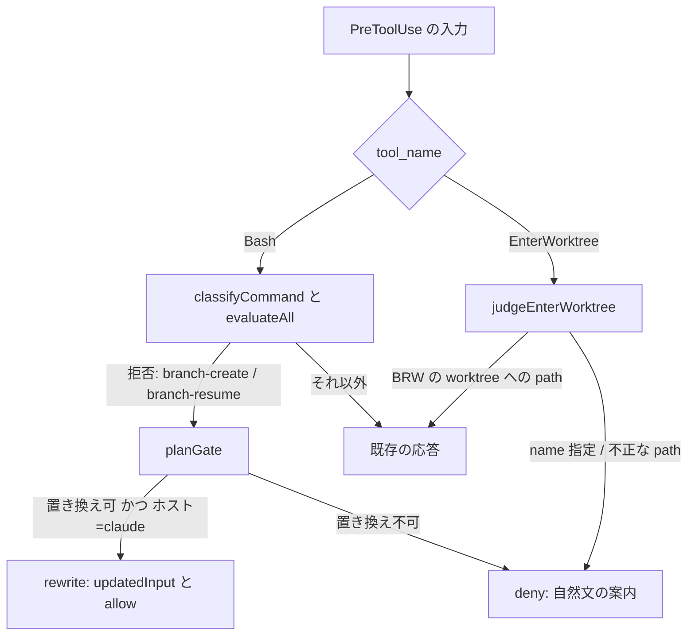
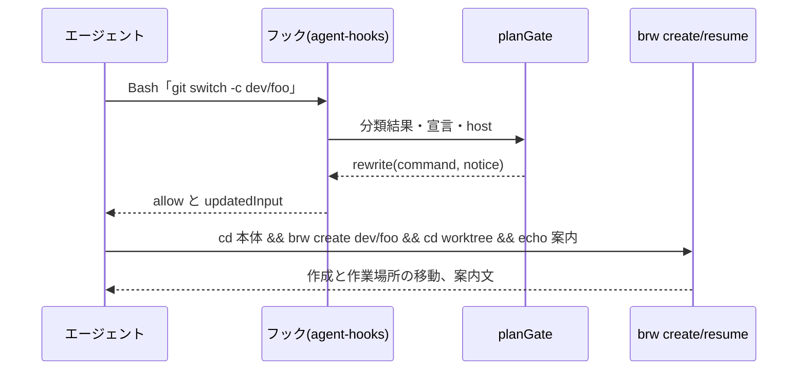

# 設計書: brw-branch-gate

## 概要

**目的**: BRW 導入済みのリポジトリで、エージェントが素の git コマンドや EnterWorktree でブランチ・worktree を作ろうとしたとき、BRW が操作を奪って `brw create`（再開は `brw resume`）に収束させる。
**対象**: エージェント（Claude Code・Codex）と、通常のブランチ作成を指示するだけの呼び出し側（cc-sdd-bootstrap など）。呼び出し側は BRW を知る必要がない。
**影響**: 現状は拒否のみだった作成・再開の判定結果を、Claude Code では「置き換えて実行し、作業場所を移す」に、Codex では「次のコマンドを書いた拒否」に改める。判定の対象に EnterWorktree を加える。

### 目標

- 命名規則に合う作成・既存ブランチの再開を、Claude Code では拒否せず BRW の手順へ置き換え、作業場所まで移す（1.1〜1.3、3.1）。
- 置き換えられないものは、読むだけで次の手順が取れる自然文の案内つきで拒否する（1.4〜1.6、2.1、4）。
- Bash 以外の入口（EnterWorktree）も同じ判定に載せる（2.1〜2.5）。
- 判定できないときは安全側に倒し、導入していないリポジトリには干渉しない（5）。

### 非目標

- cc-sdd-bootstrap と kiro 系スキルの変更。`brw create` の命名規則・分岐元・配置先の変更。
- Codex での入力の書き換え（未検証、research.md #7）。Codex は拒否と案内で扱う。
- PR 作成・片付けの流れ（brw-pr-handoff）。

## 境界の確約

### この仕様が担う

- 作成・再開の入力を、置き換え・拒否・通過のいずれかに決める「ゲートの計画」（置き換え後のコマンド、案内文を含む）。
- 置き換え結果と拒否理由の案内の書式（見出し・次のコマンド・作業場所）。
- EnterWorktree の判定と、フックの対象入口の拡大（定義と導入検査）。
- 判定の拡張（開始点の記録）と、それに対する試験・評価ケース・資料。

- `brw create --carry`（追跡済みファイルの未コミットの変更を新しい worktree へ移す、安全確認つきの移動）。

### 担わない

- ブランチ作成そのもの（`brw create`・`brw resume` の処理内容）のうち `--carry` 以外。作成・再開の成否と配置先は既存のまま使う。未追跡のファイルの移動。
- 保護・分岐元・宣言外のブランチの扱い（`operation-decision` の既存の判定）。
- PR・片付け・公開計画（brw-pr-handoff、brw-enforcement）。

### 許可する依存

- `scripts/operation-policy.mjs` の分類結果（操作の種類・ブランチ・パス）と `scripts/lib.mjs` の宣言・ブランチ判定・worktree 一覧。
- `scripts/brw.mjs` の `create`・`resume`（コマンドとして呼ぶだけで、関数は import しない）。
- 依存の向きは「ゲートの計画 → 分類結果・宣言」の一方向とし、`operation-decision` はゲートの計画を知らない。

### 再検証の契機

- `createOp` の分類結果（`action`・`via`・開始点）の形を変えるとき。
- `brw create`・`brw resume` の引数・配置先・出力を変えるとき。
- Claude Code のフックの応答形式（`updatedInput`・`permissionDecision`）が変わったとき。
- フックの登録一覧（`CLAUDE_HOOKS`・`hooks.json`）を変えるとき。

## アーキテクチャ

### 既存の構造の分析

- 判定層（`operation-decision.evalCreate`）は作成・再開を常に拒否する。フック層（`agent-hooks.judgeBash`）が判定結果を応答にする。
- 置き換えはホスト固有（Claude Code の書き換え機能）の層の責務なので、判定層は変えず、フック層で「拒否」を「置き換え」へ変換する。Codex と `brw guard` は従来の拒否のまま（5.4）。

### 構成図



- **選んだ形**: 判定層はそのまま、フック層に `planGate` を足す。
- **維持する既存の形**: 判定は `decideHook` → `responseOf` の 2 段。判定できない入力は止める（安全側）。
- **新しい部品の理由**: 置き換えの条件・コマンド組み立て・案内の書式は判定層にもフックの入出力にも置きたくないため、独立のモジュールにする。

### 技術スタック

| 層 | 選択 | 役割 | 備考 |
|---|---|---|---|
| CLI・フック | Node.js 22 以上、`.mjs`、標準モジュールのみ | 判定・書き換え・案内 | 既存どおり |
| ホスト機能 | Claude Code の PreToolUse `updatedInput` | 入力の書き換え | PoC #1・#2・#5・#9 で確認（2.1.329） |
| 試験 | `tests/*.mjs`（自己テスト）、`claude -p` による実機確認 | 契約・結果の検証 | 実機は `tests/real-env/` の方式 |

## ファイル構成計画

### ディレクトリ構成

```
scripts/
├── branch-gate.mjs        # 新規: ゲートの計画（置き換え可否・コマンド組み立て・案内の書式・EnterWorktree の判定）
├── carry.mjs              # 新規: 未コミットの変更の移動（退避の作成・適用・照合・取り除き・巻き戻し）
├── brw.mjs                # 変更: create に --carry を追加し、carry.mjs を呼ぶ
├── operation-policy.mjs   # 変更: createOp が開始点（start）を記録する
├── agent-hooks.mjs        # 変更: judgeBash がゲートを呼ぶ、EnterWorktree を判定、responseOf が rewrite 応答を作る
├── hook-install.mjs       # 変更: CLAUDE_HOOKS に EnterWorktree の matcher を追加
hooks/
└── hooks.json             # 変更: PreToolUse に EnterWorktree の matcher を追加
tests/
├── carry.mjs              # 新規: 移動の安全確認（照合・巻き戻し・並行変更）の試験
├── branch-gate.mjs        # 新規: ゲートの計画の単体・契約テスト
├── agent-hooks.mjs        # 変更: rewrite 応答・EnterWorktree の契約テストを追加
└── selftest.mjs           # 変更: 新規テストを呼ぶ
evals/
└── redirects-git-switch-to-brw-create/   # 新規: 評価ケース
SKILL.md                   # 変更: 作成・再開の挙動を追記
references/setup.md        # 変更: 入口の導入検査と Codex の違いを追記
```

### 変更するファイル

- `scripts/operation-policy.mjs` — `createOp` の結果に `start`（開始点の文字列。無ければ `null`）と `branchOnly`（`git branch <名前>` の形）を加える。判定の挙動は変えない。
- `scripts/agent-hooks.mjs` — `judgeBash(command, cwd, host)` に host を渡し、拒否（`branch-create`・`branch-resume`）のとき `planGate` の結果で置き換える。`decideHook` に `EnterWorktree` の分岐を追加する。`responseOf` に `rewrite` を追加する。
- `scripts/hook-install.mjs`・`hooks/hooks.json` — Claude Code の登録一覧に `PreToolUse` / `EnterWorktree` を加える。Codex の一覧は変えない。

## システムフロー



- 置き換えのコマンドは `&&` でつなぐため、`brw create` が失敗すれば `cd` も案内も実行されず、作業場所は動かない（PoC #9）。
- 置き換えは、元のコマンドを実行する前に 1 回だけ判定される。書き換え後のコマンドは再判定されない（BRW 自身の CLI のみで、許可を返す）。

## 要件トレーサビリティ

| 要件 | 概要 | 部品 | インターフェース |
|---|---|---|---|
| 1.1 | 命名規則に合う作成を置き換える | `planGate`、`agent-hooks.judgeBash` | `planGate` → `rewrite` |
| 1.2 | 作業場所を worktree へ移す | `planGate`（`cd` の組み立て） | 書き換えコマンドの `cd <worktree>` |
| 1.3 | 置き換えを自然文で表示する | `planGate`（案内文） | `echo` で出力 |
| 1.4 | 規則外・分岐元不明・複合は拒否 | `planGate`（適格性の判定） | `deny` |
| 1.5 | 配置先以外・移動を確認できない環境は拒否 | `planGate`（配置先の照合） | `deny` |
| 1.6 | 書き換え非対応のホストは拒否 | `agent-hooks`（host 判定） | `deny` |
| 1.7 | 未導入リポジトリは何もしない | 既存の `repoState`（`unmanaged`） | 既存どおり通過 |
| 1.8 | 追跡済みの未コミット変更があれば拒否し 2 択を案内 | `planGate`（`gate-dirty`）、`guidance` | `deny` |
| 1.9 | 未追跡だけなら置き換え、残ることを案内 | `planGate` | `rewrite` の `notice` |
| 1.10 | `--carry`: 適用・照合後にだけ取り除く | `carry.mjs`、`brw.mjs`（`create`） | `carryChanges` |
| 1.11 | 失敗・不一致・分岐元のずれは巻き戻す | `carry.mjs`、`brw.mjs`（`create`） | `CarryResult.failed` |
| 1.12 | 並行して変わったら取り除かない | `carry.mjs` | `CarryResult.keptBoth` |
| 1.13 | 未追跡は移さず一覧を表示 | `carry.mjs` | `CarryResult.skipped` |
| 2.1 | EnterWorktree の `name` は拒否し 2 手を案内 | `judgeEnterWorktree` | `deny` |
| 2.2 | BRW の worktree への `path` は許可 | `judgeEnterWorktree` | 通過 |
| 2.3 | それ以外の `path` は拒否 | `judgeEnterWorktree` | `deny` |
| 2.4 | 入力を確定できなければ止める | `judgeEnterWorktree` | `deny` |
| 2.5 | 入口が増えても同じ規則・書式 | `branch-gate.mjs`（案内の書式を共有） | `guidance` |
| 3.1 | 既存の開発ブランチ切り替えを再開へ | `planGate`（`resume` の組み立て） | `rewrite` / `deny` |
| 3.2 | 保護・分岐元は通常承認 | 既存の `evalCreate` | 既存どおり |
| 3.3 | 切り替え先を確認できなければ止める | 既存の `createOp`（未解決） | 既存どおり |
| 3.4 | detached HEAD は作成と見なさない | 既存の `createOp`（`detach`） | 既存どおり |
| 4.1〜4.5 | 案内の中身・書式・再現性 | `guidance`（書式）、`sanitize` | 案内の書式 |
| 5.1 | 確定できなければ止める | `planGate`、`decideHook` の例外処理 | `deny` |
| 5.2 | 失敗しても作成途中を残さない | `brw create` の失敗は何も作らない（PoC #9）。`&&` で後続を止める | 書き換えコマンド |
| 5.3 | 宣言が無ければ通す | 既存の `repoState` | 既存どおり |
| 5.4 | ホスト間で同じ判定（置き換え可否を除く） | 判定層を共有、フック層だけが host で分岐 | `decideHook` |
| 5.5 | 照会は妨げない | 既存の `query` 分類 | 既存どおり |
| 6.1・6.2 | 入口の導入検査と有効化手順 | `hook-install.CLAUDE_HOOKS`、既存の診断 | 不足の報告 |
| 6.3・6.4 | 資料 | `SKILL.md`、`references/setup.md` | — |

## 部品とインターフェース

| 部品 | 層 | 役割 | 要件 | 主な依存 | 契約 |
|---|---|---|---|---|---|
| `planGate` | ゲート | 作成・再開の入力を置き換え・拒否に決める | 1、3、4、5 | `lib.mjs`（P0）、分類結果（P0） | Service |
| `judgeEnterWorktree` | ゲート | EnterWorktree の入力を判定する | 2、4、5 | `lib.mjs`（P0） | Service |
| `guidance` | ゲート | 案内文の書式を作る | 4 | なし | Service |
| `judgeBash`（変更） | フック | 拒否を置き換えへ変換する | 1、3、5 | `planGate`（P0） | State |
| `responseOf`（変更） | フック | `rewrite` をホストの応答にする | 1 | なし | API |

### ゲート（`scripts/branch-gate.mjs`）

#### planGate

| 項目 | 内容 |
|---|---|
| 役割 | 拒否された作成・再開の操作を、置き換え可能なら置き換えの計画にし、そうでなければ案内つきの拒否にする |
| 要件 | 1.1〜1.6、3.1、4.1〜4.5、5.1 |

**責務と制約**
- 入力は分類結果の 1 件（`kind: "create"`）、宣言、host、git の現在の状態（現在のブランチ・既存ブランチ・worktree 一覧）。副作用を持たない（ファイルを書かない、git を変えない）。
- 置き換えの適格性（すべて満たすとき）:
  1. host が `claude`。
  2. コマンド全体が単独の git 操作（先頭の `cd` を除く）で、分類に未解決（`unresolved`）が無い。
  3. 対象リポジトリが BRW 導入済み（`managed`）。
  4. ブランチ名が宣言の開発ブランチとして有効（`classifyBranch` が `development`、命名規則に合う）。接頭辞は補わない（`foo` を `dev/foo` に変えない）。
  5. 開始点が無く現在のブランチが宣言の `baseBranch` であるか、開始点が `baseBranch` または `origin/<baseBranch>` である（それ以外は `brw create <名前> --base <ブランチ>` を案内して拒否）。
  6. `action` が `create` か `resume`。`rename`・`copy`・`--orphan`・強制作成（`-C`・`-B`）は拒否。
  7. `via` が `worktree` のとき、パスが `<本体>/.claude/worktrees/<alias>` と一致する。一致しなければ拒否。
- `action: "create"` でも、ブランチがローカルまたは `origin` に既にあるとき（リモートにだけある切り替えを含む）は `resume` として扱う。
- `branchOnly`（`git branch <名前>`）は `brw create <名前> --branch-only` に置き換え、`cd` は付けない（作業場所を移さない）。
- 追跡済みファイルの未コミットの変更（`git status --porcelain` の `??` 以外）があるときは、置き換えず拒否する（`gate-dirty`）。案内は 2 つの選択肢: 「`brw create <名前>`（変更は元の作業ツリーに残る）」と「`brw create <名前> --carry`（変更を新しい worktree へ移す）」。どちらを選ぶかは、変更が自分のものかを知っている呼び出し側に委ねる。
- 未追跡のファイルだけがあるときは置き換え、案内に「未追跡のファイル N 件は元の作業ツリーに残る」と書く。

**契約**: Service

```typescript
type GateHost = "claude" | "codex";

interface GateInput {
  host: GateHost;
  command: string;            // 元の Bash コマンド
  toolInput: Record<string, unknown>;
  op: CreateOperation;        // 分類結果（action, via, branch, path, start, branchOnly, cwd）
  config: NormalizedConfig;
  hasLeadingCd: boolean;
  unresolved: string[];
}

type GateResult =
  | { verdict: "rewrite"; command: string; reason: string; notice: string[] }
  | { verdict: "deny"; reason: string; code: GateDenyCode };

type GateDenyCode =
  | "gate-name-invalid" | "gate-start-unsupported" | "gate-compound"
  | "gate-outside-placement" | "gate-host-no-rewrite" | "gate-unresolved"
  | "gate-action-unsupported" | "gate-dirty";

function planGate(input: GateInput): GateResult;
```
- 事前条件: `op.kind` が作成・再開で、判定層が拒否している（`branch-create`・`branch-resume`）。
- 事後条件: `rewrite` のコマンドは `cd <dir> && node <brw> create|resume <引数> [&& cd <worktree>] && echo <案内>` の形。引数・パスは単引用符で引用する。他のコマンドを含まない。
- 不変条件: 拒否の `reason` は自然文で、次に実行するコマンドを含む。

#### judgeEnterWorktree

| 項目 | 内容 |
|---|---|
| 役割 | EnterWorktree の入力を判定する |
| 要件 | 2.1〜2.5、5.1、5.3 |

**責務と制約**
- 対象リポジトリが BRW 導入済みでなければ通過（5.3）。
- `name` 指定: 拒否。案内は、`brw create <名前>` を実行した後に `EnterWorktree` を `path`（作成される worktree の絶対パス）指定で呼ぶ 2 手。名前が `namePattern` に合わないときは、合う名前の付け方（小文字・数字・`-`）も案内する。
- `path` 指定: `git worktree list` に載り、そのブランチが開発ブランチ（`classifyBranch` が `development`）で、`.claude/worktrees/` の配下にあるときだけ通過。それ以外は拒否し、`brw resume` を案内する。
- `name` も `path` も無い（ランダム名の作成）、両方ある、型が不正: 拒否。
- 例外が出たら拒否（安全側）。

**契約**: Service

```typescript
interface EnterWorktreeInput { name?: unknown; path?: unknown }
type EnterDecision =
  | { verdict: "pass" }
  | { verdict: "deny"; reason: string; code: "gate-enter-name" | "gate-enter-path" | "gate-enter-unresolved" };
function judgeEnterWorktree(input: EnterWorktreeInput, cwd: string | null): EnterDecision;
```

#### carryChanges（`scripts/carry.mjs`）

| 項目 | 内容 |
|---|---|
| 役割 | `brw create --carry` で、追跡済みファイルの未コミットの変更を新しい worktree へ安全に移す |
| 要件 | 1.10〜1.13 |

**方式**（research.md の検討を採用）
1. 退避の作成: 元の作業ツリーで `git stash create` を実行し、変更を表すコミット `S` を得る（退避の置き場 `refs/stash` は使わない。他のセッションと共有されるため）。出力が空なら移す変更は無い。
2. 前提の確認: `brw create` が決めた開始点のコミットが、元の作業ツリーの `HEAD` と同じであること。違えば移さず失敗（分岐元がずれていると適用が混ざるため）。
3. 適用: 新しい worktree で `git stash apply <S>`。競合・失敗なら失敗。
4. 照合: `S` が変更した全パスについて、新しい worktree の内容（ファイルの OID・実行権限）が `S` と一致し、`S` で削除されたパスは存在しないこと。存在の判定は `git cat-file -e S:<パス>` による（削除されたパスに `rev-parse` を使わない。research.md の検証）。
5. 取り除き: 元の作業ツリーで、もう一度 `git stash create` した結果のツリーが `S` と同じときだけ、`git restore --staged --worktree --source=HEAD -- <パス>` で該当のパスだけを戻す（`reset --hard` は使わない）。違えば何も戻さない（`keptBoth`）。
6. 失敗時の巻き戻し: 手順 2〜4 の失敗では、作成した worktree とブランチを削除する。元の作業ツリーには手順 5 まで触れない。

**契約**: Service

```typescript
type CarryResult =
  | { kind: "none" }                                              // 移す変更が無い
  | { kind: "carried"; files: string[]; skipped: string[] }       // skipped は未追跡
  | { kind: "keptBoth"; files: string[]; skipped: string[] }      // 元にも残した
  | { kind: "failed"; reason: string };                           // 巻き戻し済み
function carryChanges(opts: { source: string; worktree: string; startOid: string }): CarryResult;
```
- 不変条件: `carried` 以外では、元の作業ツリーの内容は呼び出し前と同じ。ステージ済みの変更は、移動後は未ステージの変更になる（案内に書く）。

#### guidance（案内の書式）

固定の書式を持つ 1 つの関数で、置き換え・拒否・EnterWorktree の案内を作る。

```
[branch-release-workflow] <1 行の結論（自然文）>
BRW 案内: 置き換え | 拒否
次のコマンド: <そのまま実行できる 1 コマンド。2 手のときは「1) …」「2) …」>
作業場所: <移る先の絶対パス。無ければ ->
<理由と注意の自然文（複数行可）>
```

- 見出しの行は呼び出し側が機械的に取り出すための補助で、本文だけで意味が通る（research.md #6）。
- cc-sdd・kiro・`.kiro` などの特定の呼び出し側の語を含めない。同じ入力には同じ文面を返す（4.5）。
- 資格情報らしい文字列は既存の `sanitize` で伏せる。

### フック

#### judgeBash / responseOf（変更）

- `judgeBash` は、判定が拒否で `code` が `branch-create` または `branch-resume` のときだけ `planGate` を呼ぶ。結果が `rewrite` なら `{ verdict: "rewrite", command, reason }`、`deny` なら案内つきの拒否（既存の `decisionOf` と同じ形）にする。
- `responseOf` は `rewrite` を次の応答にする（Claude Code のみ。Codex には届かない）。

```json
{ "hookSpecificOutput": { "hookEventName": "PreToolUse",
  "permissionDecision": "allow",
  "permissionDecisionReason": "[branch-release-workflow] …",
  "updatedInput": { "...元の tool_input": "", "command": "<書き換え後>" } } }
```

- 許可を返す理由: 書き換え後のコマンドは BRW 自身の CLI の 2 種類（`create`・`resume`）と `cd`・`echo` だけで、組み立ては判定済みの値の引用に限る。確認を求めると呼び出し側の指示が止まる。
- `decideHook` に `tool === "EnterWorktree"` の分岐を足し、`judgeEnterWorktree` の拒否を既存の `decisionOf` と同じ形にして返す。`pass` は応答なし。

**実装メモ**
- 連携: `createOp` の `start`・`branchOnly` を `planGate` が読む。
- 検証: 書き換え後のコマンドの文字列を、引用の往復（シェルで解釈して元の引数に戻ること）で試験する。
- リスク: `--carry` は元の作業ツリーを書き換える唯一の処理。取り除きの直前の再照合（手順 5）で、並行する他のセッションの変更を失わないようにする。
- リスク: `brw create` が worktree 作成後に `renameSync`（宣言の未登録時）で失敗しうる。既存の挙動で、この仕様では変えない（拒否は残さない保証は、作成が失敗した場合の巻き戻しの対象外と明記する）。

## データモデル

永続データは持たない。フック間で受け渡す値は次の 2 つ。

- 分類結果（拡張）: `start: string | null`、`branchOnly: boolean`。
- 判定結果（拡張）: `verdict` に `rewrite` を追加（`command`・`reason`）。

## エラー処理

| 区分 | 例 | 応答 |
|---|---|---|
| 規則に合わない | 名前が `namePattern` 外、開始点が分岐元以外 | 拒否。合う名前または `--base` の付け方を含む案内 |
| 確定できない | 複合コマンド、動的引数、EnterWorktree の型不正 | 拒否。確定できない理由を表示（安全側） |
| 実行時の失敗 | `brw create` が既存ブランチなどで終了コード 1 | 書き換えコマンドの `&&` で後続を止める。`brw create` の出力が理由になる |
| 内部エラー | フック内の例外 | 既存どおり、Git の操作を含む入力は拒否 |

## テスト戦略

### 単体・契約（`tests/branch-gate.mjs`）
- `planGate`: 適格な `git switch -c dev/foo`（本体で `baseBranch` 上）が `rewrite` になり、コマンドが `cd <本体> && node <brw> create 'dev/foo' && cd '<wt>' && echo …` の形であること（1.1〜1.3）。
- `planGate`: 名前が規則外・開始点が分岐元以外・`worktree add` のパスが配置先外・複合コマンド・host が `codex` のとき `deny` で、案内に次のコマンドがあること（1.4〜1.6、4.1）。
- `planGate`: 既存ブランチへの切り替えが `brw resume` に置き換わり、リモートにだけあるブランチも `resume` になること（3.1）。
- 引用の往復: 空白・単引用符を含むパスでも、書き換えコマンドをシェルで解釈して元の引数に戻ること。
- `judgeEnterWorktree`: `name` は拒否、BRW の worktree への `path` は通過、それ以外の `path`・入力不正は拒否（2.1〜2.4）。
- 案内の書式: 見出し 4 行があり、特定の呼び出し側の語を含まず、同じ入力で同じ文面になること（4.2〜4.5）。

### 移動（`tests/carry.mjs`）
- 追跡済みの変更（変更・削除・実行権限・バイナリ）が新しい worktree に同じ内容で現れ、元から取り除かれること（1.10）。
- 開始点が `HEAD` と異なるとき、適用が競合したとき、照合が一致しないときに、worktree とブランチが残らず元が変わらないこと（1.11）。
- 照合と取り除きの間に元のファイルを書き換えると、何も取り除かず `keptBoth` になること（1.12）。
- 未追跡のファイルは移らず、一覧が表示されること（1.13）。

### 統合（`tests/agent-hooks.mjs` ほか）
- `handleHook("claude", "PreToolUse", …)` が `updatedInput` つきの許可を返し、`handleHook("codex", …)` が同じ入力で拒否を返すこと（1.6、5.4）。
- 宣言のないリポジトリでは何も返さないこと（1.7、5.3）。`hooks.json`・`CLAUDE_HOOKS` に `EnterWorktree` があり、欠けていると導入検査が報告すること（6.1、6.2）。

### 実機（`claude -p`、`tests/real-env/` の方式）
- 使い捨てリポジトリで、`git switch -c` の置き換え後に次の Bash 呼び出しの `pwd` が worktree であること。EnterWorktree の `name` が拒否され、案内どおりの 2 手で worktree に入れること（PoC #5・#9 の再現）。

## セキュリティ

- 書き換えコマンドの値（ブランチ名・パス）は、すべて単引用符で引用する。ブランチ名は宣言の命名規則（小文字・数字・`-`・`/`）に合うものに限り、パスは git の一覧から得る。シェルの特殊文字が混入しても別のコマンドにならない。
- 許可を返すのは、BRW 自身の CLI を組み立てた場合だけ。元のコマンドを部分的に引き継がない。
- 案内文は `sanitize` を通し、資格情報らしい値を出さない。
