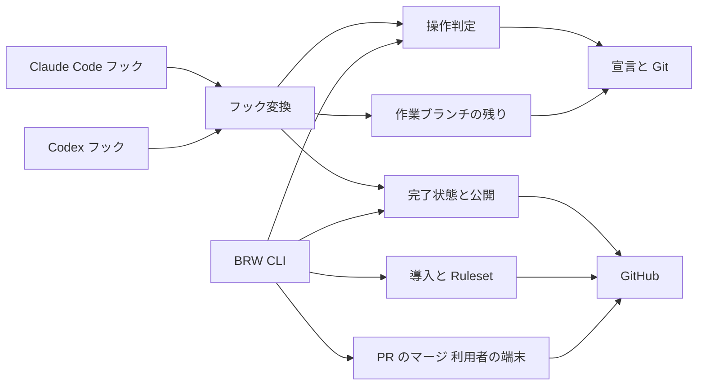
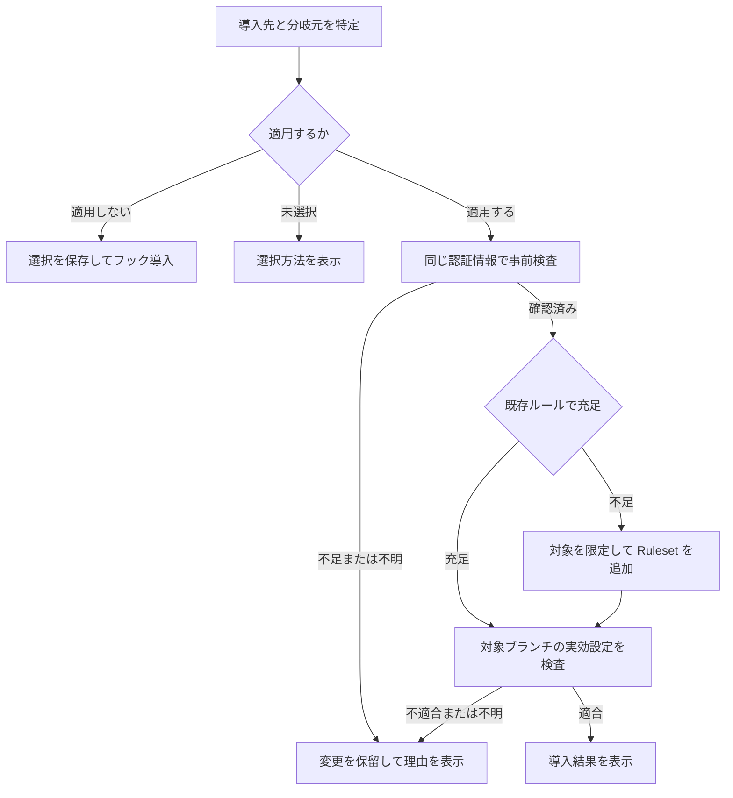
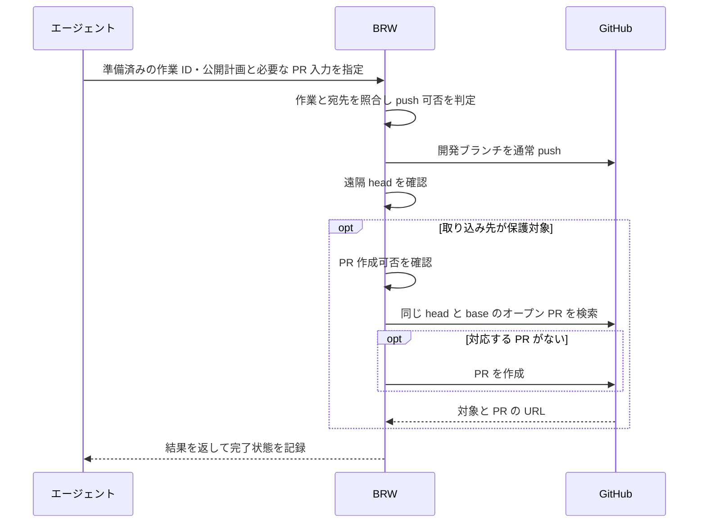
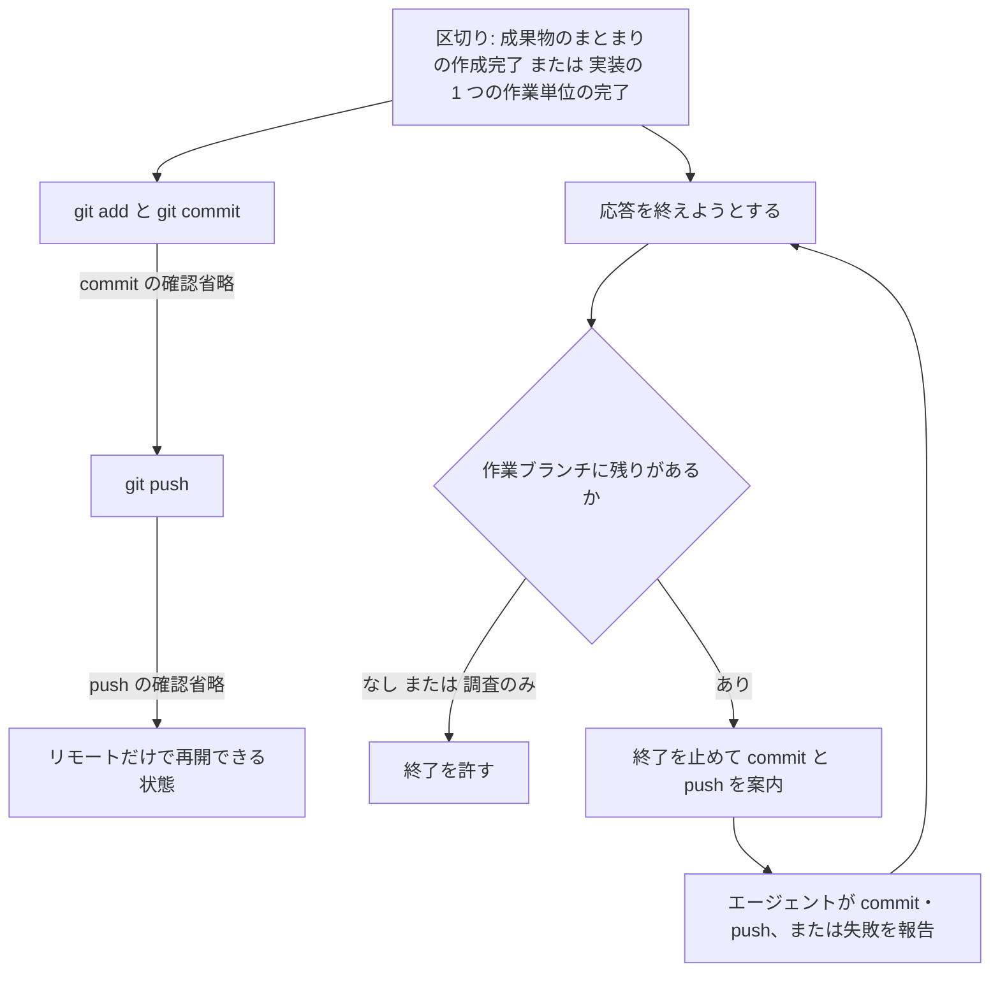

# BRW の操作強制と GitHub Ruleset の技術設計

## Overview

BRW 導入リポジトリの Claude Code と Codex の操作を、同じブランチ分類と許可条件で判定する。開発中の push、作業完了時の PR 作成、依存作業の取り込みを BRW で進められるようにする。導入担当者が選択したリポジトリでは、GitHub のブランチ Ruleset で恒常的な分岐元への取り込みを制御する。作業ブランチの変更は、成果物のまとまり（文書の作成を含む）の作成完了ごとと、実装の 1 つの作業単位の完了ごとに、許可を求めずに commit・push し、応答を終えるときに未コミットの変更または未 push の commit があれば止めて案内する（リモートだけで再開・引き継ぎできる状態を保ち、終了時に未 push の作業ブランチを残さない）。恒常的な分岐元向けの PR のマージは、エージェントには許さず、利用者が自分の端末で実行する `brw pr-merge` だけが行う。保護ブランチ向けの PR は、これまでどおり利用者が GitHub 上でマージする。

### Goals

- 対応する両エージェントで禁止操作を実行前に止め、条件を満たす通常操作の追加確認を省く。
- 作業完了時の push と PR 作成を復旧できる一連の処理にする。
- Ruleset の採否確認、書き込み権限の検査、適用、実効設定の確認を一つの導入操作で行う。
- 作業ブランチの変更を区切りごとに commit・push し、途中で終了してもリモートだけで再開できる状態を保つ。応答の終了時に、作業ブランチの未コミットの変更と未 push の commit を検出して案内する。
- 恒常的な分岐元向けの PR のマージを、利用者が自分の端末でだけ実行できるコマンドに限り、エージェントの直接のマージ・自動マージ予約は取り込み先にかかわらず拒否のままにする。保護ブランチ向けのマージはどの経路でも行わない。

### Non-Goals

- 既存履歴の書き換え、GitHub 全体へのマージ方式の一律変更、組織向け Global MCP サービスの配備。
- 宣言（`.branch-release-workflow.json`）への SSH 別名の記載。個人の SSH 設定が commit され、他の人の clone や貢献者の PR のノイズになるため採らない。`insteadOf` の展開前の URL を読む運用も、実際の送り先と違う URL を検査することになるため採らない。
- フックによる push の実行（フックは判定と案内だけを行い、副作用を起こさない）。commit 直後の push の案内（PostToolUse）も採らない。Codex では `additionalContext` がモデルに届くことを実機で確認したが（Claude は未確認）、利用者が残余リスクを許容した（下記）ため、本 spec の範囲に含めない。
- 利用者の依頼（「commit して」「push して」）で扱う中断。区切りの規則が担保するのは、トークンの使い切りと作業の停止による中断に備えた、直前の区切りまでの push。それ以外の契機での中断は対象にしない。

## Boundary Commitments

### This Spec Owns

- ルートの BRW 宣言を基にしたブランチの分類、フックが処理する操作、確認省略、作業完了と開発ブランチ間のマージの判定。
- BRW が作成または再利用する PR と、導入担当者が選択した対象への Ruleset の導入・整合検査。
- エージェントごとのフック導入状態、実効 Ruleset、復旧に必要な情報の CLI 表示。
- リモートの URL を GitHub のリポジトリとして読む規則（SSH の別名ホストの解決と、確定できないときの案内。要件 1.6〜1.8）。
- 作業ブランチの区切りごとの commit・push の規則（指示の文面と、commit の確認省略）、および応答の終了時に開発ブランチの未コミットの変更・未 push の commit を検出して案内する Stop の処理と、フックが使えない環境向けの終了前の確認 `brw guard --finish`（要件 2.9〜2.19）。
- 恒常的な分岐元向けの PR を、利用者の端末の対話で確認したうえでマージする `brw pr-merge` と、エージェントによる直接のマージ・自動マージ予約・`brw pr-merge` の呼び出しの拒否（要件 3.2〜3.9）。

### Out of Boundary

- プレビューと配備のトリガーは既存のプロバイダーと CI が管理する。
- GitHub のレビュー・必須チェック、アカウントの権限設定、ネットワーク制御、管理対象フックの配布は各環境の設定で管理する。
- Codex・Claude へのフックの届け方（プラグインの配布、フック定義、Codex のフックの信頼登録、`brw setup` の Codex 側の処理、診断の Codex の状態語彙）は harness-plugin-unification が持つ。本 spec は届いたフックが何を判定するかだけを持つ。
- 呼び出し側のスキル（cc-sdd の `kiro-*` など）の手順。これらはセッションの開始ごとに入れ直されるため書き換えられず、BRW もこれらを前提にしない。区切りの commit・push は、BRW の SKILL.md の一般的な指示（特定のスキルや文書の置き場に依存しない言い方）、導入先の指示（このリポジトリでは CLAUDE.md）、および Stop の検出で担保する。
- フックの保証範囲は稼働確認済みの操作経路。独立したプロセス、対話シェル内の命令、ホストがフック対象にしないツール経路には、GitHub 上の分岐元への反映時に Ruleset が適用される。

### Allowed Dependencies

- Node.js 22 以上の標準モジュールと既存の ESM、Git と `gh`、OpenSSH の `ssh -G`（設定の読み取りのみ。無くても拒否側に倒れる）、Claude Code と Codex のフック（届け方は harness-plugin-unification の対応表に従う）、GitHub REST API（PR の取得 `GET /pulls/{n}` と、`brw pr-merge` だけが使うマージ `PUT /pulls/{n}/merge`）。既存の宣言読み込み、命名規則、worktree とプレビュー操作を利用する。`work-remainder.mjs` は brw-pr-handoff の `tidy.mjs` が公開する `SECRET_PATTERNS` を読むだけで使う（片方向）。

### Revalidation Triggers

- フックのイベント形式、ツール名・実行ディレクトリ、確認省略または信頼登録の仕様が変わった場合。
- `ssh -G` の出力形式（`hostname` 行）や OpenSSH の設定の解釈が変わった場合。
- 宣言の `autoApprove` の項目（`commit` の追加を含む）、作業の制限（`noPush`）、Stop イベントの登録が変わった場合。
- ブランチの分類、分岐元の解決、導入確認の対象、GitHub の権限や実効ルールの契約が変わった場合。ブランチ作成、終了処理、片付け、プレビューの CI トリガーも再検証する。
- GitHub の PR 取得・マージ API の契約（`sha`・`merge_method`・405/409 の応答）、実行環境（Claude Code・Codex）が標準入出力を端末として渡すかどうかが変わった場合（`brw pr-merge` の確認が成立しなくなる）。
- `SECRET_PATTERNS`（brw-pr-handoff）の形が変わった場合。

## Architecture

### Existing Architecture Analysis

`scripts/brw.mjs` は CLI、Claude Code フック、シェル文字列による commit・push の判定と確認省略を担う。`scripts/lib.mjs` は宣言の検証や Git 照会を持つ。Codex へのフックの届け方は harness-plugin-unification でプラグインに置き換わる（旧インストーラー・worktree の有効化は削除）。`agent-hooks.mjs` の Stop は、現状は当該セッションに結び付いた準備済みの作業だけを案内し、ブランチと作業ツリーの状態は見ない。確認省略（`autoApprovable`）の対象は push と PR 作成だけで、commit は判定を通すのみ。既存の `branch.<name>.brwBase` は `create --base` の記録で、現状は主に `finish` が参照する。PR 作成にもこの分岐元解決を共用する。

### Architecture Pattern & Boundary Map

CLI とフックを既存の入口に残し、操作判定を共有する。GitHub を変更する入口は、検証済みの引数を使う BRW の導入と公開の処理に限定する。



依存方向は `lib.mjs` → 操作判定・GitHub クライアント → 完了公開・Ruleset → フック変換と CLI とする。矢印の左側を下位依存とし、UI やホストの応答形式は下位モジュールに持ち込まない。

### Technology Stack

| レイヤー | 採用 | 用途 |
|---|---|---|
| CLI・処理 | Node.js 22 以上、Git | 既存 CLI、操作判定、ref 検証、worktree 状態 |
| フック | Claude Code の `PreToolUse`・`PostToolUse`・`Stop`、Codex の `PreToolUse`・`PostToolUse`・`PermissionRequest`・`Stop` | 実行前の拒否・通常操作の許可・作業の関連付け・公開漏れの検知。導入時の動作検査で必要イベントを確認 |
| 外部連携 | GitHub REST API と `gh api` | 対象リポジトリを固定した権限照会、PR、Ruleset の適用と実効ルール確認 |
| 状態 | 登録済み BRW 宣言、Git の共通ディレクトリと worktree ごとの状態 | 共有運用ポリシー、導入先の選択、タスク中の公開進捗 |

## File Structure Plan

| パス | 変更 | 責務 |
|---|---|---|
| `scripts/lib.mjs` | 更新 | 宣言の互換読み込み・検証、恒常的な分岐元、現在の ref、個別の分岐元解決。追加: `autoApprove.commit`（検証と `autoApproveOf`） |
| `scripts/operation-policy.mjs` | 新規 | シェル・対応する GitHub ツール入力の操作への変換、ref 分類 |
| `scripts/github-operations.mjs` | 新規 | `gh` コマンド・MCP ツール入力からの GitHub 書き込み経路（PR 作成・マージ・自動マージ予約など）の識別。operation-policy から呼ぶ 更新: `remoteRepos`・`parseRepoSpec` の scp・ssh 形式のホストを `remote-url.mjs` で正規化し、SSH の別名が `github.com` に解決できれば GitHub を指す remote として扱う（要件 1.6, 1.7） |
| `scripts/remote-url.mjs` | 新規 | リモートの URL から GitHub の所有者・リポジトリ名を読む唯一の入口。scp・ssh 形式のホストが SSH の別名なら `ssh -G` で `github.com` に解決する（読み取りのみ・通信なし）。確定できない理由の文言（別名ホストの案内を含む）を作る（要件 1.6〜1.8） |
| `scripts/operation-decision.mjs` | 新規 | 操作・登録済み宣言・作業の禁止から、拒否・通す・確認省略の可否を決める共通判定（ホストの入出力の形は持たない）。更新: `github-merge`・`auto-merge` の拒否は取り込み先を問わず維持し、案内文を `brw pr-merge` を含む短い文面（フック経路の 500 文字の制限内）に改める |
| `scripts/agent-hooks.mjs` | 新規・更新 | イベントとホスト応答の変換、終了時の作業状態の案内。更新: Stop に作業ブランチの残りの案内を統合する。Bash の PreToolUse で、信頼済みの `brw pr-merge` の呼び出しを拒否する（コード `pr-merge-user-only`。要件 3.5 を実行前に止める補強） |
| `scripts/work-remainder.mjs` | 新規（追加） | 開発ブランチの未コミットの変更と未 push の commit の検出、秘密情報らしい名前のファイルの抽出、案内文の作成（読み取り専用・ネットワークに依存しない）。Stop と `brw guard --finish` が共用する |
| `scripts/hook-install.mjs` | 新規 → 削除 | harness-plugin-unification で削除される（Claude の登録検査は `hook-registry.mjs` へ移る） |
| `scripts/hook-diagnose.mjs` | 新規 | フックの稼働と対応経路の診断（読み取り専用。合成入力による動作検査） |
| `scripts/github-client.mjs` | 新規 | 固定した GitHub ホスト・リポジトリへの API 呼び出し、対象の照合、応答とエラーの検証、PR・Ruleset の照会と追加 |
| `scripts/publish.mjs` | 新規 | 作業 ID・完了申告・公開計画・push の実行と、途中・完了の状態管理 更新: `githubRepoOf` を `remote-url.mjs` へ移し再エクスポートする（呼び出し側の互換を保つ）。push 先を確定できない失敗文言を `remote-url.mjs` の共通文言にする（要件 1.6〜1.8） |
| `scripts/publish-pr.mjs` | 新規 | 保護対象への PR の再利用・作成と、応答不確実時の再取得による照合 |
| `scripts/publish-cli.mjs` | 新規 | `brw work`・`brw publish`・`brw pause` の入口（引数の検査、文言、次の操作の案内） 更新: push 先を確定できない失敗文言を共通文言にする（要件 1.8） |
| `scripts/pr-merge.mjs` | 新規 | `brw pr-merge <PR 番号>`。端末判定 → PR の取得 → 取り込み先の判定 → 利用者への確認 → マージ（要件 3.3〜3.6） |
| `scripts/ruleset-choice.mjs` | 新規 | 導入先と分岐元ごとの Ruleset の採否の保存と再利用 |
| `scripts/ruleset-preflight.mjs` | 新規 | 導入前の読み取り検査（認証・導入権限・プラン・squash 設定・既存ルール） |
| `scripts/ruleset-apply.mjs` | 新規 | 既存ルールの再利用、不足分だけの Ruleset 追加、応答不確実時の照合 |
| `scripts/ruleset-inspect.mjs` | 新規 | 適用後・日常の実効ルールと作業経路（迂回可能な権限）の検査 |
| `scripts/setup-cli.mjs` | 新規 | `brw setup`・`--migrate`・`brw check --ruleset` の入口（対象の決定、問い、表示、終了コード） |
| `scripts/brw.mjs` | 更新 | サブコマンドの振り分け、既存ブランチ操作と各モジュールの呼び出し（旧 `hook` サブコマンドは手動実行用で、フック登録は agent-hooks.mjs）。追加: `pr-merge` の振り分けと、`guard --finish`（コマンドを渡さずに終了前の残りを判定する形。要件 2.19）。`autoApprovable` など手動実行用の判定は拡張しない（実際の確認省略の経路は `operation-decision.mjs` と `agent-hooks.mjs`） |
| `hooks/hooks.json` | 更新 | Claude プラグインのイベント登録。Codex 用の定義と導入は harness-plugin-unification が持つ（`scripts/install-codex.mjs` は削除） |
| `SKILL.md`、`references/setup.md`、`references/config.md`、`assets/config.example.json` | 更新 | ゲートで求めるワークフロー、導入・移行・復旧と対応範囲、宣言例。追加: SKILL.md の「作業の区切りの commit・push」（「してよい」を「行う」に改める。特定のスキルを示さない一般の言い方）と「終了前の確認」（フックが無い環境では `brw guard --finish`）、「分岐元向け PR のマージ」（利用者が自分の端末で `brw pr-merge`。保護ブランチ向けは GitHub 上）、`references/config.md` の `autoApprove.commit` と push 禁止の扱い |
| `CLAUDE.md`（このリポジトリ） | 更新 | このリポジトリで cc-sdd の各フェーズ・各タスクの区切りに commit・push する指示（`kiro-*` スキルは書き換えられないため） |
| `tests/work-remainder.mjs`、`tests/pr-merge.mjs`、`tests/agent-hooks-session.mjs`、`tests/branch-ops.mjs`、`tests/decision.mjs` | 新規・更新 | 残りの検出、Stop と `guard --finish`、commit の確認省略、リモートからの再開、`brw pr-merge` の判定・確認・マージ、直接のマージの拒否の契約テスト |
| `tests/remote-url.mjs` | 新規 | 別名ホストの解決・拒否・文言の契約テスト。`PATH` の先頭に置いた偽の `ssh` で `ssh -G` の出力を固定する。`tests/publish-plan.mjs`・`tests/decision.mjs` に別名 origin での公開準備と `gh pr create -R` の判定を足す（要件 1.6〜1.8） |
| `tests/selftest.mjs` と `tests/*.mjs`（モジュール別の契約テスト・`integration-*.mjs`）、`tests/support/`、`tests/real-env/` | 更新・新規 | 既存 CLI の互換性、新しい操作・導入契約の統合テスト、テスト補助（一時リポジトリ・偽の GitHub）、実環境検証の補助 |

## System Flows

### Ruleset の導入と再試行



### 作業完了時の公開

両操作に確認省略が適用される経路を示す。禁止、通常確認待ち、失敗のいずれかに達した場合は、完了済みの操作と未完了の理由を返す。



### 区切りの commit・push と終了時の検出



Stop の案内は 1 回だけ出し、同じ応答の再入（`stop_hook_active`）では案内せず終了を許す。区切りの commit・push の実行は指示に依存し、Stop は取りこぼしの後追いの検出になる。長い 1 回の応答の途中で中断した場合は、直前の区切りより後の変更が手元に残る（残余リスク。利用者が許容した。中断の契機として想定するのは「トークンの使い切り」と「利用者による作業の停止」で、どちらも Stop が呼ばれないことがある）。

## Requirements Traceability

| 要件 | 対応 | 契約・フロー |
|---|---|---|
| 1.1, 1.2, 1.3 | 操作判定、フック変換、CLI | 共通宣言、ブランチ分類、作成・再開・直接変更の拒否 |
| 1.4, 1.5 | 操作判定、フック変換 | 曖昧な更新の拒否、未導入時の通過 |
| 1.6, 1.7, 1.8 | 送り先リモートの読み取り、操作判定、完了公開 | SSH 別名の `ssh -G` による解決、解決不能時の拒否、原因と対処の文言 |
| 2.1, 2.6, 2.8 | 操作判定、フック変換 | 送り先の検証と確認省略、明示制限の優先 |
| 2.2, 2.3, 2.4, 2.5 | 完了公開、フック変換 | 状態と push・保護対象への PR 作成・再利用 |
| 2.7 | 完了公開、GitHub クライアント | 失敗の報告、push 後および作成応答消失時の復旧 |
| 2.9, 2.10 | 作業ブランチの残り、フック変換（Stop） | `remainderOf`（cwd と Git だけを使い、作業の記録・ブランチの作り方に依存しない）、Claude・Codex の Stop で block |
| 2.11 | 作業ブランチの残り | 案内文に、秘密情報らしいファイルを commit に含めないことと、push できないときは理由を報告して終了することを含める |
| 2.12 | フック変換（Stop） | `stop_hook_active` の再入では案内しない（既存） |
| 2.13 | 作業ブランチの残り | 未コミットも未 push も無ければ `null`（止めない） |
| 2.14 | SKILL.md・CLAUDE.md の指示、操作判定（commit の確認省略） | 区切りの commit・push、`evalCommit` の確認省略、`plainOperation` の複合コマンド、`autoApprove.commit` |
| 2.15 | 区切りの commit・push、`brw resume`、作業ブランチの残り | リモートからの再開（既存の `resume`）、終了時の検出 |
| 2.16 | 作業ブランチの残り、完了公開の状態（`noPush`）、宣言（`autoApprove.push`） | push 禁止時は未 push を理由にせず、未コミットの変更の案内は残す |
| 2.17 | SKILL.md の指示、Stop の案内文 | 失敗時の報告（成功・未完了・理由）、手元に残る変更の明示 |
| 2.18 | 操作判定、作業ブランチの残り | 保護・分岐元・宣言外では案内も停止もしない。commit・push は要件 1 の 3 で拒否 |
| 2.19 | `brw guard --finish`、SKILL.md | フックが使えない環境で 2.9 と同じ判定を `remainderOf` で返す（`[block]`・終了コード 1 / `[allow]`・0） |
| 3.1 | 操作判定、CLI | PR 不要の開発間マージ（既存） |
| 3.2 | 操作判定、フック変換 | `github-merge`・`auto-merge` を取り込み先にかかわらず拒否（既存の判定を維持） |
| 3.3 | 操作判定（案内文） | 拒否の案内に `brw pr-merge <番号>` を、実行できる形で含める（取り込み先を知らずに出すため、分岐元向けだけ実行でき保護ブランチ向けは拒否される旨を含める） |
| 3.4, 3.5, 3.6 | PR のマージ（`pr-merge.mjs`）、フック変換 | 端末の対話での確認、非対話の拒否、取り込み先が保護ブランチ・確定不能のときの拒否 |
| 3.7 | 操作判定 | 自動マージ予約の拒否（既存） |
| 3.8 | 操作判定（`evalMerge`） | 開発ブランチから分岐元・保護ブランチへのローカルマージ・push の拒否（既存。試験で固定） |
| 3.9 | 操作判定、完了公開 | 保護ブランチ向けの PR の URL・取り込み先・squash の案内（既存） |
| 4.1, 4.2, 4.3, 4.4 | CLI、Ruleset | 対話の既定値（導入しない）、非対話の選択（未指定は見送り）、見送り |
| 4.5, 4.6 | Ruleset | リポジトリ ID・対象 ref に対応する導入記録 |
| 5.1, 5.2, 5.3 | Ruleset、GitHub クライアント | 事前検査、変更の保留、一連の適用フロー |
| 5.4, 5.5, 5.6 | Ruleset、GitHub クライアント | 実効設定の検査、競合の報告、重複防止 |
| 5.7, 5.8 | Ruleset、GitHub | 対象 ref 限定、バイパスなしの有効な branch Ruleset |
| 6.1, 6.2 | フック変換、Ruleset、CLI | フックの実測と Ruleset の整合検査 |
| 6.3, 6.4 | 宣言・Git、CLI | 旧パスと現行片付け条件の互換 |

## Components and Interfaces

| コンポーネント | 入口 | 主な依存 |
|---|---|---|
| 操作判定 | `evaluate(operation, context) → Decision` | 宣言・実際の Git ref |
| フック変換 | `handleHook(host, event) → HookResponse` | 操作判定、プロジェクトのフック信頼状態 |
| 完了公開 | `publish(input) → PublishResult` | Git remote、作業先の状態、GitHub API |
| 作業ブランチの残り | `remainderOf(cwd) → Remainder \| null`、`remainderGuidance(remainder, policy) → string \| null` | 宣言、Git、作業の制限 |
| PR のマージ | `runPrMerge(args, deps) → exitCode` | `github-client`、`remote-url`、宣言、利用者の端末 |
| Ruleset | `plan(target, selection) → Result<Plan>`、`apply(plan) → Result<Report>`、`inspect(target) → Report` | GitHub クライアント、導入記録 |
| GitHub クライアント | `request(target, method, path, body?) → Result<Response>` | `gh api`、GitHub API の入力と応答 |

### 操作判定とフック変換

- 操作の境界で `{kind, repository, cwd, sourceRef?, targetRef?, remote?, headOid?}` を検証する。種類は作成・再開、commit、push、PR 作成、マージ、自動マージ予約、照会、解釈不能。判定は `pass`、`deny`、`eligibleForApproval` と理由を返す。
- 開発ブランチは命名規則を満たし、`workBranches` に一致するものから恒常的な分岐元と `protectedBranches` を除いて判定する。保護・宣言外への直接更新を拒否する。BRW の作成・再開は正規の CLI コマンドから行う。既存の branch-only と worktree 付きの両方に対応し、`resume` でローカルブランチから worktree を作れるようにする。
- シェル入力は引用符を考慮して解析し、ホストから確認できる実際の実行ディレクトリ、Git の `-C`、実際の remote・refspec と追跡設定を照合する。ブランチ変更を含み、内容を確定できない複合操作には拒否を返す。確認省略はコマンド全体の対象が検証できる場合に限る。強制・削除、未登録や編集中の宣言、明示オプトアウトには確認省略を適用しない。GitHub を変更する MCP ツールも既知の引数を検証する。対応外の書き込みツールは、ホストが遮断を支援する場合は BRW 経由へ誘導し、それ以外は検査で強制範囲外と表示する。
- Claude は `PreToolUse` で拒否と許可を返す。Codex は同イベントで明示的に拒否し、確認省略は `PermissionRequest` に対してのみ許可を返す。導入済みの対応経路では、変更能力のある呼び出しを分類できない場合や、リポジトリ・操作・更新先のいずれかを確定できない場合は、理由付きで拒否する。既知の変更ツールで必須入力が欠ける場合も同じ。通常のホスト承認に委ねるのは、BRW の適合判定が済み、確認省略の条件だけを満たさない操作に限る。既知の照会と未導入リポジトリは通過させる。導入設定だけがある場合は変更を保留し、設定の復旧を案内する。フック自体が届かない経路は導入検査で報告する。
- **commit の確認省略（2.9, 2.10）**: 実際の確認省略の経路は、`agent-hooks.mjs` の `judgeBash` が `evaluateAll`（`operation-decision.mjs`）の結果 `eligibleForApproval` と `plainOperation` の両方を満たすときに許可を返す形である（`brw.mjs` の `autoApprovable`・`safePush` は手動実行用の旧経路で、拡張しない）。この経路に次を足す。
  - `operation-decision.mjs` の `evalCommit`: 開発ブランチへの commit が、登録済みで作業ツリーの内容が HEAD と一致する宣言（リポジトリ直下の `.branch-release-workflow.json`。`autoApprove` はその項目）で、`autoApprove.commit` が明示的に `false` でなく、通常の commit（`--amend`・`--no-verify`・`-n`・`-c`（設定の上書き）・環境変数の前置・メッセージ以外の展開を含まない）のとき、`eligibleForApproval`（`approval: "skip"`）を返す。そうでなければ従来どおり `approval: "normal"`（通常の承認に任せる）。保護ブランチ・宣言外は従来どおり拒否する。
  - `operation-policy.mjs`: `git commit` の分類に、上の除外条件（`amend`・`noVerify`・設定の上書き）を `op.flags` として持たせる。メッセージは、リテラルの引用文字列、またはクォートした heredoc（`-m "$(cat <<'EOF' … EOF)"`。既存の解析器は heredoc を読めるため、本文が展開されない形だけを通常の引数として扱う）に限る。
  - `agent-hooks.mjs` の `plainOperation`: 現在は変更操作がちょうど 1 つの `git`・`gh` コマンドだけを対象にする。agent の典型的な `git add <パス> && git commit -m …`（読み取り扱いの `git add` と commit の複合。続けて `git push` を含むこともある）が確認省略されるよう、(a) 判定対象は `query` 以外の操作だけを数える、(b) 各区間は `cd`・`git add`・`git commit`・`git push` のいずれかで、`query` 以外の操作がすべて `eligibleForApproval` のときだけ許可する、に改める。パイプ・リダイレクト・その他のコマンドを含む複合は従来どおり通常の承認に任せる。`git add` は `-A`・`-u`・`--all`・`-N`・`-v` とパス指定だけを許し、それ以外の引数（`-f`・`--force`・`-i`・`-p` など）を含むときは対象外にする。
  - `lib.mjs`: `validateConfig` が `autoApprove.commit` を受け付け、`autoApproveOf` が `commit` を返す。
  - Claude は `PreToolUse` の許可、Codex は `PermissionRequest` の許可で返す。
- `brw merge <source>` は、元 ref と checkout 先の両方が宣言済みの開発ブランチと確認できる場合にローカルマージする。対象 worktree と確定した元コミットを使い、競合は Git の状態と解決方法を返す。通常の開発ブランチへの push は共通判定に従う。開発間の取り込みに PR 作成は不要。
- `protectedBranches` と恒常的な分岐元は、エージェント操作上の保護対象とする。対応するフック経路で直接の PR 作成も同じ分類を使い、宣言済み開発ブランチから保護対象への PR だけを BRW の公開操作として許可する（恒常的な分岐元から保護ブランチへの PR は brw-pr-handoff の `brw pr` が扱う）。開発ブランチ間はローカルマージを案内し、宣言外への PR 作成は拒否する。保護対象への PR は作成または再利用まで行い、利用者に GitHub 上の PR URL、base、squash の案内を返す。エージェントからの GitHub マージ（`gh pr merge`・API・MCP）と自動マージ予約は、**取り込み先にかかわらず**フック経路で拒否する（フックは PR の取り込み先を調べない。通信を判定に入れない）。拒否の案内は、取り込み先が恒常的な分岐元の PR は利用者が自分の端末で `brw pr-merge <番号>` を実行すること、保護ブランチ向けは GitHub 上でマージすること、を短く示す。非開発ブランチへのローカルマージも拒否する。BRW が GitHub のマージ API を呼ぶ入口は `brw pr-merge` だけで、利用者の端末の確認の後に限る。GitHub 側の直接更新とマージ方式の制限は、選択して適用した Ruleset の対象 ref に効く。

- Claude・Codex へのフックの届け方（プラグインの配布、フック定義、信頼の登録、診断）は harness-plugin-unification の設計に従う。本 spec は、届いたフックのイベントごとの判定と応答を定める。許可と拒否の両方について、対応する実行環境でフックが届くことの稼働検査は、同 spec の受け入れ確認で行う。

### 送り先リモートの読み取り

`scripts/remote-url.mjs` が、リモートの URL から GitHub の所有者・リポジトリ名を読む唯一の入口になる（要件 1.6〜1.8）。`publish.mjs` の `githubRepoOf` と `github-operations.mjs` の `parseRepoSpec`・`remoteRepos` は、ここを通して読む。

```ts
type GithubRepo = { owner: string; name: string };
// https・ssh・scp 形式。認証情報付きは null。別名ホストは解決できたときだけ読む
function githubRepoOf(url: string | null): GithubRepo | null;
// scp・ssh 形式のホストを正規化する。別名が github.com に解決できれば "github.com"、それ以外は入力のまま
function canonicalSshHost(host: string, user?: string): string;
// 確定できない理由の文言。URL は出力しない（秘密値を含みうる）。ホスト名だけを示す
function unknownDestinationText(remote: string, url: string | null): string;
```

- **解決の条件**　URL が scp 形式（`user@host:path`）または `ssh://` 形式で、`host` が `github.com` ではなく、`^[A-Za-z0-9][A-Za-z0-9._-]{0,252}$` に一致するときだけ `ssh -G -l <user> -- <host>` を実行する。出力の `hostname` が `github.com` なら、`host` を `github.com` として読む。実行は `spawnSync`（シェルを介さない引数配列、標準入力なし、タイムアウト 3 秒）。結果は同じプロセスの中で別名ごとに覚える（失敗も）。
- **拒否する場合**　`ssh` が無い・失敗・タイムアウト、`hostname` が `github.com` 以外（GHES など。`github-operations.mjs` の別ホスト指定は従来どおり）、別名の形が不正、認証情報付きの URL。いずれも null（確定できない）とし、要件 1.4 の拒否に従う。
- **文言（1.8）**　読めなかった URL が scp・ssh 形式でホストが別名の形なら、「ホスト `<名前>` は SSH の別名で、`github.com` に解決できませんでした。GitHub を指す https の remote を足すか、`~/.ssh/config` の `HostName` を確認してください」の形にする。それ以外は従来どおり「GitHub のリポジトリとして確定できません」。呼び出し側（`publish.mjs` の 3 か所、`publish-cli.mjs` の 2 か所）はこの関数の戻りを使う。フックの PR 作成先の拒否理由（`operation-decision.mjs` の `pr-create-repository`）も、cwd の remote が別名で読めなかった場合に同じ案内を足す。
- **判定の性質**　`git remote get-url`（`insteadOf` の展開後）の URL を読む現行の方針は変えない。`ssh -G` は接続せず、`~/.ssh/config` の記述だけで答えるため、GitHub などへの通信はない。宣言への別名の記載は設けない。
- **安全**　`ssh -G` は設定の `Match exec` を評価し、利用者自身のコマンドを実行する。別名はリポジトリ側の remote から来るため、上の文字種の検査を `%h` 展開などへの注入の防止も兼ねる条件とし、`-` で始まる値は拒否し `--` で引数と分ける。

### 完了公開と状態

- `brw work start` は新規の変更作業を始めるときに作業 ID を払い出す。既存作業の再試行は同じ ID を明示して再開する。会話の文面や `HEAD` のみから作業を引き継がない。調査だけの依頼では作業を開始しない。別の依頼では同じセッション・worktree・`HEAD` でも新しい ID を使う。進行中の作業を別の作業に切り替えるときは、中断を記録する。`PostToolUse` は成功した `work start` / `work resume` の出力と worktree を検証し、ホスト入力のセッション ID にその作業 ID を関連付ける。停止・完了時に関連付けを解除する。ホスト情報のない端末では作業 ID を明示して同じ制限を適用する。
- `brw work ready --work <id>` は、担当エージェントが依頼の完了条件を満たし、必要な検証が成功し、公開するコミットを確認した後に呼ぶ。CLI はその完了申告と検証の要約を記録し、作業 ID・worktree・開発ブランチ・公開する head OID・push 先リポジトリ ID と ref・取り込み先のリポジトリ ID と ref、および作業で明示された push と PR 作成の制限を照合して固定する。未コミットの変更、未解決の宛先、検証失敗を申告した作業は準備済みにしない。既存 PR の一意な対象、記録済み `brwBase`、宣言の既定値は、記録済み `brwBase` を優先して照合し、競合時は明示指定を求める。CLI が検証するのは記録と Git の状態で、依頼内容の完了判定は担当エージェントが担う。
- `brw publish --work <id> --plan <id> [--title <title> --body-file <path>]` は準備済みまたは途中まで公開済みの指定作業だけを扱う。開発ブランチへの取り込みは push の結果で公開を完了し、PR 作成を計画しない。取り込み先が保護対象の場合は PR を計画し、既存 PR がなければ作成前にタイトルと本文を求める。宣言外や未解決の取り込み先は公開準備で拒否する。
- push と PR 作成の直前に、公開処理自身が登録済み宣言と作業に記録された制限を共通判定へ渡し、副作用ごとに可否と確認省略を判定する。作業開始時と追加指示を受けた時点で、担当エージェントは `brw work restrict --work <id> --no-push|--no-pr` で該当する制限を記録する。同じ作業の再試行では制限を保持する。ホストで作業を追跡できる場合は、直接呼び出された push と PR 作成にも同じ制限を適用する。自動公開の既定は登録済み宣言の各項目が未指定なら有効、明示的な `false` なら無効。未登録・編集中・不正な宣言では確認を省略しない。明示禁止は実行せず、`autoApprove` が無効な操作は自動公開から外してホストの通常ポリシーに従う個別の操作として案内する。実行結果は公開処理が遠隔状態から照合できる。ホストで通常の確認経路を提供できない場合は利用者の実行に委ねる。明示的に禁止された push は省き、同じ OID がすでに対象 ref にあると読み取りで確認できる場合だけ PR 処理へ進める。PR 作成だけが禁止されたときは許可された push の結果を報告し、PR は作成しない。
- `publish` には `brw work plan --work <id>` が発行した計画 ID が必要。計画は作業 ID、宛先、head OID、照合した宣言と制限の版、実行できる書き込みの集合を保持する。計画の作成は読み取りとローカル記録まで。明示禁止・通常確認待ちの書き込みは計画に入れない。Claude `PreToolUse` と Codex `PermissionRequest` は、単独で呼ばれた信頼済み BRW の `publish` だけを対象に、ローカルの計画と必要な引数を共通判定で検証し、計画中の全書き込みが確認省略の対象である場合に限り許可を返す。CLI はホストの許可応答の有無にかかわらず計画を検証し、計画外の書き込みを行わない。再計画では対象の遠隔状態を読み直し、途中の成功を引き継ぐ。
- push は準備時の OID から確定した宛先への通常 push とし、push 後は遠隔の対象 ref が同じ OID を指すことを確認する。PR 作成の直前にも対象 ref を再確認し、同一リポジトリ・head・base のオープン PR を探す。作成後、競合時、応答喪失時は PR を取得し、head OID と両リポジトリ・ref が一致した場合に URL を返す。作成後に食い違いが判明した場合は作成済みの URL と差異を報告し、完了とは記録しない。push を確認できない場合は PR 作成に進まない。準備時の対象が変わった場合や、既存 PR が異なる head を示す場合は結果を成功扱いせず、再確認を求める。
- 状態は `inProgress`、`ready`、`pushed`、`published` を持ち、`brw pause --work <id> --reason <reason>` は次の副作用を保留する。操作ごとに成功・対象外・明示禁止による省略・通常確認待ち・失敗を記録する。必要な操作が終了したときは `published` とし、PR を作成しない場合は URL を持たない。中断後の再開は `brw work resume --work <id>` で明示し、作業対象と検証結果を再照合する。再試行は同じ作業 ID と対象を再照合する。worktree ごとに公開実行を直列化し、操作間では状態の記録を更新できるようにする。push と PR 作成それぞれの直前に状態ロック内で最新の制限と計画の版を照合して操作開始を記録する。開始済みの操作は取り消せないため、追加された制限や中断は次の操作から適用する。終了時フックは当該ホストのセッションに結び付いた作業のみを参照する。準備済みの公開が残っている場合に、同じ作業 ID での再試行または中断を案内する。作業途中、調査のみ、中断済み、明示禁止だけが残る状態では公開を起動しない。終了時フックは書き込みや新しい作業の開始を行わない。
- `finish` は既存の取り込み条件を利用する。リモートとの照合が失敗し、未 push の commit がないと確認できない場合は片付けを保留する。

### PR のマージ（利用者の端末）（`scripts/pr-merge.mjs`）

| 項目 | 内容 |
|---|---|
| 役割 | 取り込み先が恒常的な分岐元の PR を、利用者が自分の端末で確認してマージする |
| 要件 | 3.3〜3.6 |

**責務と制約**
- 入口は `brw pr-merge <PR 番号>`。オプションは設けない（マージ方式は `squash` に固定。リポジトリの Ruleset が squash 限定である運用に合わせる）。
- 順序: ① 標準入力と標準出力がともに端末でなければ、通信も git の変更もせずに「利用者が自分の端末で実行する必要がある」ことを案内して終了コード 1（3.5）。② 宣言と origin の GitHub リポジトリを読む（`remote-url`）。③ `GET /repos/{o}/{r}/pulls/{n}` で状態・取り込み先（`base.ref`）・取り込み先のリポジトリ・head の SHA・タイトルを得る。④ 判定（下記）。⑤ PR の番号・タイトル・`head → base`・head の SHA（短縮）を表示し、`マージしますか [y/N]` を端末から読む。`y`・`yes` 以外は何もせず終了コード 1（既定は中止）。⑥ `PUT /repos/{o}/{r}/pulls/{n}/merge` に `merge_method: "squash"` と、③で得た `sha` を渡す。`sha` が食い違えば GitHub が 409 を返し、確認した内容と違うものをマージしない。⑦ 結果（マージの commit の SHA、405 の理由、409 は再実行の案内）を表示する。
- 判定（④）は `classifyBranch(config, baseRef)` で、`base`（恒常的な分岐元）のときだけ進める。`protected` は、利用者の端末でも拒否し「保護ブランチ向けは GitHub 上でマージする」と示す（3.6）。開発ブランチ・宣言外・取り込み先のリポジトリが origin と違う・PR が open でない・取り込み先を得られない（認証・通信の失敗を含む）ときも、理由を示して実行しない（3.6）。通信の失敗で推測して進めない。
- 状態ファイルや作業の記録を作らない。ブランチの削除はしない。`brw pr-merge` を実行する権限（GitHub のトークンの権限）と、リポジトリのマージ条件（必須チェック・レビュー）は GitHub 側の設定が決める。

**依存**: `lib.mjs`（`loadConfig`・`classifyBranch`・`repoRoot`。P0）、`remote-url.mjs`（P0）、`github-client.mjs`（`createGitHubSession` による固定したホスト・リポジトリへの呼び出し。P0）。

**契約**: Service

```js
/** @typedef {{number: number, state: "open"|"closed", merged: boolean, title: string, headRef: string, headSha: string, baseRef: string, baseRepo: {owner: string, name: string}}} PrFacts */
/** @typedef {{ok: true} | {ok: false, code: "not-open"|"base-protected"|"base-not-integration"|"repo-mismatch", reason: string}} MergeVerdict */

/** 終了コード 0=マージ済み / 1=実行せず・失敗 / 2=使い方の誤り。deps で端末判定・入力・GitHub 接続を差し替えられる（試験用）。 */
export async function runPrMerge(args: string[], deps?: PrMergeDeps): Promise<number>;

/** 取り込み先の判定だけを行う純粋関数。 */
export function judgeMerge(config: Config, facts: PrFacts, origin: {owner: string, name: string}): MergeVerdict;
```

- 事前条件: `args` は 1 つの正の整数。事後条件: 終了コード 0 のとき、PR は取り込み先が恒常的な分岐元で、利用者が `y` と答えた head の SHA でマージされている。
- **確認の強さと限界**: 端末判定は、エージェントが標準入出力を端末として渡されない実行環境（Claude Code 2.1.329 の Bash と Codex 0.172.0 のシェルで実測。poc/ を参照）を前提に、利用者の端末の実行とエージェントの実行を分ける。ただし、エージェントが疑似端末（`script` など）を作って入力を与えれば端末判定は満たされる（実測）。このため、フックは信頼済みの `brw pr-merge` の呼び出しを Bash の実行前に拒否して補強するが、これは協調的なエージェントの誤用を防ぐものであり、悪意ある迂回を防ぐ強制ではない（既存の `--confirmed` と同じ限界）。迂回を許さない保証は、GitHub のマージ権限と Ruleset が与える。


### 作業ブランチの残りの検出（Stop）

| 項目 | 内容 |
|---|---|
| 役割 | 応答を終えるとき、作業ブランチに未コミットの変更または未 push の commit があれば終了を止めて案内する |
| 要件 | 2.9〜2.13、2.16〜2.19 |

**責務と制約**
- 読み取りだけを行い、状態・設定・リモートを変更しない。ネットワークを使わない（追跡ブランチの古さは許容する）。
- 既存の `stopGuidance` は、セッションの ID や状態ファイルが無い・読めないときに先頭で `null` を返す。これを `publishGuidance`（既存の処理。セッションに結び付いた準備済み作業の案内）と、残りの案内（本節。cwd と Git だけを使う）に分け、残りの案内は `publishGuidance` の早期の `null` に影響されず常に評価する。2 つの案内を 1 つの block にまとめる（公開の案内を先に並べる）。
- 対象は、cwd のリポジトリが BRW 導入済みで、現在のブランチが `judgeBranch` で allow（作業ブランチ）のとき。保護ブランチ・恒常的な分岐元・宣言外のブランチ・detached HEAD・導入していないリポジトリは対象外（案内しない。2.16、1.5）。
- 未コミットの変更: `git status --porcelain --untracked-files=normal`（ignore されたものは含まない。新規の未追跡ファイルを含める）。
- 未 push の commit: `git rev-list --count HEAD --not --remotes`（既知のどのリモート追跡ブランチにも含まれない commit の数）。追跡ブランチが無い新規のブランチも検出でき、初回の push 前でも成立する。
- push 禁止: 作業の制限 `noPush`（`brw work restrict`。セッションではなく worktree の現在の作業から解決する既存の `restrictionsFor`）、または宣言の `autoApprove.push` が明示的に `false` のとき、未 push は理由にしない。未コミットの変更の案内は残し、「commit だけ行い、未 push であることを報告する」と案内する（2.14）。宣言に push を禁止する専用の項目は無いため、`autoApprove.push: false`（確認を省略しない運用）を「宣言が push を禁じる」と扱う（利用者が 2026-11-23 に確認済み）。この扱いは `references/config.md` に明記する。
- 案内は `stop_hook_active` の再入では出さない（既存の規則。Claude Code 2.1.329 の実機で、状態ファイルが無い一時リポジトリでも 1 回目は block、2 回目は `stop_hook_active:true` になることを確認した。poc/ を参照）。既存の「準備済みで未公開の作業」の案内と 1 つの block にまとめ、公開の案内を先に、残りの案内を後に並べる。変更も未 push も無い調査・確認だけの応答では案内しない（2.13）。
- **終了前の確認（2.19）**: フックが使えない環境（未導入・未信頼）向けに、`brw guard --finish` が同じ `remainderOf`・`remainderGuidance` で判定し、残りがあれば `[block] <案内>` を出して終了コード 1、無ければ `[allow]` で 0 を返す（`stop_hook_active` の概念は無く、毎回判定する）。引数が `--finish` ちょうど 1 つのときだけこの形になり、従来の「コマンド文字列を 1 つ渡す」形（`git` で始まる文字列）とは衝突しない。SKILL.md は、応答を終える前にこれを実行し、`[block]` なら案内に従うよう指示する。

**依存**: `lib.mjs`（`git`・`loadConfig`・`repoRoot`・`judgeBranch`・`autoApproveOf`・`configMatchesHead`。P0）、`agent-hooks.mjs`（呼び出し元。P0）。依存の向きは `lib.mjs` → `work-remainder.mjs` → `agent-hooks.mjs`。

**契約**: Service

```js
/** @typedef {{branch: string, dirty: string[], dirtyCount: number, unpushed: number, secretLike: string[]}} Remainder */
/** @typedef {{noPush: boolean}} RemainderPolicy */

/** 対象の作業ブランチの残りを返す。対象外・判定不能は null（案内しない側に倒す）。 */
export function remainderOf(cwd: string): Remainder | null;

/** 残りがあれば案内文を返す（残りが無ければ null）。dirty は先頭 10 件までを示す。 */
export function remainderGuidance(r: Remainder, policy: RemainderPolicy): string | null;
```

- 事前条件: `cwd` は絶対パス。事後条件: `null` でない結果は、`dirtyCount > 0` または `unpushed > 0`。
- 案内文は、ブランチ名、未コミットの変更の件数と先頭のパス、未 push の commit の数、次の操作（`git add <パス>` → `git commit` → `git push`、`brw` を使う場合は同じ）、`secretLike`（`SECRET_PATTERNS` に当たる名前のファイル）があればそれらを commit に含めないこと（2.11）、push できないときはその理由を利用者へ報告してから終了すること、失敗時に「成功した処理・未完了の処理・失敗理由を報告して終了する」こと（2.17）、および「この作業で生じた変更なら commit・push する。この作業によるものでなければ、その旨を報告して終了してよい」という判断の指示を含む。Codex では、案内の対象がエージェント自身の作業の変更なら commit・push が実行され、依頼と無関係な既存の変更は「依頼の範囲外」として実行されないことを実機で確認した（Codex 0.167。0.172.0 では再確認していない）。後者でも 2 回目の Stop（`stop_hook_active`）で終了できる。
- 誤検出の扱い: 無関係な未追跡ファイルで止まり続けないよう、案内は 1 応答につき 1 回で、2 回目（`stop_hook_active`）は終了を許す。案内にはパスを示し、エージェントが理由を説明して終了できるようにする。

**指示の文面（2.14, 2.15, 2.17, 2.19）**: BRW の SKILL.md に「作業の区切りの commit・push」と「終了前の確認」を置く。BRW は呼び出し側のスキルや文書の置き場を知らないため、区切りは一般の言い方にする: (1) まとまった成果物（要件・設計・計画などの文書を含む）の作成が完了したとき、(2) 実装の 1 つの作業単位が完了したとき。区切りでは、変更したパスだけを `git add` し、`git commit` し、`git push` する（許可は求めない）。利用者が push を禁じた場合は commit までにとどめて未 push を報告する。失敗したときは、成功した処理・未完了の処理・失敗理由を報告し、変更が手元にあることを示す。応答を終える前に、フックが無い環境では `brw guard --finish` を実行する。別の環境・エージェントへ引き継ぐときは、リモートの作業ブランチを `brw resume` で再開する。このリポジトリの CLAUDE.md には、cc-sdd の各フェーズ・各タスクの区切りという具体的な言い方で同じ指示を置く（利用者の取り決めを書く場所であり、BRW 自体の文面ではない）。

### Ruleset の導入と検査

- `brw setup [--ruleset on|off]` で、ローカルのリモート設定から対象候補を表示し、宣言から恒常的な分岐元を解決する。Ruleset は既定 off。対話では適用範囲と効果を示して `導入しますか [y/N]` を提示し、Enter は見送り。非対話では導入担当者が指定した引数または同じ範囲に保存済みの選択を使い、どちらも無ければ見送り（選択は記録せず、GitHub への認証・通信・書き込みなし。後から `--ruleset on` で導入できる）。過去の選択が読み取れない場合（対象変更・記録破損）は適用せず保留する。エージェントの起動やフックから Ruleset の導入を暗黙に実行しない。対象が変わった場合は選択を取り直す。見送りでは GitHub の認証を求めず、選択を保存してフック導入へ進む。導入を選んだ場合は GitHub の応答でホスト・所有者・名前を照合してリポジトリ ID を確定し、保存済みの ID と異なる場合は再確認する。
- 事前検査と適用は、明示した同一のホストと認証情報を使う。認証情報は導入処理中に固定し、`gh` の子プロセスにホスト対応の環境変数で渡す。`gh auth status` は認証確認に使い、権限はリポジトリ情報と認証情報が持つアクセスの両方から判断する。通常の GitHub CLI OAuth・classic token では対象の管理権限と実レスポンスの有効な `repo` スコープを照合する。fine-grained token / GitHub App では、対象の既存リポジトリ Ruleset の取得で `bypass_actors` が返るなど、その対象への書き込み権限を示す確実な証拠を使う。トークンの同一性・権限・利用可否を読み取りで確認できない場合は変更を保留し、対応済みの認証方法を案内する。権限検査だけを目的とする Ruleset 作成は行わない。
- 対応する GitHub プラン・対象ブランチの存在・`allow_squash_merge`・有効なルールとの競合を事前検査する。GitHub.com の公開リポジトリは公開向けサポートを根拠にできる。非公開リポジトリの利用可否は、既存 Ruleset または取得可能な対象のプラン情報で確認する。squash が無効の場合は、リポジトリ全体の設定変更を導入時に暗黙に行わず、競合として案内する。
- BRW が作る Ruleset は `target: branch`、`enforcement: active`、`bypass_actors: []` とし、`conditions.ref_name.include` を対象の完全な `refs/heads/<name>` に限定する。`pull_request.parameters.allowed_merge_methods` は `["squash"]`。既存レビューやチェックを別のルールとして併用し、競合時は適用を止める。適合する既存ルールを確認できた場合は再利用する。
- BRW が過去に作成した同一対象の Ruleset は記録済み ID と所有リポジトリで識別する。適合するルールを再利用し、実効条件と競合しない不足分だけを新規 Ruleset として追加する。同名で不適合な Ruleset、適用対象のずれ、既存ルールの置換が必要な場合は競合として管理者に返す。GitHub の公開 API に既存ルール全体の条件付き置換がないため、BRW は既存の Ruleset を更新・削除しない。`POST` が失敗またはタイムアウトした場合は再取得し、同じ適用範囲と設定を確認してから次の操作を決める。ローカルで同一リポジトリの適用を直列化する。別端末の競合で複数候補が見つかった場合は、対象を報告して追加作成・自動削除を保留する。
- 適用後は Ruleset の詳細と各対象ブランチの実効ルールを再取得する。有効化、対象一致、PR 必須、squash 限定、実効ルールの競合、ルールを迂回できないことを確認する。バイパス情報が取得できない既存 Ruleset は適合の根拠に使わない。管理者の設定用認証と通常作業の認証を分け、確認対象の作業経路ごとに実際の主体と Ruleset の変更権限を照合する。GitHub API で主体を固定できない SSH や外部 MCP 経路では、管理設定で固定された作業主体と権限の証跡を使う。適用されたルールと作業権限の検証結果を別々に報告し、主体または変更・迂回権限が未確認の経路は迂回不可と表示しない。少なくとも一つの適合したバイパスなしのルールが必要で、他の既存制約も検査する。`brw check --ruleset` でも日常の読み取り検査を提供し、検査権限がない場合は確認不能を返す。

| 操作 | GitHub API | 入出力 |
|---|---|---|
| 対象と squash 設定の確認 | `GET /repos/{owner}/{repo}` | リポジトリ ID・可視性・権限情報・`allow_squash_merge` |
| 一覧・詳細・実効ルール | `GET /repos/{owner}/{repo}/rulesets`、`GET /repos/{owner}/{repo}/rulesets/{id}`、`GET /repos/{owner}/{repo}/rules/branches/{branch}` | 親ルールを含む一覧・詳細・各 ref の実効ルール。ページングと branch 名の URL エンコードを扱う |
| 追加 | `POST /repos/{owner}/{repo}/rulesets` | 対象とルールの JSON、返却 ID、エラー |
| PR の再利用と作成 | `GET /repos/{owner}/{repo}/pulls`、`POST /repos/{owner}/{repo}/pulls` | head リポジトリ・head ref・base ref・状態・URL。作成時は title・body・head・base |

## Data Models

- 宣言は正本と旧パスの優先順を維持する。恒常的な分岐元は `baseBranch` と追加の固定名 `baseBranches` から解決する。任意のパターンや一時的な `brwBase` は Ruleset の対象集合へ入れない。
- 導入選択は `{host, owner, repository, repositoryId?, refs, enabled}`。リポジトリ ID は GitHub 側への適用を選んだ場合に確認・保存する。Git 共通ディレクトリに保存し、適用済み ID は選択とは別に記録する。選択済みと適用確認済みを区別する。別 clone では新たな対話確認または利用者指定の非対話入力を利用する。
- 公開状態は `{workId, sessionId?, worktreeId, status, pausedReason?, ready?, restrictions, results}`。`ready` は公開先リポジトリ ID、push 先 ref、取り込み先リポジトリ ID と ref、head OID、完了申告、検証要約を持つ。作業の明示制限は `restrictions` に保存し、操作別の結果と PR URL は `results` に記録する。計画は作業に関連付け、記録した前提に変更があれば失効する。Git 共通ディレクトリに worktree 単位で保存し、同じ worktree の状態遷移はロックと一時ファイルからの置換で行う。セッションを関連付けられない環境では作業 ID で再開でき、終了時フックによる案内は無効と報告する。秘密情報や PR 本文は進捗記録に含めない。
- 作業ブランチの残りは `{branch, dirty[], dirtyCount, unpushed, secretLike[]}`。保存せず、Stop と `guard --finish` のたびに Git から導く（状態ファイルを増やさない）。
- 宣言の `autoApprove` は `{push?, pullRequest?, commit?}`（未指定は有効、明示的な `false` だけが無効）。`commit` を足す。
- 結果は成功または `auth`、`permission`、`unsupported`、`conflict`、`network`、`invalidInput` の判別可能なエラー。外部 JSON とフック入力は境界で検証してから JSDoc で型を表す。

## Error Handling

- 送り先を確定できない拒否は、原因が SSH の別名ホストと判別できるとき、別名ホストのため読めなかったことと対処（https の remote を足す、`HostName` の確認）を示す（1.8）。`ssh` が使えない・時間切れのときも同じく拒否し、別名の解決に失敗したことを示す。
- 拒否時はリポジトリ、対象ブランチ、判定理由と BRW の代替操作を返す。外部コマンドの stderr は秘密値を除いて必要な部分だけ表示する。
- 権限エラー、SSO 制約、プラン不明などは、確認できた範囲を示して設定の変更を保留する。適用成功後に確認できない場合は Ruleset ID または候補を表示し、実効設定を再取得できるようにする。
- フック検査は設定の有無と実際の応答を区別する。無害な BRW 検査呼び出しへのホストからのイベント到達を確認し、未導入・未信頼・非対応・検査不能を表示する。未導入と未信頼は登録状況またはホストの信頼状態を確認できた場合に判定し、フックが届かなかっただけの場合は検査不能を返す。Work Cloud のクラウドオーケストレーションは管理対象の Global MCP フックが前提となるため、リポジトリのコマンドフックだけの構成は非対応と表示する。
- 非対話の Codex で `.git` に書き込めない場合（commit・push の失敗）は、エージェントが失敗を報告して終了する（2.15）。BRW は検出した残りを案内するだけで、書き込み許可は変えない。
- 残りの検出は、Git の呼び出しが失敗したときや対象を決められないときに案内しない側（終了を許す側）へ倒す。確認不能で応答の終了を妨げない。
- コマンドフックで権限を確認できない場合、アプリの審査・サンドボックス・ネットワーク方針に従う。共同の保護は GitHub Ruleset の実効設定で確認する。

- `brw pr-merge` は、端末でない・取り込み先が保護ブランチ・PR が open でない・取り込み先を得られない・取り込み先のリポジトリが違う・認証や通信の失敗のいずれでも、マージを実行せず、理由と取るべき手順（利用者の端末での実行、GitHub 上でのマージ）を示して終了コード 1 で終わる。409（head が変わった）は、確認した内容と違うものをマージしていないことと、再実行の案内を示す。405（マージできない）は GitHub の理由をそのまま示す。
- フックの拒否の案内は、フック経路の 500 文字の制限内に、`brw pr-merge` の案内を欠けさせずに収める（長さの試験を置く）。

## Testing Strategy

- **単体**　恒常的な分岐元と開発指定の重複、`git -C`、push の refspec、確認対象の混在、別 remote、不正なフック入力での書き込み拒否、記録済み分岐元とオプトアウトを判定する。Claude と Codex のイベント応答、公開計画のうち一方だけ確認待ちになる場合、フックがホスト承認を受け取らない場合、開発間・宣言外への直接の PR 作成を拒否する場合を契約テストする。1.1–1.5, 2.1, 2.6, 2.8, 3.1–3.9。
- **Git 統合**　一時リポジトリと bare remote で BRW 経由の作成・再開と作業中の通常 push を確認する。調査・中断、同じセッションと HEAD での別作業、公開準備前の拒否、操作別の禁止・通常確認待ち、公開成功、push 成功後の PR 失敗・再試行、既存 PR、開発間での PR なしのマージと公開、宛先変更、未 push の worktree の保持を確認する。1.2, 2.2–2.7, 6.3, 6.4。
- **GitHub 契約**　通常の `gh` 書き込み制限、管理者でも権限不足のトークン、プラン不明、選択見送り、既存ルールの再利用、範囲変更、バイパス情報欠落、Ruleset を変更できる作業主体と確認不能な主体、競合と応答消失を再現する。別管理者が条件を追加しても既存設定の更新要求を送らないことを確認する。事前検査の失敗時に書き込み要求がゼロであることも確認する。4.1–4.6, 5.1–5.7, 6.2。
- **実環境**　検証用リポジトリで非管理の作業資格情報を使い、直接 push・rebase・merge commit が拒否され、利用者は GitHub 上で対象 PR を squash マージできることを確認する。対応するエージェント経路では GitHub マージと予約が拒否されることも確認する。Claude Code と Codex で禁止操作の拒否、通常 push・PR 作成の確認省略、作業 ID とセッションの関連付け、フック未信頼の検出を確認する。2.1, 2.2, 3.3, 5.8, 6.1。

- **区切りの commit・push と終了時の検出**　`tests/work-remainder.mjs` で、未コミットの変更（変更・新規・削除）、未 push の commit、追跡ブランチが無い新規ブランチ、push 済みで残りが無い場合、保護ブランチ・分岐元・宣言外・detached HEAD・未導入で `null` になること、無視されたファイルを数えないこと、秘密情報らしい名前を `secretLike` に集めることを確かめる（2.9〜2.11, 2.13, 2.18, 1.5。git の各状態は `poc/git-states.sh` で先に確認済み）。`tests/agent-hooks-session.mjs` で、Claude・Codex の Stop が残りを block で案内し、調査のみでは案内しないこと、`stop_hook_active` で再入しないこと、作業の記録・状態ファイルが無くても案内すること、公開の案内と 1 つの block に統合されること、`noPush`・`autoApprove.push: false` では未 push を理由にせず未コミットだけを案内すること、状態ファイルやロックを作らないこと、`brw guard --finish` が同じ判定を返すこと（残りあり=終了コード 1、無し=0）を確かめる（2.9〜2.13, 2.16, 2.19）。`tests/decision.mjs` で、作業ブランチの `git add` と `git commit`（リテラルのメッセージ、クォートした heredoc）が確認省略され、`--amend`・`--no-verify`・`-c`・展開を含むメッセージ・保護ブランチ・`autoApprove.commit: false`・未登録の宣言では省略されないこと（2.14, 2.18）、`gh pr merge`・`gh pr merge --auto`・API・MCP のマージが取り込み先にかかわらず拒否され、案内に `brw pr-merge` が含まれ、案内が 500 文字の制限に収まること、開発ブランチから分岐元・保護ブランチへのローカルマージ・push が拒否されること（3.2, 3.3, 3.7, 3.8）を確かめる。`tests/pr-merge.mjs` で、`judgeMerge` の各区分、非対話（端末でない）での拒否と通信・変更が無いこと、`y` 以外で中止すること、`sha` を渡してマージすること、405・409・認証失敗の表示を、偽の GitHub 接続で確かめる（3.3〜3.6）。フックが信頼済みの `brw pr-merge` の呼び出しを拒否することも確かめる（3.5）。`tests/branch-ops.mjs` で、区切りで push 済みの作業ブランチを、手元の worktree を消した後に `brw resume` でリモートから再開できることを確かめる（2.15）。実環境では、Claude Code と Codex で、commit の確認省略（Codex は承認方針 `on-request` の app-server 経由で `PermissionRequest` の許可を確かめ、`codex exec` は `--add-dir` の有無での成否を確かめる）、Stop の案内（エージェント自身の変更で commit・push に進み、無関係な変更では報告して終了できること）、長い応答（複数の作業単位の連続実装）での区切りごとの push と中断後の別エージェントによる再開、使い捨てのリポジトリで利用者の端末から `brw pr-merge` が分岐元向けの PR をマージし保護ブランチ向けを拒否することを確かめる（2.9〜2.15, 3.4, 3.6）。

## Security Considerations

- SSH の別名の解決（`ssh -G`）は、別名の文字種を限定し、シェルを介さず、タイムアウトを付けて実行する。結果が `github.com` と確認できたときだけ読み、それ以外は拒否する側に倒す。拒否の文言には URL を出さずホスト名だけを示す。
- 設定用の管理者資格情報は導入操作で使用し、通常作業の資格情報は Ruleset を編集・迂回できないものを使用する。適用や検査に使う資格情報の値は出力しない。
- 対応するフック経路の同一性、実行ディレクトリ、操作対象を検査する。リポジトリや worktree が供給する未登録の宣言や CLI パス変更で、確認省略や書き込みの許可範囲が広がらないようにする。
- フックの信頼の登録は harness-plugin-unification の `brw setup` が BRW のフックに限って行う（利用者の決定で、従来の「製品の確認に任せる」を改めた）。設定だけで強制を保証できない経路は導入診断で明示する。
- commit の確認省略は commit する内容を検査しない（既存の push の確認省略と同じ）。秘密情報の混入の防止は `.gitignore` やリポジトリ側の対策に委ね、`git add` は強制（`-f`）や対話（`-i`・`-p`）の指定を対象外にする。
- commit の確認省略は、作業ブランチ、登録済みの宣言、限定した引数の形に限り、`--amend`・`--no-verify`・設定の上書き・展開を含む引数は対象外にする。確認を省いても、保護ブランチ・宣言外への commit・push の拒否は変わらない。

- `brw pr-merge` の確認は、端末の対話と、フックによる呼び出しの拒否で、協調的なエージェントの誤用を防ぐ。疑似端末（`script` など）を作る意図的な迂回は端末判定を満たしうるため（実測）、迂回の防止は GitHub のマージ権限・必須レビュー・Ruleset に委ね、`brw pr-merge` を実行できるトークンは利用者のものに限る運用を `references/setup.md` に明記する。マージ API には head の SHA を渡し、確認した内容と違う head をマージしない。通信・認証・判定のどれかが確定しないときは実行しない側に倒す。
- 残りの案内は、秘密情報らしい名前のファイルを commit に含めないよう明示する。commit の内容は検査しない（既存の方針）。

## Migration Strategy

既存宣言を読み込み、ローカルのブランチ運用と重複を診断する。新規の確認省略の既定を案内し、明示済みの制限を維持する。設定を変えずに従来どおり確認を省略しない運用を続ける場合は、移行時に対象の項目を明示的に無効化できるようにする。Claude の既存プラグインの更新と、Codex のプラグイン導入・フックの信頼登録（harness-plugin-unification）を案内し、稼働を確認する。宣言の `autoApprove` に `commit` が加わる（未指定は有効。確認を求めたい運用は `false` を明示する）。Ruleset の採否が未設定なら導入フローを実行する。新設した Ruleset の無効化は GitHub の管理者操作として記録済み ID を案内し、既存ルールの復旧を伴う変更はその管理主体に委ねる。

## 改訂メモ

- 2026-11-21: File Structure Plan を実際のファイル分割に合わせ、Codex の linked worktree の前提（worktree に `.codex/` があるときだけ親の hooks.json を読む。登録・信頼は親に結び付く）を訂正した。
- 2026-11-21: 利用者の決定（仕様変更）により、Ruleset の既定を「導入する」から「導入しない（既定 off の任意の追加事項）」へ改訂した。承認済みの文書への改訂で、要件 4.1〜4.3 と対話の既定・非対話の未指定の扱いを変更した（`--ruleset on` と保存済みの導入の挙動は不変）。
- 2026-11-23: 要件 2.9〜2.16（区切りごとの commit・push と、応答終了時の残りの検出）を追加した。commit の確認省略（`evalCommit`・`plainOperation`・`autoApprove.commit`。検証で `brw.mjs` ではなく実際の経路に改めた）、Stop の統合（`work-remainder.mjs`）、指示の文面を設計した。Codex へのフックの届け方は harness-plugin-unification に委ね、`hook-install.mjs`・`install-codex.mjs` の記述を削除対象へ改めた。
- 2026-11-23（再生成）: Codex 0.167 の実機検証の結果を反映した。`PermissionRequest` による commit の確認省略（対話相当）、非対話での `.git` 書き込み許可の要否、Stop の案内への従い方（案内文に「この作業で生じた変更か」の判断を含める）、PostToolUse の追加文脈（Codex で到達。本 spec では採らない）。利用者が `autoApprove.push: false` の解釈と残余リスク（中断の契機はトークンの使い切りと作業の停止）を確認・許容した。
- 2026-11-25: 要件 1.6〜1.8（SSH の別名ホストの origin で brw が GitHub のリポジトリを確定できない問題）を追加した。`remote-url.mjs` を新設して URL の読み取りを一本化し、`ssh -G` で別名を解決する。宣言への別名の記載は採らない（利用者の決定）。要件・設計・タスクの承認は外した（タスクは再生成が必要）。
- 2026-11-26: 要件 2.9〜2.19（終了時に未 push の作業ブランチを残さない。案内の文面は特定のスキルを前提にしない一般の言い方に改めた。フックが使えない環境向けに `brw guard --finish` を追加し、秘密情報らしい名前を案内に含める）と要件 3.2〜3.9（分岐元向け PR のマージは、利用者が自分の端末で実行する `brw pr-merge` だけが行う。フックは取り込み先を調べずに直接のマージを一律拒否し、案内で `brw pr-merge` を示す。保護ブランチ向けのマージはどの経路でも行わない）の設計を更新した。利用者の決定: 確認つきマージは端末のコマンド、保護ブランチ向けは禁止。端末判定の限界（疑似端末での迂回）は実測して設計に明記した。要件・設計・タスクの承認は外したまま（タスクは再生成が必要）。
