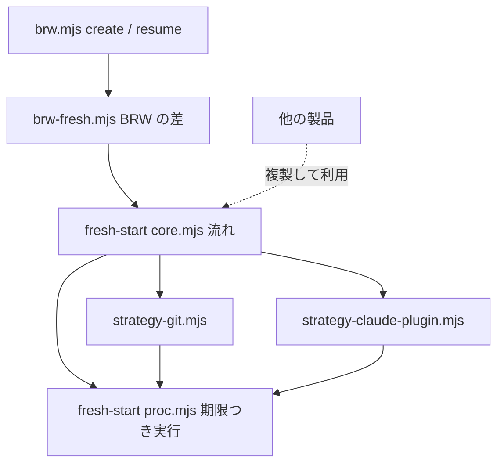
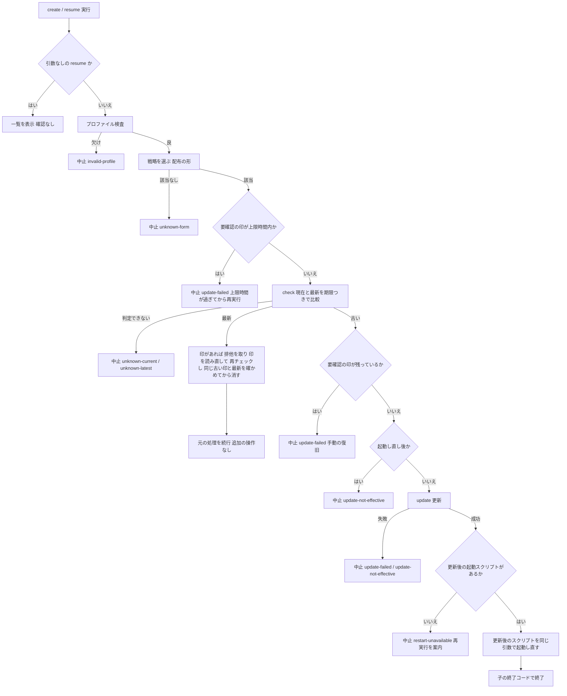

# Design Document: brw-fresh-start

## Overview
**Purpose**: `brw create` / `brw resume` が作業場所（ブランチと worktree）を作る・使う前に、BRW 自身が最新であることを確かめ、古ければ自動で更新して続け、最新化できなければ作業場所を作らず中止する。
**Users**: BRW を使う利用者とエージェント（Claude Code・Codex）。あわせて、同じ確認を自分の製品に組み込みたい BRW 以外の製品の作り手が、汎用部品を複製して使う。
**Impact**: `brw create` と、ブランチ名を指定した `brw resume` の先頭に前段を加える。確認を省く手段は設けない。

### Goals
- 作業場所を作る前に、BRW が最新かをコミットで判定する（要件 1）。
- 古ければ利用者の操作なしに更新し、更新後の版で元の操作を続ける（要件 2）。
- 最新化できないときは、作業場所を作らず、理由と次の手順を示して中止する（要件 3）。
- 判定・更新・中止の流れを、BRW を知らない汎用部品にする（要件 4）。

### Non-Goals
- worktree の置き場の変更、片付け、基底ブランチの追従（別の仕様）。
- 確認を省く設定、特定の版への固定（認めない）。
- 汎用部品を利用する他の製品の改修と、その名指し。
- Claude のフック・スキルの定義を実行中のセッションに反映すること（Claude の再起動が必要。案内に出すのみ）。

## Boundary Commitments

### This Spec Owns
- `brw create`・ブランチ名を指定した `brw resume` の前段としての最新化の確認・更新・起動し直し・中止の案内。
- 汎用部品 `scripts/fresh-start/`（判定・更新・中止と案内の流れ、プロファイルと戦略の契約、組み込みの 2 つの戦略: git の clone・Claude プラグイン）。
- BRW 固有の差を与える `scripts/brw-fresh.mjs`。
- 試験用の配布 clone を作る支援部品と、それに合わせた既存試験の起動先の差し替え。

### Out of Boundary
- 置き場の決定と作業場所の作成そのもの（`brw-branch-gate`）。引数なしの `resume` の一覧表示。
- 配布の仕組み自体（マーケットプレイスの運営、リリース手順、`plugin.json` の版の付け方）。
- 汎用部品を利用する BRW 以外の製品の側の組み込み。
- Claude Code の内部ファイルの形式の保証（形式が違えば「判定できない」で中止する）。

### Allowed Dependencies
- Node.js 22 以上の標準モジュールと、`git`、`claude`（Claude プラグインの形のときだけ）。
- `scripts/fresh-start/` は、ディレクトリの外のファイルを import しない（BRW の `lib.mjs` などに依存しない）。
- `scripts/brw.mjs` → `scripts/brw-fresh.mjs` → `scripts/fresh-start/`、の一方向だけ。

### Revalidation Triggers
- 汎用部品のプロファイル・戦略・結果の契約の変更（利用する製品の組み込みに影響）。
- 導入の記録（`installed_plugins.json`）や `claude plugin` の出力・終了コードの変更。
- `brw create` / `brw resume` の引数の解釈・最初の副作用の位置の変更（`brw-branch-gate`）。
- 中止の案内の見出しと理由の語の変更。

## Architecture

### Existing Architecture Analysis
- 入口は `scripts/brw.mjs` の `cmds` の表で、各サブコマンドは同期または非同期の関数（`await cmds[sub](rest)`）。`create`・`resume` は現在同期で、他から呼ばれない（表からだけ）。失敗は `fail(msg, code)` で標準エラーに出して終了する。
- `scripts/` に動的 import は無く、すべて静的 import。標準モジュールだけで動く（steering: tech.md）。
- フックの置き換えは、素の Git の操作を `node <brw.mjs> create <名前>` に書き換えて実行する。確認は `create` の中で行うので、直接実行も置き換え後の実行も同じ確認を通る（要件 1.4）。

### Architecture Pattern & Boundary Map

- **Selected pattern**: 戦略（配布の形ごとの部品）＋共通の流れ。判定・更新・中止と案内は `core.mjs` の 1 か所。形ごとの差は戦略、製品ごとの差はプロファイルが持つ。
- **Domain boundaries**: 流れ（core）／配布の形（戦略）／製品の差（プロファイル。BRW では adapter）／外部コマンドの実行（proc）。
- **Existing patterns preserved**: 標準モジュールのみ、kebab-case のファイル名、`.mjs`、テストは `selftest.mjs` から呼ぶ形、失敗時は案内つきで終了。
- **Steering compliance**: tech.md（Node.js 標準のみ）、structure.md（`scripts/` に集約、`tests/` に試験）。

### Technology Stack
| Layer | Choice / Version | Role in Feature | Notes |
|-------|------------------|-----------------|-------|
| CLI | Node.js 22+（`.mjs`、標準モジュールのみ） | 流れと戦略の実装 | 外部コマンドは非同期の `spawn`（`detached: true`）で起動し、期限でプロセスグループごと打ち切る（`poc/design_03.md`・`design_04.md`） |
| 外部コマンド | `git` 2.x、`claude` 2.1.x（プラグインの形のとき） | 最新の取得・更新 | `claude` が無ければ更新を失敗として中止 |
| Storage | なし（導入の記録を読むだけ） | | `installed_plugins.json`・`known_marketplaces.json` は読み取りのみ |

## File Structure Plan

### Directory Structure
```
scripts/
├── fresh-start/                    # 汎用部品（外を import しない・標準モジュールのみ・製品名を持たない）
│   ├── core.mjs                    # 流れ ensureFresh / runFreshStart、プロファイルの検査、結果と案内の組み立て
│   ├── proc.mjs                    # 期限つきの外部コマンド実行（グループごとの打ち切り、GIT_TERMINAL_PROMPT=0）
│   ├── lock.mjs                    # 導入先ごとの排他（同時に更新しない）
│   ├── strategy-git.mjs            # 戦略: git の clone（判定は ls-remote → fetch → is-ancestor、更新は ff-only）
│   ├── strategy-claude-plugin.mjs  # 戦略: Claude プラグイン（導入の記録を読み、最新を ls-remote、更新→入れ直し）
│   └── README.md                   # 他の製品が複製して使う手引き（プロファイルの項目、結果の契約）
└── brw-fresh.mjs                   # BRW 固有の差（表示名・起動スクリプト・手動更新の手順）を与える薄い接着
tests/
├── fresh-start.mjs                 # 流れ・契約・閉じていること（import の範囲、製品名の不在）の試験
├── fresh-start-strategies.mjs      # git の 9 状態、プラグインの戦略（偽の claude と導入の記録）の試験
├── fresh-start-brw.mjs             # create / resume の前段（順序・副作用なしの中止・一覧の除外）の試験
└── support/dist-fixture.mjs        # 試験用の配布 clone（一時の bare 配布元＋clone）を作る支援
```

### Modified Files
- `scripts/brw.mjs` — `create`・`resume` を非同期にし、引数の検査の後・最初の副作用の前で `brw-fresh.mjs` を呼ぶ。引数なしの `resume`（一覧）では呼ばない。
- `tests/selftest.mjs` — 新しい 3 つの試験を登録する。
- `tests/branch-ops.mjs` ほか `create`・`resume` を子プロセスで起動する試験（`integration-*.mjs`・`carry.mjs`・`enforcement.mjs` など。実装時に起動箇所を grep で洗い出す）— 起動先の `BRW` を、`dist-fixture.mjs` の配布 clone の `scripts/brw.mjs` に切り替える。
- `SKILL.md`・`references/setup.md` — 開始時の最新化の挙動、中止の案内の読み方、一度だけ手動で更新が要ること（この機能を持たない古い版）、リリース時に `plugin.json` の版を上げる運用を追記する。

## System Flows

- 確認と更新は、作業場所・記録・PR 本文など BRW が管理するものを作る前に行う（要件 2.5・3.4）。更新は導入先ごとの排他（`lock.mjs`）の中で行い、排他を取れない間は期限まで待ち、取れなければ `update-failed`（別の更新が実行中）で中止する。排他を取った直後に `check` をやり直し、他の実行がすでに更新していれば更新せずに続ける。要確認の印（前回の更新が期限切れで終わった印）の扱いは、`check` より前に確認する（上限時間内なら中止）。`check` が最新なら、**排他を取り、印を読み直し、排他の中で再チェックして**から印を消して続行する（下の競合の規則）。古ければ印があるかぎり自動の更新はせず手動の復旧を案内する（`lock.mjs` の節）。期限は 3 種類で、`checkMs`（`check` の 1 回ごと。最初の確認と再チェックそれぞれ）、`lockWaitMs`（排他を取るまで）、`updateMs`（排他を取った後の更新全体と、印の上限時間）。配布 clone の `origin` の追跡参照が更新されるのは、BRW 自身の配布物であり、利用者の作業リポジトリではない。
- 起動し直した子は、同じ確認を最初から行う（省かない）。子が「まだ古い」と判定したときは、更新を繰り返さず中止する。起動し直しの印は環境変数 `FRESH_START_RESTARTED` で、親だけが付け、確認を飛ばす効果はない（要件 1.7 に反しない）。

## Requirements Traceability
| Requirement | Summary | Components | Interfaces | Flows |
|-------------|---------|------------|------------|-------|
| 1.1 | create の前に確認 | `brw.mjs`、`brw-fresh.mjs`、`core.mjs` | `runFreshStart` | 全体 A→C |
| 1.2 | 名前指定の resume の前に確認 | 同上 | 同上 | 全体 A→B→C |
| 1.3 | 引数なしの resume は確認なし | `brw.mjs` | （呼ばない） | B→L |
| 1.4 | 置き換えの create も同じ確認 | `brw.mjs`（確認は `create` の内側） | `runFreshStart` | A |
| 1.5 | 最新なら追加の操作なしで続行 | `core.mjs` | `Outcome.fresh` | E→F |
| 1.6 | 確認は置き場の決定・作成より前 | `brw.mjs` の呼び出し位置 | — | A→C |
| 1.7 | 省く手段なし | `core.mjs`、`brw.mjs` | 環境変数・オプションで確認を飛ばす経路を作らない | 起動し直しの印は飛ばさない |
| 1.8 | 固定された版は古い | `strategy-git.mjs`、`strategy-claude-plugin.mjs` | `check`（コミットの比較） | E |
| 1.9 | 開発中の作業ツリーも同じ | `strategy-git.mjs` | `check` | E |
| 2.1 | 古ければ自動で更新 | `core.mjs`、各戦略 | `Strategy.update` | G→H |
| 2.2 | 導入の形ごとに比較・更新 | 各戦略、`core.mjs` の戦略の選択 | `Strategy.matches` | D |
| 2.3 | 更新後に元の操作を続行 | `core.mjs` | 起動し直し（引数そのまま） | I→J→K |
| 2.4 | 反映されなければ再実行を案内して中止 | `core.mjs` | `abort.restart-unavailable`・`update-not-effective` | G・I |
| 2.5 | 更新の完了前は何も作らない | `brw.mjs` の呼び出し位置 | — | 全体 |
| 2.6 | 未コミットの変更を失わせない | `strategy-git.mjs`（正確な SHA への ff のみ・衝突は git が拒否）、`lock.mjs` | `update` | H |
| 2.7 | 失わせずに更新できなければ更新せず中止 | 同上 | `abort.update-failed` | H→X5 |
| 3.1 | 最新を取得できなければ中止 | 各戦略、`proc.mjs` | `Probe.timeout/unreachable` | E→X3 |
| 3.2 | 現在の版を判定できなければ中止 | 各戦略 | `abort.unknown-current` | E→X3 |
| 3.3 | 更新失敗は理由と状態を示して中止 | 各戦略（状態を読み直す）、`core.mjs`、`lock.mjs` | `abort.update-failed`、`UpdateResult.state` | H→X5 |
| 3.4 | 中止は非ゼロ・何も作らない | `core.mjs`、`brw.mjs` | 終了コード 1 | X* |
| 3.5 | 待ち時間に上限 | `proc.mjs`（グループごとの打ち切り）、`core.mjs` | `checkMs`・`updateMs`・`deadline` | E・H |
| 4.1 | 単独で利用できる | `scripts/fresh-start/` 全体 | 外を import しない | — |
| 4.2 | 製品ごとの差を与えられる | `core.mjs` | `Profile` | C |
| 4.3 | 同じ結果と振る舞い | `core.mjs` | `Outcome` | 全体 |
| 4.4 | 必須項目の欠けで中止 | `core.mjs` | `abort.invalid-profile` | C→X1 |
| 4.5 | 製品名・固有の値を持たない | `scripts/fresh-start/` | 自己テストで検査 | — |
| 4.6 | BRW は差だけを与える | `brw-fresh.mjs` | `Profile` | — |
| 4.7 | BRW は他の製品を前提にしない | `brw-fresh.mjs` | — | — |

## Components and Interfaces
| Component | Domain/Layer | Intent | Req Coverage | Key Dependencies (P0/P1) | Contracts |
|-----------|--------------|--------|--------------|--------------------------|-----------|
| `core.mjs` | 汎用 | 流れ・検査・結果と案内 | 1.5, 1.7, 2.1–2.5, 3.1–3.5, 4.1–4.5 | `proc.mjs` (P0)、戦略 (P0) | Service |
| `proc.mjs` | 汎用 | 期限つきの外部コマンド実行（子孫まで打ち切る） | 3.1, 3.3, 3.5 | Node 標準 (P0) | Service |
| `lock.mjs` | 汎用 | 導入先ごとの排他 | 2.6, 3.3 | Node 標準 (P0) | Service |
| `strategy-git.mjs` | 汎用（配布の形） | git の clone の判定と更新 | 1.8, 1.9, 2.2, 2.6, 2.7 | `proc.mjs` (P0)、git (P0) | Service |
| `strategy-claude-plugin.mjs` | 汎用（配布の形） | Claude プラグインの判定と更新 | 1.8, 2.2, 3.1–3.3 | `proc.mjs` (P0)、claude (P0)、git (P0) | Service |
| `brw-fresh.mjs` | BRW | BRW の差を与える | 1.1–1.4, 4.6, 4.7 | `core.mjs` (P0) | Service |
| `brw.mjs`（変更） | BRW | 呼び出し位置の固定 | 1.1–1.4, 1.6, 2.5, 3.4 | `brw-fresh.mjs` (P0) | — |

### 汎用部品

#### `core.mjs`
| Field | Detail |
|-------|--------|
| Intent | プロファイルを検査し、戦略で判定→更新→起動し直しを行い、結果を返す・案内を出す |
| Requirements | 1.5, 1.7, 2.1–2.5, 3.1–3.5, 4.1–4.5 |

**Responsibilities & Constraints**
- 戦略の選択、期限の管理、起動し直し、中止の案内の組み立てを持つ。更新や判定の具体は戦略に任せる。
- 確認を飛ばす入力（環境変数・引数・設定）を持たない。`FRESH_START_RESTARTED` は「起動し直し済みの子では再更新しない」という制限にだけ使う。
- 製品名・固有のパス・固有の文言を持たない。案内の固有部分はプロファイルから受け取る。

**Contracts**: Service [x]

##### Service Interface
```typescript
/** 版を識別する不透明な文字列（コミットの SHA など）。比較は戦略が行う */
type Revision = string;

type ProbeCode = "timeout" | "unreachable" | "unsupported" | "invalid";
type Probe<T> = { ok: true; value: T } | { ok: false; code: ProbeCode; detail: string };

type CheckResult = {
  fresh: boolean;
  current: Revision;
  latest: Revision;
  plan: unknown;   // 戦略が update に引き渡す固有の確認結果（git: 既定ブランチ名と確かめた SHA。プラグイン: 選んだ導入・マーケットプレイス・取得先）。core は中身を読まない
};

type UpdateResult =
  | { ok: true; restartRoot: string }        // 更新後の導入先（起動し直す場所）
  | { ok: false; code: "failed" | "not-effective"; detail: string; next: string[]; state: "unchanged" | "changed-usable" | "unusable" | "unknown" };

interface Strategy {
  id: string;                                 // "git" | "claude-plugin" など。案内の語
  matches(root: string): boolean;             // この導入の形か
  check(ctx: { root: string; deadline: number }): Promise<Probe<CheckResult>>;
  update(ctx: { root: string; latest: Revision; plan: unknown; deadline: number }): Promise<UpdateResult>; // 更新前の状態の記録（snapshot）と、失敗時の state の決定は、各戦略が下記の規則で内部に持つ
}

interface Profile {
  name: string;                               // 案内に出す表示名（必須）
  root: string;                               // 実行中の製品の導入先。実体のパス（必須）
  entry: string;                              // root からの起動スクリプトの相対パス（必須）
  manualUpdate: (strategyId: string) => string[]; // 手動で更新する手順（必須）
  strategies?: Strategy[];                    // 省略時は組み込みの 2 つ
  checkMs?: number;                           // 既定 10000
  updateMs?: number;                          // 既定 180000。排他を取った後の更新全体の上限。要確認の印の「上限時間」にも使う
  lockWaitMs?: number;                        // 既定 30000。排他を取るまでの待ち時間の上限（更新の上限とは別）
}

type AbortCode =
  | "invalid-profile" | "unknown-form" | "unknown-current" | "unknown-latest"
  | "update-failed" | "update-not-effective" | "restart-unavailable";

type Outcome =
  | { kind: "fresh" }
  | { kind: "restarted"; exitCode: number }
  | { kind: "abort"; code: AbortCode; reason: string; next: string[] };

/** 判定・更新・起動し直しを行い、結果を返す。副作用は戦略の更新と子プロセスの起動だけ */
/** 副作用は、戦略の更新・`check` による取得・要確認の印の更新と削除・子プロセスの起動に限る */
function ensureFresh(profile: Profile, argv: string[]): Promise<Outcome>;
/** ensureFresh の結果を標準エラーに出して終了する。fresh のときは何も出さず戻る */
function runFreshStart(profile: Profile, argv: string[]): Promise<void>;
```
- Preconditions: `profile.name`・`root`・`entry`・`manualUpdate` が揃っている（欠けたら確認を行わず `invalid-profile` で中止し、欠けた項目名を `reason` に示す）。
- Postconditions: `fresh` のとき、何も出力せず、利用者の作業ツリー・導入物を変更しない（許される副作用は、`check` が行う取得だけ。git の戦略では、BRW の clone の `refs/remotes/origin/<既定ブランチ>` の更新。要確認の印があるときは、印の削除が加わる）。`abort` のとき、ブランチ・worktree・記録を作らない（呼び出し側が最初の副作用の前に呼ぶ）。`restarted` のとき、子の終了コードをそのまま返す。
- Invariants: `deadline` は絶対時刻で、複数の呼び出しの合計が上限を超えない。起動し直しは 1 回まで（`FRESH_START_RESTARTED` がある子が「古い」と判定したら `update-not-effective`）。

**中止の出力形式（標準エラー、終了コード 1）**
```
[fresh-start] 中止: <AbortCode>
理由: <reason>
次の手順:
  - <next の各行>
```
`AbortCode` ごとの理由と `next` の既定は、`core.mjs` が持つ（`unknown-latest` は「最新の版を取得できません（オフラインなど）。通信を確かめてから、もう一度実行してください」、`restart-unavailable` と `update-not-effective` は再実行の案内、など）。更新を手で行う手順は `profile.manualUpdate` が与える。

**失敗時の状態の契約**: 戦略は `update` に入る前に、更新前の状態（スナップショット）を記録する。`update` が失敗または期限切れで終わったら、導入の記録・ファイルを**読み直して**、次の 4 つのどれかを `state` に返す。推測では決めない。
| state | 条件 | 案内の言い方 |
|-------|------|--------------|
| `unchanged` | 戦略が更新前に記録したスナップショットと、読み直した値が**完全に一致する**。比べる値は戦略ごとに下の「戦略ごとの状態の規則」で定める。比べられない・計算できないときは `unknown` | 「確認した範囲（<比べた項目>）では、更新前のまま変わっていません」 |
| `changed-usable` | スナップショットと異なるが、その戦略が定める「導入が残り起動できる手がかり」が揃う（起動できることまでは確認していない） | 「更新前から変わっています。導入は残っていますが、起動できることは確認していません」 |
| `unusable` | 「導入が残り起動できる手がかり」が欠ける | 「導入が失われています」＋復旧コマンド |
| `unknown` | 読み直せない、または**期限切れ・強制終了で終わった**（子孫が動き続けている可能性を排除できないため、状態を確定しない） | 「状態を確認できません」＋確認・復旧コマンド |
**戦略ごとの状態の規則**（スナップショットは `update` に入る前に記録する）:
| 戦略 | スナップショットとして比べる値（`unchanged` の条件） | 導入が残り起動できる手がかり（`changed-usable`・`unusable` の分かれ目） |
|------|--------------------------------------------------------|----------------------------------------------------------------------|
| git | 現在のブランチ名・HEAD の SHA・`git status --porcelain=v1 -z` の出力・`git diff HEAD` の出力の SHA-256（追跡ファイルの内容）。さらに `MERGE_HEAD` と index のロックが無いこと。未追跡ファイルは名前だけを比べる（更新は未追跡のファイルを上書きせず、git が拒否するため） | HEAD が解決でき、`MERGE_HEAD`・index のロックが無く、`entry` のファイルが作業ツリーにある |
| プラグイン | 導入の記録の `installPath`・`version`・`gitCommitSha`、導入先ディレクトリの**内容の指紋**（相対パスの並びと、各ファイルの内容の SHA-256 から作る SHA-256）、起動スクリプトの存在 | 導入の記録に選んだ導入が残り、その `installPath` に起動スクリプトがある |
案内は、実際に比べた項目の範囲に限って「更新前のまま」と言う。

`core.mjs` は `state` をそのまま案内の理由に含め、`changed-usable`・`unusable`・`unknown` のときの `next` に、確認と復旧に使う実行コマンド（`scope`・実行場所つき）を含める。要件 3.3 のとおり、更新前の版が使えるかどうかを、`unchanged` だけが「更新前のまま」と言える。

**成功時の出力**: 更新して起動し直すときだけ 1 行（`<name> を更新しました（<旧> → <新>）。更新後の版で続けます。`）を標準エラーに出す。Claude プラグインの形では、さらに「フック・スキルの定義の反映には Claude の再起動が必要」の 1 行を出す。

#### `proc.mjs`
| Field | Detail |
|-------|--------|
| Intent | 外部コマンドを期限つきで実行し、結果を `{status, stdout, stderr, timedOut}` に正規化する |
| Requirements | 3.1, 3.5 |

- 非同期の `spawn`（`detached: true`、`GIT_TERMINAL_PROMPT=0`）で新しいプロセスグループとして起動し、期限（絶対時刻 `deadline` までの残り）になったら `process.kill(-pid, "SIGKILL")` でグループ全体を打ち切り、終了（`close`）を待ってから `timedOut: true` で返す。`spawnSync` の `timeout` は孫プロセスを止めないため使わない（`poc/design_04.md`）。
- 結果は `{status, stdout, stderr, timedOut}`。期限は絶対時刻で受け取り、各呼び出しは残りを使う。
- 残る限界: 子が自らプロセスグループを離れる場合は止まらない。このため、期限切れ・強制終了で終わった呼び出しの後は、状態を確定せず（`state: unknown`）、排他も安全側に扱う（`lock.mjs`）。

#### `lock.mjs`
| Field | Detail |
|-------|--------|
| Intent | 同じ導入先を同時に更新しない（共有キャッシュ・clone の並行更新を防ぐ） |
| Requirements | 2.6, 3.3 |

- 排他は OS の一時ディレクトリ配下の、導入先の実体のパスのハッシュを名前にしたディレクトリの作成（`mkdir` の原子性）で取る。中に所有者の PID と時刻を書く。
- 取れないときは期限まで短い間隔で再試行する。所有者の PID が存在せず、かつ作成から `updateMs` を超えているときだけ、古い排他として取り直す。期限内に取れなければ `update-failed`（別の更新が実行中）。
- 排他は `update` の前後だけ保持し、通常は `finally` で解放する。**期限切れ・強制終了で終わった `update` の後は、排他を解放せず「要確認の印」に変える**（時刻 `timedOutAt` を書く。子孫が更新を続けている可能性を排除できないため）。
- 印があるときの規則（利用者の決定: 更新の上限時間を設け、時間が過ぎたら再チェックして、更新されていれば再開、されていなければ手動の復旧）:
  1. `timedOutAt` から `updateMs`（更新の上限時間）が過ぎるまでは、`check` の結果にかかわらず更新を行わず、`update-failed`（直前の更新が期限切れで終わりました。上限時間が過ぎてから再実行してください）で中止する。
  2. 上限時間が過ぎた後は、`check` で実際の状態を確かめる。**最新だった**（子孫の更新が終わっていた）なら、印を消して元の操作を続ける。**古いままだった**なら、自動の更新はせず `update-failed`（手動の復旧が必要）で中止し、`next` に手動の更新手順（`profile.manualUpdate`）と、印の場所を示す。印は、のちの `check` が最新を返したときに、排他を取って消される（手動の復旧の後に、もう一度実行すれば進む）。再チェックは通常の `check` と同じで、git の戦略では追跡参照の取得を伴う（作業ツリー・HEAD には触れない）。
- **印を消す手順の競合の規則**: 印を消して続行するのは、(a) 排他を取れたとき、かつ (b) 排他の中で印を読み直し、最初に読んだ印と同じ（`timedOutAt` が同じ）で上限時間を過ぎているか、印が無くなっているとき、かつ (c) 排他の中で行う再チェックが最新を返したときだけ。読み直した印が、最初に読んだものと異なる（別の実行が期限切れで新しい印を残した）場合は、上限時間内であれば `update-failed`（上限時間が過ぎてから再実行）で中止し、上限時間を過ぎていれば (c) の再チェックに進む。再チェックが古ければ印を残して手動の復旧を案内する。
- 残る限界: 上限時間を超えて動き続ける子孫が、最新と判定された後に更新を書き換える可能性は排除できない（利用者が受け入れた限界。`check` は導入の記録と起動スクリプトの存在まで確かめる）。

#### `strategy-git.mjs`
| Field | Detail |
|-------|--------|
| Intent | git の clone（Codex が参照する clone、開発中の作業ツリー、固定された clone）の判定と更新 |
| Requirements | 1.8, 1.9, 2.2, 2.6, 2.7 |

- `matches(root)`: `git -C root rev-parse --show-toplevel` が `root` と一致する。
- `check`: (1) `git ls-remote --symref origin HEAD` で既定ブランチ名 `b` と先端 `L` を得る（取得できなければ `unreachable`/`timeout`、`origin` が無ければ `unsupported`）。(2) `git fetch --no-tags origin +refs/heads/b:refs/remotes/origin/b` で取得し、`git cat-file -e L^{commit}` で `L` が手元にあることを確かめる（取得の間に配布元が進んで `L` を取得できなかったときは、`ls-remote` からやり直すのを 1 回だけ行い、それでも無ければ `unreachable`）。(3) `git merge-base --is-ancestor L HEAD` が成功なら `fresh`。`current` は `git rev-parse HEAD`。判定と更新は、`origin/b` の名前ではなく、確かめた `L` の SHA だけを使う。
- `update`（`L` は `check` が確かめた SHA。先に `git merge-base --is-ancestor <移動先の現在位置> L` で fast-forward できることを確かめ、できなければ何も変更せず `failed`）:
  - (a) HEAD が `refs/heads/b` なら `git merge --ff-only L`。
  - (b) detached HEAD（固定）なら、ローカルの `b` があるときは `b` が `L` の祖先であることを確かめてから `git switch b` → `git merge --ff-only L`。無いときは `git switch -c b L` の後に `git branch --set-upstream-to=origin/b b`。
  - (c) 他のブランチ上（開発ブランチ）でも、HEAD が `L` の祖先（開発ブランチに独自の commit が無く、単に遅れている）なら `git merge --ff-only L` で fast-forward する。独自の commit があり `L` を含まない（分岐）ときは、更新せず `failed` とし、`next` に `git merge origin/b`（利用者が行う取り込み）を示す。マージ・リベースは自動で行わない。
  - (d) git が拒否した場合（未コミットの変更の衝突、`switch` の拒否）は、上の「戦略ごとの状態の規則」（git の行）で読み直して `state` を決める（全項目が一致なら `unchanged`、異なるが手がかりが揃えば `changed-usable`、手がかりが欠けるか読み直せなければ `unusable`・`unknown`）。異なる場合は、現在のブランチと HEAD、元のブランチ名と元の HEAD を `detail` と `next` に示す。`git` の出力を `detail` に、`next` に「変更を commit か退避してから再実行」を示す。期限切れで終わったときは `unknown`。
- `restartRoot` は `root` 自身。

#### `strategy-claude-plugin.mjs`
| Field | Detail |
|-------|--------|
| Intent | Claude プラグインとして導入された製品の判定と更新 |
| Requirements | 1.8, 2.2, 3.1–3.3 |

- `matches(root)`: `root` の実体が `<設定>/plugins/cache/<マーケットプレイス>/<プラグイン>/<版>` の形で、`<設定>/plugins/installed_plugins.json` がある。`<設定>` は `root` から上へたどって求める（`CLAUDE_CONFIG_DIR` に依存しない）。
- `check`: (1) `installed_plugins.json`（`version: 2`）から、`installPath` の実体が `root` に一致する導入（候補）を集める（複数のプロジェクトが同じ版のキャッシュを共有するため複数になりうる）。(2) **実行元の導入を 1 件に決める規則**: 実行時のカレントディレクトリのリポジトリの作業ツリーの最上位（`git rev-parse --show-toplevel`）、その本体の作業ツリー（`git worktree list` の先頭）の順に、候補の `projectPath`（scope が `project`）と一致するものを選ぶ。どれにも一致しなければ、候補のうち scope が `user` のものを選ぶ。それでも 1 件に決まらない、または候補が 0 件なら `invalid`（`unknown-current` で中止。理由に「導入先を一意に決められない」と候補の `scope`・`projectPath` を示す）。選んだ導入の `scope` が `user`・`project` 以外（`local`・`managed`）なら `unsupported`（自動更新の対象外。実機で確かめていないため）。`gitCommitSha` が無い・形式が違うときも `invalid`。(3) `known_marketplaces.json[<マーケットプレイス>].source` から取得先を決める（`source: "github"` で `ref` が無いものは `https://github.com/<repo>.git`、`source: "git"` で `ref` が無いものは `url`。`ref`・`path` など他のキーがあるもの、その他の種類は `unsupported`。ブランチは指定せず `HEAD`）。(4) `git ls-remote <取得先> HEAD` の先頭の SHA を最新とし、選んだ導入の `gitCommitSha` と比べる。
- `update`（`cwd` は `scope` が `project` なら選んだ導入の `projectPath`、`user` なら導入の記録のあるディレクトリ。別のディレクトリで実行しない。`poc/design_01.md` の 7）: (1) `claude plugin marketplace update <マーケットプレイス>`。(2) `claude plugin update <プラグイン>@<マーケットプレイス> --scope <scope> --json`。(3) 記録を読み直し、同じ `scope`・`projectPath` の導入の `gitCommitSha` が最新と一致すれば成功。一致しない（版が同じで `up_to_date` と答えた）ときは、(4) 同じ `cwd`・`scope` で `claude plugin uninstall` → `claude plugin install` を実行し、記録を読み直す（`poc/design_01.md` の 3・6・7）。(5) それでも一致しなければ `not-effective`。各段階の失敗の直後に、上の「戦略ごとの状態の規則」（プラグインの行）で読み直して `state` を決める（導入の記録・指紋が全項目一致なら `unchanged`）。ただし (4) の `uninstall` が始まった後の失敗は、一致していても `unchanged` にせず、手がかりが揃えば `changed-usable`、欠ければ `unusable` とする（入れ直しは導入先を作り直すため）。期限切れで終わったときは常に `unknown`。`unusable`・`unknown` のときの `next` に、`claude plugin install <プラグイン>@<マーケットプレイス> --scope <scope>`（実行場所つき）を示す。
- 共有キャッシュの扱い: 同じ版のキャッシュ（`installPath`）を複数の導入が共有しているとき、入れ直し (4) は同じ版のキャッシュを上書きするため、他の導入への影響を確かめていない。そこで、**入れ直し (4) は、記録の中でその `installPath` を使う導入が選んだ 1 件だけのときに限って行う**。他の導入も共有しているときは入れ直さず `not-effective` で中止し、`next` に手動の手順（共有している導入の一覧つき）を示す。版を上げた更新 (2) は新しい版のキャッシュを作り、古い版のキャッシュを残すため、この制限の対象外。同時に更新しないよう `lock.mjs` の排他を取る。
- `restartRoot` は読み直した記録の、選んだ導入の `installPath`。
- `claude` が無い・コマンドが失敗・期限切れのときは `failed`（失敗の理由と、読み直した `state` を `detail` と `next` に示す。要件 3.3）。

### BRW

#### `brw-fresh.mjs`（BRW 固有の差）
- 提供: `freshStart(argv: string[]): Promise<void>`（`runFreshStart` を待つ）。`Profile` を組み立てて `runFreshStart` を呼ぶだけ。
- 与える差: `name: "BRW"`、`root`（`import.meta.url` の実体から `scripts/` の親）、`entry: "scripts/brw.mjs"`、`manualUpdate`（Claude プラグインは `claude plugin update branch-release-workflow@nekono-dev`、git の clone は `git -C <root> pull --ff-only` 相当を示す）。
- 他の製品の存在を前提にした記述を持たない（要件 4.7）。

#### `brw.mjs`（呼び出し位置）
- `create`: 使い方の検査（`--carry` と `--branch-only` の同時指定など）の後、最初の git 操作・ファイル作成の前に `freshStart(["create", ...args])`。
- `resume`: 引数なし・`--all` のみ（一覧）では呼ばない。ブランチ名があるときだけ、分類や `git fetch` の前に `freshStart(["resume", ...args])`。
- どちらも `async function` にする（`cmds` の表は `await` 済みで変更不要）。

## Error Handling

### Error Strategy
中止の理由は 7 つの語（`AbortCode`）に分類し、すべて終了コード 1、固定の見出し `[fresh-start] 中止: <語>` で出す。案内は「理由」と「次の手順」を必ず含む。

### Error Categories and Responses
| 状況 | AbortCode | 要件 |
|------|-----------|------|
| 配布元に届かない・期限切れ | `unknown-latest` | 3.1, 3.5 |
| 導入の記録が読めない・形式が違う・コミットが無い | `unknown-current` | 3.2 |
| 配布の形を判定できない（どの戦略にも合わない） | `unknown-form` | 3.2 |
| 更新コマンドの失敗・期限切れ・git の拒否（未コミットの変更の衝突、分岐） | `update-failed` | 2.7, 3.3 |
| 更新したのに最新にならない（起動し直した子がまだ古い、入れ直しでも一致しない） | `update-not-effective` | 2.4, 3.3 |
| 更新後の起動スクリプトが見つからない | `restart-unavailable` | 2.4 |
| プロファイルの必須項目が無い | `invalid-profile` | 4.4 |

## Testing Strategy

### Unit Tests（`tests/fresh-start.mjs`）
- 流れの全分岐を偽の戦略で確かめる: 最新で何も出さず続行（1.5）、古い→更新→起動し直し（子の終了コードを返す、引数が同じ）（2.1・2.3）、起動し直した子がまだ古いと中止（2.4）、起動スクリプトが無いと `restart-unavailable`（2.4）、判定の失敗で更新せず中止（3.1・3.2）、更新の失敗で理由と状態を示して中止（3.3）。
- 必須項目が欠けたプロファイルで、欠けた項目名を示して確認を行わず中止（4.4）。
- 3 つの結果と案内の形が、戦略によらず同じ（4.3）。中止の出力に固定の見出し・理由・次の手順がある。
- 閉じていること: `scripts/fresh-start/` の import がディレクトリ内と `node:` に限られ（4.1）、`branch-release-workflow`・`BRW`・`brw`・`cc-sdd` などの製品名を含まない（4.5）。
- 確認を飛ばす経路が無いこと: `FRESH_START_RESTARTED` を外から付けて起動しても、古ければ更新せず中止し、最新なら続行する（1.7）。
- 期限と後始末: 応答しない外部コマンドが期限で打ち切られ、孫プロセスも残らない（3.5）。排他が取れない間は期限まで待って `update-failed` になり、古い排他だけが取り直される（3.3）。更新が失敗・期限切れで終わったときの `state` が、スナップショットと読み直した事実から `unchanged`・`changed-usable`・`unusable`・`unknown` を返し、期限切れは常に `unknown` になること、期限切れの後は要確認の印が残り、上限時間が過ぎるまで他の実行が `update-failed` になること、印を消す直前に別の実行が新しい印を残した場合（競合）も上限時間内は中止すること、上限時間が過ぎた後は再チェックで最新なら印が消えて続行し、古ければ自動更新せず手動の復旧を案内すること（3.3）。印の確認が `check` より前に行われ、最新と判定されたときも印が排他の中で消されること、印があるかぎり更新が起きないこと、`lockWaitMs`・`checkMs`・`updateMs` がそれぞれ別に効くこと（1.5・2.5・3.3・3.5）。`unchanged` がファイルの指紋（プラグイン）・`git status` の出力（git）の一致まで確かめること（3.3）。

### Integration Tests（`tests/fresh-start-strategies.mjs`）
- git: 実測の 9 状態（`poc/design_02.md`）を一時リポジトリで再現し、最新・遅れ・未コミットの変更の保護・固定・開発ブランチの分岐・オフラインの結果を確かめる（1.8・1.9・2.6・2.7・3.1）。加えて、独自の commit が無い遅れた開発ブランチが fast-forward で更新されること、判定の後で配布元が進んでも確かめた SHA だけに更新されること、固定された clone で `switch` が拒否されたとき HEAD が動かないこと、`merge` が失敗したとき現在のブランチと HEAD が案内に示されること（2.1・2.6・2.7・3.3）。
- プラグイン: 偽の `claude` を `PATH` に置き、導入の記録の一時ファイルと偽の取得先（ローカルの bare リポジトリ）で、最新・古い→更新成功・`up_to_date` で入れ直し・入れ直しでも不一致・プロジェクト単位が `projectPath` をカレントにして実行される・記録の形式が違う・取得先が未対応（`ref` つき・`local`/`managed`）・オフラインを確かめる（1.8・2.2・3.1〜3.3）。共有キャッシュで複数の導入が候補になるとき、実行元（作業ツリーの最上位→本体→`user`）の規則で 1 件に決まり、決まらなければ `unknown-current` で中止すること、`uninstall` の後に `install` が失敗したとき `state: unusable`（記録に残れば `changed-usable`）と復旧コマンドが案内されること、同じ版のキャッシュを他の導入が共有しているとき入れ直しを行わず `not-effective` で中止すること（2.2・3.2・3.3）。
- 期限: 応答しない取得先で期限内に打ち切られる（3.5）。

### E2E / CLI Tests（`tests/fresh-start-brw.mjs`）
- 試験用の配布 clone の `brw.mjs` で、`create`（`--branch-only`・`--carry` を含む）と名前つきの `resume` が、最新のとき従来どおり成功する（1.1・1.2・1.5）。
- 配布元を遅らせた clone で `create` を実行すると、古い→更新→起動し直しで成功し、更新後の版で作業場所ができる（2.1・2.3）。
- 配布元に届かない clone で `create`・`resume <ブランチ>` が中止し、非ゼロの終了コードで、ブランチ・worktree・記録が一切できていない（3.1・3.4・2.5）。
- 引数なしの `resume` は、配布元に届かなくても一覧を表示する（1.3）。
- 素の Git のブランチ作成の置き換えで実行された `create` も、同じ確認を通る（1.4）。
- 確認は、ブランチの分類・fetch・worktree の作成より前に行われる（1.6）。
- BRW を開発中の作業ツリー（先端を含む開発ブランチ）で最新と判定され、先端を含まない場合は中止して取り込みの手順を案内する（1.9）。
- 既存の `create`・`resume` の試験は、起動先を試験用の配布 clone に切り替えて、通信なしで従来どおり通る。フックが生成する `brw` のパスを経由する統合試験（置き換え経由）も含め、直接起動と置き換え経由の両方の起動箇所を実装時に洗い出して切り替える。

## Supporting References
- `research.md`（調査の記録と設計判断の根拠）、`poc/design_01.md`〜`design_03.md`（実機検証）。
- リスクと残る前提: (1) Claude Code の導入の記録の形式は内部ファイルで、変わりうる（変われば `unknown-current` で中止し、更新手順を案内する）。(2) 開発中の作業ツリーで、既定ブランチが進むたびに、先端を含まない開発ブランチは中止になる（自動マージはしない。案内の手順で取り込む。利用者の決定「他の配布の形と同じに扱う」の帰結）。(3) リリースで `plugin.json` の版を上げない運用でも最新は判定できるが、更新は入れ直しに頼る。版を上げる運用が望ましい（資料に追記する）。(4) この機能を持たない古い版は自分で更新できないため、一度だけ手動の更新が要る。(5) `claude` が自らプロセスグループを離れて子孫を作る場合は期限切れで止まらない。止められたことを前提にせず、期限切れの後は状態を `unknown` とし、要確認の印を残す。上限時間が過ぎてから再チェックし、最新なら再開、古ければ手動の復旧とする（利用者の決定。上限時間を超えて動き続ける子孫は排除できない）。(6) `local`・`managed` scope と `ref` つきの取得先は自動更新の対象外（実機で確かめていないため、中止して手動の手順を案内する）。(7) `create` は現在、引数の検査の前に Git の読み取り（`repoRoot`・宣言の読み込み）を行う。確認の呼び出しは使い方の検査の後・最初の書き込みの前に置くため、実装時に検査と読み取りの順序を整理する。
