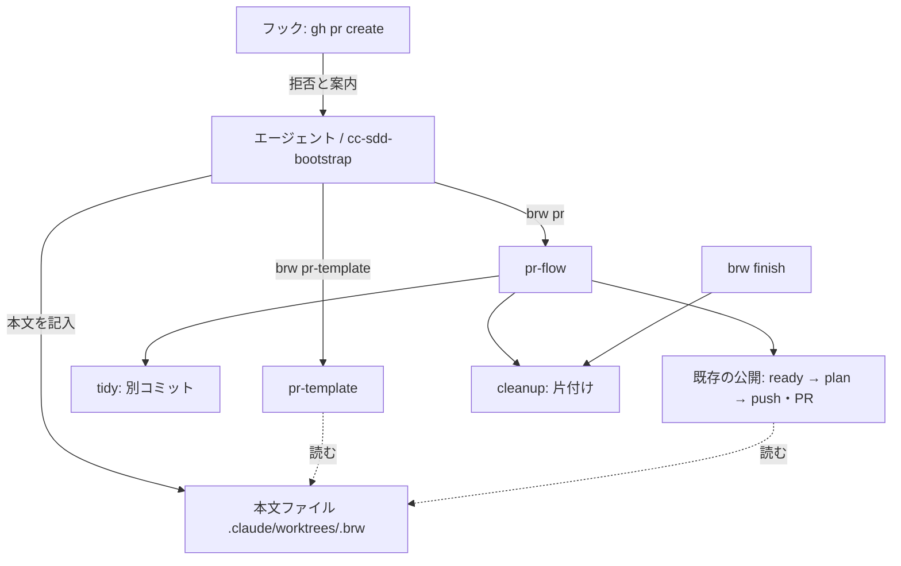
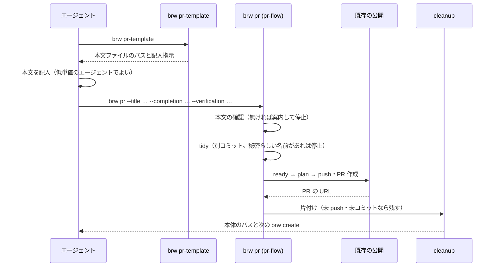

# 設計書: brw-pr-handoff

## 概要

**目的**: 作業の完了から PR 作成、作業場所の片付けまでを `brw pr` 1 つの流れにし、PR 本文を統一した雛形から人が読める文章で書かせ、作成の直後に worktree・ローカルブランチ・作業状態を自動で片付ける。
**対象**: BRW 導入リポジトリで作業する開発者とエージェント。将来 cc-sdd-bootstrap が `brw pr-template` と `brw pr` を呼ぶことを想定するが、BRW は cc-sdd を知らない。
**影響**: 現状は任意だった PR 作成（`brw work …` と `brw publish` の複数コマンド）と、利用者の指示を待っていた片付けを、1 つの入口にまとめる。直接の `gh pr create` は拒否に変わる。

### 目標

- `brw pr` が、別コミット化 → 準備 → 計画 → push・PR 作成 → 片付けを順に行い、止まったら再実行で続きから進む（要件 1、2、4）。
- `brw pr-template` が、雛形と自己完結した記入指示を出し、本文はエージェントが書く（要件 3）。
- 宣言 1 キーで片付けを外せる。既定は有効（要件 5）。

### 非目標

- 本文の自動生成、cc-sdd・`.kiro` の参照、リモートブランチの削除・プレビューの後始末・GitHub 側のマージ。
- 公開の承認・計画・状態記録の仕組みの変更（brw-enforcement の既存の部品を使う）。

## 境界の確約

### この仕様が担う

- `brw pr`（調整役）と `brw pr-template`（雛形・記入指示）の 2 つの入口。
- 未コミット変更の別コミット化（秘密らしい名前の停止を含む）。
- PR 作成後の自動片付け（worktree・ローカルブランチ・作業状態・本文ファイル）と、手動の `brw finish` との共通化。
- 直接の PR 作成の拒否（判定層の変更）と案内。
- 宣言の 2 キー（`afterPublish.cleanup`・`pullRequest.language`）と導入時の既定値。

### 担わない

- push・PR 作成・計画・承認・作業状態の記録そのもの（`publish.mjs`・`publish-cli.mjs`・`publish-pr.mjs`）。
- 取り込み済みの判定の規則（`landedState` の判定内容。自動側は事実を渡して回避するだけ）。
- ブランチ・worktree の作成の入口（brw-branch-gate）。

### 許可する依存

- `scripts/publish.mjs`・`publish-cli.mjs`（`runWork`・`runPublish`）の公開関数と、`lib.mjs` の宣言・git 補助。
- 依存の向きは「`pr-flow` → 公開の既存の段階・`tidy`・`cleanup`・`pr-template`」の一方向。`cleanup` は `brw.mjs` を import しない（`brw.mjs` が `cleanup` を使う）。

### 再検証の契機

- `runWork`・`runPublish` の引数と出力（作業 ID・計画 ID の形）を変えるとき。
- `finishBlocker` の判定条件を変えるとき。
- 作業状態のファイルの置き場所・ロックの名前を変えるとき。
- 宣言の検証（`validateConfig`）の形を変えるとき。

## アーキテクチャ

### 既存の構造の分析

- 公開は 4 段階（`work start` → `work ready` → `work plan` → `publish`）で、各段階が状態を記録する。承認の要否は計画と宣言（`autoApprove`）が決める。
- 片付けは `brw.mjs` の `finish` が持ち、`finishBlocker`（安全確認）と `removeBranch`（削除）が中核。取り込み済みの判定は `landedState`（祖先関係・squash・`gh` の PR）。
- PR 作成の判定（`evalPrCreate`）は、規則に合う PR 作成を確認省略の対象として通す。

### 構成図



- **選んだ形**: 調整役（`pr-flow`）が既存の段階を順に呼ぶ。新しい承認・計画の仕組みは作らない。
- **維持する形**: 作業状態は worktree ごとのファイル。公開の再試行は同じ作業・同じ計画で行う。
- **新しい部品の理由**: 別コミット・片付け・雛形はそれぞれ単独で試験でき、`finish` と共有できるものを分ける。

### 技術スタック

| 層 | 選択 | 役割 | 備考 |
|---|---|---|---|
| CLI | Node.js 22 以上、`.mjs`、標準モジュールのみ | 入口・調整・片付け | 既存どおり |
| Git・GitHub | `git`、既存の GitHub 接続（`github-client.mjs`） | commit・削除・PR | `gh` は取り込み判定の補助だけで、必須にしない |
| 試験 | `tests/*.mjs`、`claude -p` の実機確認 | 契約・結果の検証 | 既存の方式 |

## ファイル構成計画

### ディレクトリ構成

```
scripts/
├── pr-flow.mjs        # 新規: brw pr の調整役（段階の順序・再入・出力）
├── pr-template.mjs    # 新規: 雛形の解決・本文ファイルの生成・記入指示の出力
├── tidy.mjs           # 新規: 未コミット変更の別コミット化・秘密らしい名前の検出
├── cleanup.mjs        # 新規: finishBlocker・removeBranch・状態ファイル削除・片付け後の案内
├── brw.mjs            # 変更: pr・pr-template を振り分け、finish が cleanup.mjs を使う
├── publish-cli.mjs    # 変更: 本文ファイルの読み取り先に BRW の本文置き場を許可
├── agent-hooks.mjs    # 変更: 信頼済みの brw pr を確認省略の対象にし、本文置き場を許可
├── operation-decision.mjs # 変更: evalPrCreate が規則に合う場合も拒否して brw pr を案内
├── lib.mjs            # 変更: 宣言の検証・既定値に afterPublish・pullRequest を追加
└── setup-cli.mjs      # 変更: 宣言の新規作成時に afterPublish.cleanup: true を書く
assets/
├── config.example.json         # 変更: 2 キーの記入例
└── pr-template.ja.md / pr-template.en.md  # 新規: 既定の雛形
tests/
├── tidy.mjs / pr-template.mjs / cleanup.mjs / pr-flow.mjs  # 新規
└── agent-hooks.mjs / decision.mjs / selftest.mjs           # 変更
evals/
└── opens-pr-and-cleans-up/     # 新規: 評価ケース
SKILL.md / references/config.md / references/setup.md       # 変更
```

### 変更するファイル

- `scripts/brw.mjs` — `finish` の安全確認と削除を `cleanup.mjs` へ移す（挙動は変えない）。サブコマンド `pr`・`pr-template` を追加する。
- `scripts/operation-decision.mjs` — `evalPrCreate` は、規則に適合する場合（現在は確認省略の対象）も拒否にする。案内は `ALT_PR_FLOW`（`brw pr-template` で本文を用意し、`brw pr` で作成）。不適合の拒否の案内は従来のまま。
- `scripts/publish-cli.mjs` — `readBody` は、作業ディレクトリ配下の相対パスに加え、`<本体>/.claude/worktrees/.brw/` 配下の絶対パスを受け付ける（実体パスで配下を確認し、`..`・リンクの逸脱を拒否する既存の基準を同じに適用）。

## システムフロー



- 段階の途中で止まったときは、`brw pr` を同じ作業で再実行する。作業の状態（`inProgress`・`ready`・`pushed`・`published`）から、済んだ段階を飛ばして続ける。
- 片付けだけが残っている状態（PR は作成済みで状態は `published`）では、`brw pr` は片付けだけを再試行する。
- 開発ブランチへの取り込み（push だけで完了する公開）は、`brw merge` に使うブランチなので片付けない。

## 要件トレーサビリティ

| 要件 | 概要 | 部品 | インターフェース |
|---|---|---|---|
| 1.1 | 直接の PR 作成を拒否し案内 | `evalPrCreate`（変更） | 拒否の案内 `ALT_PR_FLOW` |
| 1.2 | `brw pr` が公開と同じ流れ | `pr-flow` | `runPr` |
| 1.3 | 作業 ID なしで作業を補う | `pr-flow`（作業の探索・開始） | `runPr` |
| 1.4 | 開発ブランチ外・対象不明は止める | `pr-flow`（事前確認） | 終了コード 1 と案内 |
| 1.5 | 既存 PR の再利用 | 既存の `existingPr` | 既存どおり |
| 1.6 | フック無効・Codex でも拒否 | `brw guard`（判定層を共有） | 既存の `guard` |
| 1.7 | 未導入は拒否しない | 既存の `repoState` | 既存どおり |
| 2.1・2.2 | 別コミット・メッセージ | `tidy` | `tidyChanges` |
| 2.3 | gitignore 対象を含めない | `tidy`（`git status` の結果のみ使用） | `tidyChanges` |
| 2.4 | 秘密らしい名前は停止 | `tidy`（`SECRET_PATTERNS`） | `TidyResult.blocked` |
| 2.5 | 本文へ一覧を提供 | `pr-template`（事前確認の一覧と過去の別コミット） | 雛形の差し込み |
| 2.6 | 変更が無ければ作らない | `tidy` | `TidyResult.none` |
| 2.7 | 失敗時は進まない | `pr-flow`（段階の順序） | 終了コード 1 |
| 3.1・3.2 | 雛形・記入指示・4 つの節 | `pr-template`、`assets/pr-template.*.md` | `buildTemplate` |
| 3.3 | リポジトリの雛形を優先 | `pr-template`（`resolveTemplate`） | `resolveTemplate` |
| 3.4 | 言語の指定 | `lib.mjs`（`pullRequest.language`）、`pr-template` | 設定 |
| 3.5・3.6 | 作業外の変更・検証の差し込み | `pr-template` | `buildTemplate` |
| 3.7 | 自己完結した短い記入指示 | `pr-template`（`instruction`） | 標準出力 |
| 3.8 | 本文なしなら案内 | `pr-flow`（本文の確認） | 終了コード 1 |
| 3.9 | 本文ファイルを作業ツリーの外に置く | `pr-template`（`bodyPathOf`）、`readBody`（変更） | `.claude/worktrees/.brw/` |
| 4.1 | 片付け（worktree・ブランチ） | `cleanup`（`removeBranch`） | `cleanupAfterPr` |
| 4.2・4.11 | 作業状態の削除（順序） | `cleanup` | `cleanupAfterPr` |
| 4.3 | リモート・プレビューは残す | `cleanup`（削除対象の限定） | — |
| 4.4・4.5 | 未 push・未コミットは残す | `finishBlocker`（共有） | `CleanupResult.kept` |
| 4.6・4.10 | 止まったとき再試行できる | `pr-flow`（再入）、`cleanup`（状態を残す） | 状態 `published` |
| 4.7 | 既存 PR 再利用でも同じ判定 | `pr-flow` | 同上 |
| 4.8・4.9 | 本体のパス・次の `brw create` を表示 | `cleanup`（`afterCleanupGuide`） | 標準出力 |
| 5.1〜5.4 | 設定・既定・導入時・既存導入先 | `lib.mjs`、`setup-cli.mjs` | `afterPublish.cleanup` |
| 5.5 | 無効時は案内のみ | `pr-flow` | 標準出力 |
| 5.6 | 不正値の報告 | `validateConfig` | 既存の報告 |
| 5.7 | 言語の既定 | `lib.mjs` | 既定 `ja` |
| 6.1〜6.5 | 連携の入口・独立性 | `pr-template`、`pr-flow`、`evalPrCreate` | 入口 2 つ、cc-sdd を参照しない |

## 部品とインターフェース

| 部品 | 層 | 役割 | 要件 | 主な依存 | 契約 |
|---|---|---|---|---|---|
| `pr-flow` | 調整 | 段階の順序・再入・出力 | 1、2、3.8、4、5.5 | 既存の公開（P0）、`tidy`・`cleanup`・`pr-template`（P0） | Service |
| `pr-template` | 本文 | 雛形の解決・本文ファイル・記入指示 | 2.5、3、6 | `lib.mjs`（P0） | Service |
| `tidy` | 別コミット | 未コミット変更の検出・コミット | 2 | git（P0） | Service |
| `cleanup` | 片付け | 安全確認・削除・案内 | 4 | git（P0）、`publish.mjs` の状態の場所（P0） | Service |
| `evalPrCreate`（変更） | 判定 | 直接の PR 作成を拒否 | 1.1、1.6 | なし | API |

### 調整（`scripts/pr-flow.mjs`）

#### runPr

| 項目 | 内容 |
|---|---|
| 役割 | `brw pr` を実行する |
| 要件 | 1.2〜1.5、2.7、3.8、4.6〜4.10、5.5 |

**責務と制約**
- 引数: `--title`・`--body-file`（省略時は既定の本文置き場）・`--completion`・`--verification`・`--failed`・`--target`・`--work`（省略可）。
- 順序（各段階の前に再入の判定を行う）:
  1. 事前確認: 導入済み・現在のブランチが開発ブランチ。無ければ理由を表示して止まる。
  2. 作業の特定: `--work` か、現在のブランチの未公開の作業。無ければ `work start` 相当で開始。
  3. 本文の確認: 新規 PR になりうるとき、本文ファイルが無ければ `brw pr-template` を案内して止まる（副作用の前）。
  4. `tidy`（別コミット）。失敗・停止なら以降へ進まない。
  5. `work ready`（`--completion`・`--verification`）→ `work plan` → `publish`。承認待ち・禁止・失敗は既存の案内をそのまま返す。
  6. 成功（PR の作成または再利用）なら `cleanup`（設定が有効なとき）。無効なら手動の `brw finish` を案内。
- 既存の段階は `runWork`・`runPublish` を、出力を捕捉する `io` で呼び、作業 ID と計画 ID を読む（出力の形は既存の契約）。
- 公開が `push` 完了の取り込み（開発ブランチ宛）のときは、片付けず `brw merge` の案内を返す。

**契約**: Service

```typescript
interface PrArgs {
  title?: string; bodyFile?: string; completion: string;
  verification: string; failed?: boolean; target?: string; work?: string;
}
type PrOutcome =
  | { status: "done"; prUrl: string; cleanup: CleanupResult }
  | { status: "stopped"; stage: "precheck" | "body" | "tidy" | "ready" | "plan" | "publish" | "cleanup"; message: string; retry: string };
function runPr(args: string[], deps?: PrDeps): Promise<number>; // 終了コード 0 / 1 / 2
```
- 事前条件: `completion`・`verification` は必須（既存の `work ready` と同じ）。
- 事後条件: 終了コード 0 のとき PR が存在する。1 で止まったときは再実行で続きから進む。
- 不変条件: 同じ作業・同じ HEAD への再実行で、push・PR は重複しない（既存の公開の性質）。

### 別コミット（`scripts/tidy.mjs`）

```typescript
type TidyResult =
  | { kind: "none" }
  | { kind: "committed"; files: string[]; oid: string }
  | { kind: "blocked"; secretLike: string[] }
  | { kind: "failed"; message: string };
function tidyChanges(worktree: string): TidyResult;
function previewTidy(worktree: string): { files: string[]; secretLike: string[] };   // brw pr-template が使う
const TIDY_SUBJECT = "chore: 作業外の変更（ボーイスカウト）";
const SECRET_PATTERNS: RegExp[]; // .env*, *.pem, *.key, id_rsa*, *credentials*, *secret*, *.p12, *.pfx
```
- 対象は `git status --porcelain=v1 -z` の全項目（ignore 対象は元から現れない）。1 件でも `SECRET_PATTERNS` に当たれば、何も commit せず `blocked`（2.4）。
- コミットは対象のファイルを明示して `git add -- <files>` し、`git commit -m <TIDY_SUBJECT> -m <ファイル一覧>`。フックは回避しない（失敗なら `failed`、2.7）。

### 本文（`scripts/pr-template.mjs`）

```typescript
function resolveTemplate(worktree: string, language: "ja" | "en"): { source: "repo" | "builtin"; text: string };
function bodyPathOf(mainPath: string, branch: string): string; // <本体>/.claude/worktrees/.brw/<alias>.md
function buildTemplate(ctx: TemplateContext): string;           // 雛形に作業外の変更・検証を差し込んだ本文
function instruction(ctx: TemplateContext): string;             // 自己完結した短い記入指示
```
- 優先順位: `.github/PULL_REQUEST_TEMPLATE.md`（worktree の作業ツリー）→ 同梱の `assets/pr-template.<language>.md`。
- 差し込み: 「作業外の変更」の節へ `previewTidy` の一覧と、ブランチ内の既存の別コミット（件名が `TIDY_SUBJECT`）のファイル一覧。「検証」の節へ `--verification`・`--failed`（未通過なら冒頭に「検証未通過」）。リポジトリ側の雛形には節が無いことがあるため、差し込みは節の見出しが見つかったときだけ行い、無ければ末尾に追記する。
- `brw pr-template` は本文ファイルを `bodyPathOf` に書き出し（既に記入済みなら上書きせず、そのパスを案内）、標準出力に記入指示を出す。指示は次を含み、BRW・特定の呼び出し側の事前知識を要しない: 本文ファイルのパス、各節に書くこと（事実のみ・推測しない・読み手は人）、参照すべき情報（`git log <base>..HEAD`・`git diff --stat <base>`）、書き終えた後に実行する `brw pr` のコマンド。

### 片付け（`scripts/cleanup.mjs`）

```typescript
interface KnownPr { url: string; base: string }
type CleanupResult =
  | { kind: "cleaned"; branch: string; worktree: string | null; main: string }
  | { kind: "kept"; branch: string; reason: string };            // 未 push・未コミットなど
function finishBlocker(main, others, config, branch, base, known?: KnownPr): string | null; // 既存の判定を移す。known があれば landedState を飛ばす
function removeBranch(main, others, branch): { worktree: string | null };
function cleanupAfterPr(opts: { main: WorktreeInfo; branch: string; config; known: KnownPr }): CleanupResult;
```
- 順序（4.2・4.11）: ① 削除前に状態ファイル（`.json`・`.json.lock`）と本文ファイルのパスを求める → ② `finishBlocker`（`known` を渡して、`gh` の検索に依存しない）→ ③ `removeBranch`（git は `cwd` に本体のパスを明示。research.md #6）→ ④ 状態ファイルと本文ファイルを削除 → ⑤ 案内の出力。②で止まったときは何も消さず、状態は `published` のまま残す（4.6）。
- 案内: 本体のパスと「次の作業は `brw create <名前>`」。作業場所が消えた後のコマンドは、ホストが本体へ戻して実行する（research.md #1）。

### 判定層（`scripts/operation-decision.mjs`）

- `evalPrCreate` は、`gh pr create`・GitHub API・MCP による PR 作成を、規則に適合する場合も `deny`（コード `pr-create-use-brw`）にし、案内は `ALT_PR_FLOW`（`brw pr-template` で本文を用意し、`brw pr` で作成する）。`brw guard` は同じ判定を共有するため、Codex と手順書の経路でも止まる（1.6）。不適合の拒否の案内は変えない。
- 確認省略（`autoApprove.pullRequest`）は `brw pr` の公開段階の承認にだけ使い、`gh` 経由の判定には使わない。

### フック（`scripts/agent-hooks.mjs`）

- 信頼済みの `node <brw.mjs> pr …` で、引数が決まった形（既知のオプションと値）、宣言が `autoApprove` の push・PR をともに有効にしているときだけ確認を省略する。承認の要否・禁止は `brw pr` の内部の公開（計画・状態）が改めて判定するため、フックはホストの確認を省くだけ。それ以外は応答を返さない（通常の承認）。

## データモデル

- 宣言の拡張（`lib.mjs`）:

```jsonc
{ "afterPublish": { "cleanup": true },   // 省略時は true 扱い。false の明示だけが無効
  "pullRequest": { "language": "ja" } }  // 省略時は "ja"。"ja" | "en"
```
- 検証: オブジェクトでない・未知のキー・型違い・未対応の言語は不正（5.6）。
- 状態ファイルの形は変えない。片付けの完了で `.json` と `.json.lock` を削除する。

## エラー処理

| 区分 | 例 | 応答 |
|---|---|---|
| 事前条件 | 開発ブランチでない、本文なし | 理由と次のコマンドを表示して終了コード 1（副作用の前） |
| 停止 | 秘密らしい名前のファイル | 対象のファイル名を表示。commit も公開もしない |
| 公開 | 承認待ち・禁止・失敗 | 既存の案内（同じ作業での再実行・中断）をそのまま返す |
| 片付け | 未 push・未コミット・削除の失敗 | PR は作成済みであること、残した理由、`brw pr`（片付けのみ再試行）または `brw finish` を表示。PR を取り消さない |

## テスト戦略

### 単体・契約
- `tidy`: 追跡済みの変更と未追跡を 1 つの別コミットにする。メッセージと本文の一覧。ignore 対象は含めない。`.env` が混じると何も commit せず停止。変更が無ければ作らない（2.1〜2.6）。
- `pr-template`: リポジトリの雛形が優先される。言語の切り替え。作業外の変更と検証（未通過を含む）の差し込み。節の無い雛形では末尾に追記。記入指示が自己完結し、cc-sdd・`.kiro` の語を含まない（3、6.2）。
- `cleanup`: 未 push の commit・未コミット変更で残る。既知の PR を渡すと `gh` なしで片付く。状態ファイルと本文ファイルが、worktree の削除に成功した後だけ消える。削除後に子プロセスを走らせない（4）。
- `lib.mjs`: 2 キーの検証・既定値・不正値の報告（5）。

### 統合
- `pr-flow`: 偽の GitHub 接続で、準備から片付けまでが 1 回で通る。承認待ちで止まり、再実行で続きから進む。PR 作成済みで片付けだけが止まった状態からの再実行。`afterPublish.cleanup: false` で削除しない。`push` 完了の取り込みは片付けない（1、4、5）。
- 判定: `gh pr create`・`gh api …/pulls`・MCP の PR 作成が、適合する場合も拒否になる。`brw guard` の結果が同じ。未導入リポジトリは通す（1.1、1.6、1.7）。
- フック: 信頼済みの `brw pr` だけが確認省略の対象になる（6.1）。

### 実機（`claude -p`、使い捨てリポジトリと偽の GitHub 接続）
- 本文ファイルを `.claude/worktrees/.brw/` へ Write ツールで確認なしに書けること（research.md #8 の再現）。片付けの後、次の Bash 呼び出しが本体で動くこと。

## セキュリティ

- 秘密らしい名前の一覧は誤検出より見逃しを嫌う側に倒し、当たったら止める。一覧は付属の定数で、宣言では緩められない（緩和は利用者が自分で commit する運用）。
- 本文ファイルの読み取りは、実体パスが許可された置き場の配下であることを確認し、リンクによる逸脱を拒否する（既存の `readBody` の基準）。
- PR の本文・タイトル・資格情報をログや標準出力に出さない（既存の `publish-cli` の方針を維持）。
