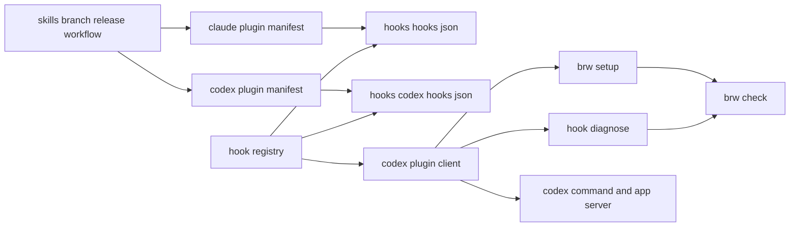
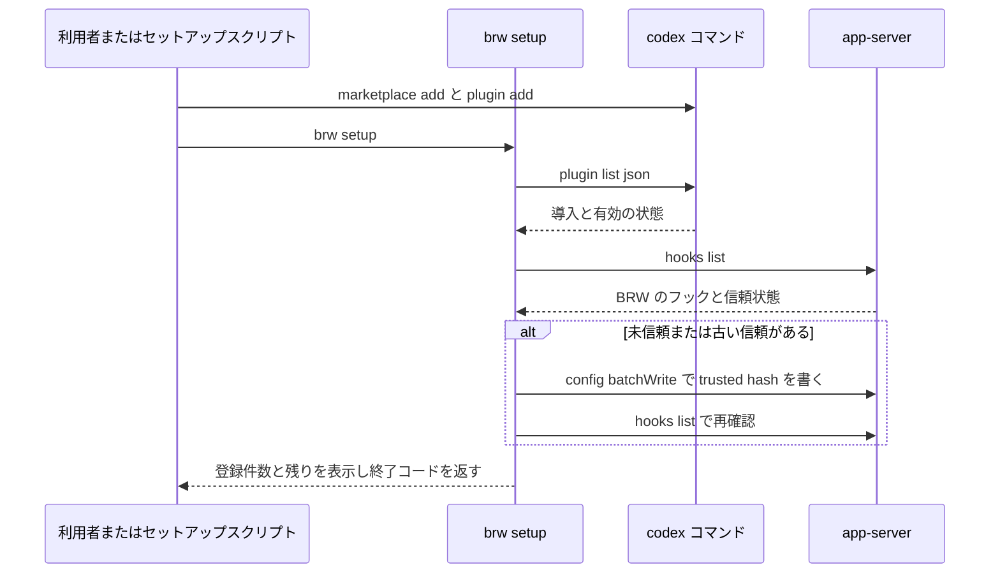
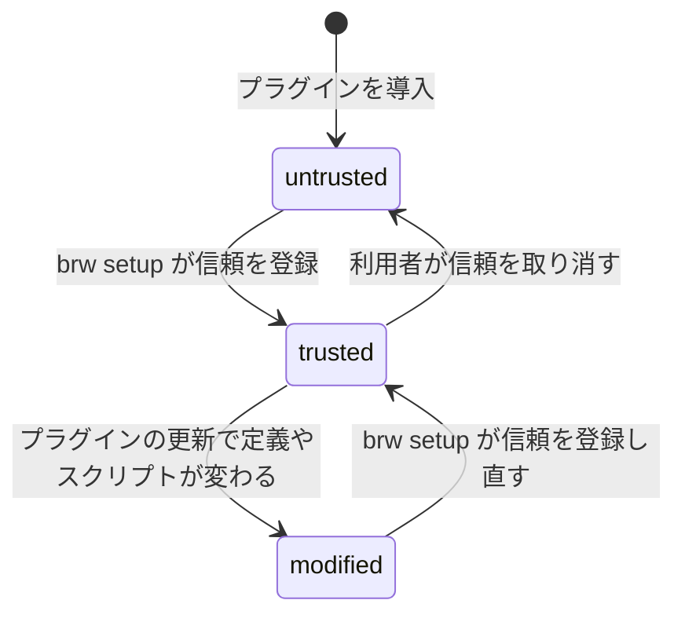

# 両ハーネスのプラグイン導入の統一: 技術設計

## Overview

BRW を Claude Code と Codex の両方で使う開発者とエージェントが、どちらでも「マーケットプレイスの追加 → プラグインの導入 → `brw setup` → `brw check`」の同じ手順で導入・更新できるようにする。同じリポジトリを両ハーネスのプラグインとして配り、フックの判定本体（`scripts/agent-hooks.mjs`）は変えない。

**目的**　作業を一方のハーネスから他方へ引き継いでも、同じスキル・同じ判定・同じフックの動作にする。Codex 専用の clone、絶対パスの登録、worktree ごとの有効化をなくす。
**利用者**　導入担当者、クラウド・CI のセットアップスクリプトの作成者、両ハーネスを行き来する開発者とエージェント。
**影響**　Codex の導入が「手動の clone ＋ `install-codex.mjs` ＋ `.codex/hooks.json` への登録」から「プラグインの導入 ＋ `brw setup` によるフックの信頼の登録」に変わる。`SKILL.md` の置き場所が変わる。

### Goals

- 両ハーネスで同じ導入・更新の手順と、同じ診断（`brw check`）の語彙を提供する（要件 1、5、6）。
- Codex のプラグインには Codex 用のフック定義だけを登録させ、両ハーネスのフック定義を 1 つの対応表から検証する（要件 3）。
- `brw setup` が BRW のフックの信頼を登録し、更新で外れた信頼を `brw check` が検出する（要件 4、5）。
- クラウド・CI・非対話の実行で、対話と同じコマンド列で強制を有効にする（要件 7）。
- 旧方式のコード・テスト・文書を削除する（要件 8）。

### Non-Goals

- 判定ロジック、確認省略の条件、GitHub Ruleset、プレビュー・配備の変更。
- 旧方式で導入済みの環境からの移行手段（旧登録の検出・削除を含む）。
- Codex の公開ディレクトリへの掲載、Codex Cloud のタスク上での動作の保証。
- Codex・Claude の製品側の承認・サンドボックスの仕様変更。

## Boundary Commitments

### This Spec Owns

- 配布物の構成: 両ハーネスのプラグインの定義、共有のマーケットプレイスの定義、ハーネスごとのフック定義、スキルの置き場所と参照の規則。
- 両ハーネスのフック登録の対応表（どのイベント・どの対象を、どのハーネスに登録するか）と、定義ファイルがその表に一致していることの検証。
- Codex のプラグインの導入状態の確認と、BRW のフックの信頼の登録・検査（`brw setup`・`brw check` の Codex 側の処理）。
- 導入手順・宣言の記入例・クラウドと CI の手順の文書、受け入れ確認の手順。
- 旧方式の削除。

### Out of Boundary

- フックが受け取った操作の許可・拒否と応答の形（`agent-hooks.mjs`、`operation-*.mjs`。brw-enforcement が持つ）。
- フックの診断のうち、合成入力でランチャーの応答を確かめる処理（`runProbes`）の中身と、Claude 側の診断。
- Stop イベントで何を検出するか（brw-enforcement の要件 2.12〜2.14）。本 spec は Stop を両ハーネスに届けることだけを扱う。
- Codex の信頼の仕組みそのもの、他のプラグインやプロジェクト単位の信頼（`[projects]`）の設定。

### Allowed Dependencies

- Node.js 22 以上の標準モジュールと Git（外部パッケージは使わない）。
- `codex` コマンド（`plugin list --json`・`plugin add --json`・`features list`・`app-server`）。Codex 0.167 以上を前提とする。
- 既存の `scripts/hook-diagnose.mjs` の `runProbes`、`scripts/publish.mjs`、`scripts/lib.mjs`。
- 依存の向き: `hook-registry.mjs`（他に依存しない）← `codex-plugin.mjs` ← `hook-diagnose.mjs`・`setup-cli.mjs` ← `brw.mjs`。`agent-hooks.mjs` は本 spec のモジュールに依存せず、本 spec のモジュールも `agent-hooks.mjs` を import しない（コマンドとして呼ぶだけ）。上向きの import は禁止する。

### Revalidation Triggers

- 両ハーネスのフック登録の対応表（イベント・matcher）が変わったとき。brw-enforcement の Stop など、イベントを足す spec は再確認する。
- Codex の app-server の `hooks/list`・`config/batchWrite`、プラグインのマニフェスト（`hooks`・`skills` の指定）、信頼の保存形式（`hooks.state`）が変わったとき。
- スキルの置き場所または `<skill>` からのスクリプト参照の規則が変わったとき。
- `brw setup`・`brw check` の終了コードと状態語彙が変わったとき（CI のセットアップスクリプトが使う）。

## Architecture

### Existing Architecture Analysis

- 配る側は `.claude-plugin/plugin.json`（`skills: ["./"]`）、`.claude-plugin/marketplace.json`（`source: "./"`）、`hooks/hooks.json`（Claude 用）。Codex は同じマーケットプレイス定義を読めるが、Codex 用のマニフェストが無いと `hooks/hooks.json`（引数 `claude`）を読み込んでしまう（実機確認）。
- 入れる側は `hook-install.mjs`（Codex の `.codex/hooks.json` への登録、worktree の有効化、Claude の登録検査）、`setup-cli.mjs` の `installHooks`、`hook-diagnose.mjs` の `codexRegistration`。いずれも旧方式を前提にする。
- 保つ既存の形: 診断の経路（`routes`）と状態語彙（`active`・`not-installed`・`untrusted`・`unverifiable`・`unsupported`・`conflict`）、`brw setup` の終了コード（0 問題なし、1 直す必要がある、3 確認不能）、`agent-hooks.mjs <host> <event>` の呼び出し形。

### Architecture Pattern & Boundary Map

配る側はデータ（マニフェストと定義ファイル）で表し、入れる側は Codex の公式のコマンドと app-server だけを使う。ハーネスごとの違いは「対応表の列」と「導入コマンド」に閉じ込める。



**Architecture Integration**:
- 採用する形: 「プラグインで配る ＋ 信頼は `brw setup` が登録する」。Codex の公式のプラグイン機構を使い、BRW 独自の登録先（`.codex/hooks.json`）を持たない。
- 責務の分離: 対応表（`hook-registry.mjs`）は何を登録するかだけを持つ。Codex との通信（`codex-plugin.mjs`）は状態の読み取りと信頼の書き込みだけを持つ。表示と終了コードは `setup-cli.mjs`、診断の語彙への変換は `hook-diagnose.mjs` が持つ。
- 保つ既存の形: ネイティブ ESM、標準モジュールのみ、テストは `run*Checks` 関数を `selftest.mjs` から呼ぶ。
- 新しい部品の理由: 対応表は 2 つの定数（`CODEX_HOOKS`・`CLAUDE_HOOKS`）の重複を 1 か所にし、定義ファイルとの整合を機械的に検査するために要る。Codex クライアントは、状態確認と信頼登録を `setup` と `check` で共有するために要る。

### Technology Stack

| レイヤー | 採用 | 役割 | 備考 |
|---|---|---|---|
| CLI・処理 | Node.js 22 以上（標準モジュールのみ） | 対応表、Codex クライアント、`brw setup`・`brw check` | `node:child_process` の `execFile`・`spawn`（シェルを介さない） |
| Codex 連携 | `codex plugin list --json`、`codex features list`、`codex app-server`（標準入出力の JSON-RPC） | 導入・有効の確認、フックの信頼状態の取得、信頼の登録 | app-server は Codex が実験的と表示する内部 API。失敗時は `/hooks` の手動承認へ切り替える |
| 配布物 | `.claude-plugin/plugin.json`、`.codex-plugin/plugin.json`、`.claude-plugin/marketplace.json`（共有）、`hooks/*.json` | 両ハーネスのプラグイン | Codex は `.claude-plugin/marketplace.json` を読める（実機確認） |
| 検証 | `tests/*.mjs`、`tests/real-env/`、`claude plugin validate`・`eval` | 契約テストと実機での受け入れ確認 | 実機確認は一時的な `CODEX_HOME` を使う |

## File Structure Plan

### Directory Structure

```
.claude-plugin/
├── plugin.json                  # 更新: skills の指定を ./skills/ に変更
└── marketplace.json             # 変更なし（両ハーネスが読む共有の定義）
.codex-plugin/
└── plugin.json                  # 新規: Codex 用マニフェスト（name・version・skills・hooks）
hooks/
├── hooks.json                   # Claude 用（対応表から生成。内容は変えない）
└── codex-hooks.json             # 新規: Codex 用（対応表から生成）
skills/
└── branch-release-workflow/
    └── SKILL.md                 # 移動: 直下の SKILL.md から。参照パスを ../../ に書き換える
scripts/
├── hook-registry.mjs            # 新規: 両ハーネスの登録の対応表、定義の生成と検査、Claude の登録検査
├── codex-plugin.mjs             # 新規: Codex のプラグインの状態確認と BRW のフックの信頼登録
├── hook-diagnose.mjs            # 更新: Codex の診断をプラグインと信頼の状態に置き換える
├── setup-cli.mjs                # 更新: フックの導入を「プラグイン確認＋信頼登録」に置き換える
└── brw.mjs                      # 更新: create・resume から worktree の有効化を削除
tests/
├── hook-registry.mjs            # 新規: 対応表と定義ファイルの整合、マニフェストの整合
├── codex-plugin.mjs             # 新規: クライアントの契約テスト（偽の codex を使う）
├── support/fake-codex.mjs       # 新規: 偽の codex（plugin list・features list・app-server を模す）
└── real-env/codex-plugin.mjs    # 新規: 一時的な CODEX_HOME での受け入れ確認（任意実行）
```

### Modified Files

- `scripts/hook-diagnose.mjs` — `codexRegistration`・`WORKTREE_NOT_REGISTERED`・旧ランチャーの検出を削除し、`codex`（導入状態）を引数に受けて経路を作る。`LIMITS` の Codex 項目を新方式に合わせる。
- `scripts/setup-cli.mjs` — `installHooks` を `setupHooks`（非同期）に置き換え、`--host` と対象の決め方を足す。`runSetup` の導入後の検査と `runStateCheck`（`brw check`）が、Codex の検査結果を `diagnose` へ渡す。`codexHome`・`featuresText` の受け渡しを削除する。
- `scripts/brw.mjs` — `installWorktreeHooks` の import と呼び出し（`create`・`resume`）、関連の出力を削除する。
- `tests/selftest.mjs`、`tests/hook-diagnose.mjs`、`tests/setup-cli.mjs`、`tests/branch-ops.mjs`、`tests/real-env/host-events.mjs`、`tests/real-env/hosts.mjs` — 旧方式の検証を削除し、新方式の検証に置き換える。`selftest.mjs` の `install-codex` のリンク検証（109 行付近）は削除する。
- `README.md`、`references/setup.md`、`SKILL.md`（移動後）— Codex の導入を新手順に書き換え、旧方式の記述（clone、`install-codex.mjs`、worktree の `.codex/`）を取り除く。
- `.kiro/steering/{product,tech,structure}.md` — 実装後に steering を同期する（Codex の登録の説明と構成）。

### Deleted Files

- `scripts/install-codex.mjs`、`scripts/hook-install.mjs`、`tests/hook-install.mjs`

## System Flows

### Codex の導入と信頼の登録



導入のコマンド（`marketplace add`・`plugin add`）は `brw setup` が実行しない。利用者またはセットアップスクリプトが実行し、`brw setup` は結果を確認する。未導入なら必要なコマンドを表示して終了コード 1 で終わる。

### フックの信頼状態



`untrusted` と `modified` の間は、フックが読み込まれず強制が止まる。フック自身は検出できないため、`brw check` が `modified` を「更新後に登録し直していない信頼」として報告する。

## Requirements Traceability

| 要件 | 概要 | コンポーネント | 契約・フロー |
|---|---|---|---|
| 1.1, 1.2 | 同じ手順で導入・更新 | 配布物、導入手順の文書 | 導入コマンド表（Codex の導入と信頼の登録フロー） |
| 1.3 | 1 つの配布元 | 共有のマーケットプレイス定義、両マニフェスト | 配布物の構成 |
| 1.4 | 違いは対象の指定だけ | 導入手順の文書 | 導入コマンド表 |
| 1.5, 8.1 | 手動 clone・絶対パス登録を求めない | 配布物、`hook-registry.mjs`、削除対象 | `${PLUGIN_ROOT}` を使う定義 |
| 2.1 | 同じスキル | `skills/branch-release-workflow/SKILL.md`、両マニフェスト | スキルの参照規則 |
| 2.2 | 同じ判定 | 既存の `agent-hooks.mjs`（変更なし）、両フック定義 | 対応表 |
| 2.3, 2.4 | worktree の追加操作が不要 | `brw.mjs` の変更、削除対象 | フック定義がプラグインに属する |
| 3.1, 3.2 | 各ハーネスに自分の定義だけ | `.codex-plugin/plugin.json`、`hooks/codex-hooks.json`、`hooks/hooks.json` | マニフェストの `hooks` 指定 |
| 3.3, 3.4 | 対応表の 1 か所化と整合検査 | `hook-registry.mjs`、`tests/hook-registry.mjs` | `HookRegistry`、`verifyDefinitions` |
| 3.5 | シンボリックリンクを含めない | `tests/hook-registry.mjs` | 配布物の走査 |
| 4.1, 4.2, 4.5 | プラグイン確認と信頼の登録 | `codex-plugin.mjs`、`setup-cli.mjs` | `inspectCodexPlugin`、`registerHookTrust`、導入フロー |
| 4.3, 4.8 | BRW のフックだけを書く | `codex-plugin.mjs` | `registerHookTrust` の事後条件 |
| 4.4, 4.7 | 件数の表示と部分失敗 | `codex-plugin.mjs`、`setup-cli.mjs` | `TrustRegistration` |
| 4.6 | 登録できない理由と手動承認 | `codex-plugin.mjs`、`setup-cli.mjs` | `CodexInspection` の理由コード |
| 5.1, 5.2, 5.3 | ハーネスごとの診断と理由の区別 | `hook-diagnose.mjs`、`codex-plugin.mjs` | 診断の語彙の対応表 |
| 5.4 | 取得できないとき有効と推定しない | `hook-diagnose.mjs` | `unverifiable` |
| 5.5 | 旧方式を診断しない | `hook-diagnose.mjs` の削除部分 | なし |
| 6.1〜6.4 | 導入先リポジトリの宣言 | 導入手順の文書、`setup-cli.mjs` の案内 | 宣言の記入例、導入コマンドの表示 |
| 7.1, 7.4 | 非対話で同じコマンド列 | 導入手順の文書 | クラウド・CI の手順 |
| 7.2 | 非対話の拒否 | 既存の判定、`codex-plugin.mjs` の信頼登録 | 受け入れ確認 |
| 7.3 | 登録失敗を終了コードで示す | `setup-cli.mjs` | 終了コードの規則 |
| 8.2, 8.3 | 旧方式の記述と移行手段の削除 | 文書、テスト、削除対象 | なし |
| 8.4 | Claude の既存導入を壊さない | `.claude-plugin/plugin.json`、`hooks/hooks.json` | Claude の検証 |
| 9.1〜9.5 | 受け入れ確認 | `tests/real-env/codex-plugin.mjs`、`claude plugin validate`・`eval` | 受け入れ手順 |

## Components and Interfaces

> 契約のシグネチャは記述用の TypeScript 風の表記で書く。実装は JavaScript（ネイティブ ESM）で、型は JSDoc の `@typedef` と `@param` で表す。

| コンポーネント | 層 | 役割 | 要件 | 主な依存 | 契約 |
|---|---|---|---|---|---|
| 配布物（マニフェストと定義） | データ | 両ハーネスへ同じ内容を配る | 1.3, 3.1, 3.2, 8.4 | 対応表 | State |
| スキルの置き場所 | データ | 両ハーネスが同じスキルを読む | 2.1 | 両マニフェスト | State |
| hook-registry | 部品 | 登録の対応表、定義の生成と検査 | 1.5, 3.3, 3.4 | なし | Service |
| codex-plugin | 部品 | Codex の状態確認と信頼登録 | 4.1〜4.8, 5.2〜5.4 | hook-registry（P0）、codex コマンド（P0）、app-server（P1） | Service |
| hook-diagnose（更新） | 診断 | Codex の状態を診断の語彙に変換 | 5.1〜5.5 | codex-plugin（P0）、runProbes（P0） | Service |
| setup-cli（更新） | CLI | 確認・登録・表示・終了コード | 4.1〜4.8, 6.3, 7.3 | codex-plugin（P0）、hook-diagnose（P1） | Service |
| 導入手順の文書 | 文書 | 共通の手順・宣言例・クラウドと CI | 1.1〜1.4, 6.1〜6.4, 7.1, 7.4 | なし | なし |
| 受け入れ確認 | 検証 | 一時環境での通しの確認 | 9.1〜9.5 | codex、claude | なし |

### 配布物

#### 配布物（マニフェストと定義）

| 項目 | 内容 |
|---|---|
| 役割 | 1 つのリポジトリ・1 つの版を両ハーネスのプラグインとして配る |
| 要件 | 1.3, 3.1, 3.2, 8.4 |

**責務と制約**
- `.claude-plugin/plugin.json`: `skills` を `./skills/` に変える。`hooks/hooks.json` は既定の位置のまま Claude が読む。
- `.codex-plugin/plugin.json`: `name`・`version`・`description` を `.claude-plugin/plugin.json` と同じ値にし、`skills: "./skills/"`、`hooks: "./hooks/codex-hooks.json"` を持つ。`hooks` の明示により、Codex は `hooks/hooks.json` を読まない（実機確認）。
- `.claude-plugin/marketplace.json` は変えない。Codex は同じファイルからプラグインを導入できる（実機確認。マーケットプレイス名 `nekono-dev`）。
- `hooks/hooks.json` と `hooks/codex-hooks.json` は `hook-registry.mjs` の対応表から生成した内容と一致する。コマンドは、Claude が `node "${CLAUDE_PLUGIN_ROOT}/scripts/agent-hooks.mjs" claude <イベント>`、Codex が `node "${PLUGIN_ROOT}/scripts/agent-hooks.mjs" codex <イベント>`（どちらもシェルが環境変数を展開する。Codex では実機確認）。
- 配布物にシンボリックリンクを置かない（Codex のキャッシュはリンクを写さない。実機確認）。

**契約**: State

#### スキルの置き場所

- `SKILL.md` を `skills/branch-release-workflow/SKILL.md` へ `git mv` する。ディレクトリ名と frontmatter の `name` を同じ `branch-release-workflow` にし、スキル名を変えない。
- 参照の規則（Codex で、キャッシュ上の SKILL.md からの `../../scripts/brw.mjs` の解決と実行を実機確認済み）: エージェントの Bash にはプラグインのルートを指す環境変数が無い（実機確認。設定されるのはフックの実行時だけ）ため、SKILL.md からの相対パスで参照する。`<skill>` は SKILL.md があるディレクトリとし、スクリプトは `node <skill>/../../scripts/brw.mjs`、文書は `../../references/…`、`../../assets/…` と書く。プラグインのキャッシュはディレクトリ構成をそのまま保つため、両ハーネスで同じ相対パスが成り立つ。
- `references/`・`assets/`・`scripts/` は移動しない（README・自己テスト・他の文書が参照するため）。

### 部品

#### hook-registry

| 項目 | 内容 |
|---|---|
| 役割 | 両ハーネスの登録の対応表と、定義ファイルの生成・検査 |
| 要件 | 1.5, 3.3, 3.4 |

**責務と制約**
- 登録するイベントと matcher の表（現行の `CODEX_HOOKS`・`CLAUDE_HOOKS` を統合したもの）を 1 か所に持つ。Claude は PreToolUse（Bash・`mcp__.*`）・PostToolUse（Bash）・Stop。Codex はこれに PermissionRequest（Bash・`mcp__.*`）を加える。
- 他のモジュールに依存しない（最下位）。

**契約**: Service

```js
/** @typedef {"claude"|"codex"} Host */
/** @typedef {{event: string, matcher: string|null}} HookEntry */

/** @type {Readonly<Record<Host, ReadonlyArray<HookEntry>>>} */
export const HOOK_REGISTRY;

/** ホストのフック定義（hooks.json の中身）を対応表から作る。 */
export function definitionOf(host: Host): { hooks: Record<string, unknown[]> };

/** 配布物の定義ファイルとマニフェストを対応表と照合する。差異を理由付きで返す。 */
export function verifyDefinitions(pluginRoot: string): { ok: boolean, problems: Array<{ file: string, reason: string }> };

/** Claude のプラグインの登録を検査する（現行の checkClaudeHooks を移す。結果の形は変えない）。 */
export function checkClaudeHooks(pluginRoot: string): ClaudeHooksCheck;

/** 定義ファイルを対応表から書き出す（開発用: node scripts/hook-registry.mjs write）。 */
export function writeDefinitions(pluginRoot: string): void;
```

- 事前条件: `pluginRoot` はプラグインのルート。事後条件: `definitionOf` の結果は、決定的な順序・書式で `hooks/*.json` と一致する。
- `verifyDefinitions` が検査する項目: 両定義ファイルの一致、`.claude-plugin/plugin.json` と `.codex-plugin/plugin.json` の `name`・`version` の一致、`.codex-plugin/plugin.json` の `hooks` の指す先、配布物にシンボリックリンクが無いこと。

#### codex-plugin

| 項目 | 内容 |
|---|---|
| 役割 | Codex の導入・有効・フック信頼の状態の読み取りと、BRW のフックの信頼の登録 |
| 要件 | 4.1〜4.8, 5.2〜5.4 |

**責務と制約**
- 読み取りは `codex plugin list --json`（導入・有効・版）、`codex features list`（フック機能の有無）、app-server の `hooks/list`（フックごとの信頼状態）で行う。書き込みは app-server の `config/batchWrite` だけで、BRW のフックの `hooks.state.<キー>.trusted_hash` に限る。
- BRW のフックの特定: `source` が `plugin`、`pluginId` が `branch-release-workflow@` で始まり、`sourcePath` が `hooks/codex-hooks.json` で終わる項目。マーケットプレイス名には依存しない。
- 期待するフックの件数を対応表から求め、実際の件数と食い違うとき（キャッシュが古い等）は `definitionMatches: false` を返し、信頼を登録しない。
- 同時に動く Codex や他のプラグインの設定を変えない。書くキーは BRW のフックの信頼だけで、書く前後の `hooks/list` の他の項目が変わらないことを確かめる。
- app-server は 1 回の呼び出しごとに起動して終了する（常駐しない）。各リクエストに 10 秒の上限を置き、超えたらプロセスを終了して `app-server-unavailable` とする。

**依存**
- Inbound: `setup-cli`（P0）、`hook-diagnose`（P0）。
- Outbound: `hook-registry`（期待する件数・イベント。P0）。
- External: `codex` コマンド（P0）、app-server（P1。使えないときは手動承認へ切り替える）。

**契約**: Service

```js
/** @typedef {"trusted"|"untrusted"|"modified"|"managed"} TrustStatus */
/** @typedef {{key: string, event: string, trustStatus: TrustStatus, currentHash: string, enabled: boolean, sourcePath: string}} CodexHookState */

/** @typedef {
 *   | {status: "unavailable", reasonCode: "codex-not-found"|"codex-too-old"|"command-failed"|"app-server-unavailable", reason: string}
 *   | {status: "unsupported", reasonCode: "hooks-disabled", reason: string}
 *   | {status: "not-installed"}
 *   | {status: "disabled", pluginId: string, version: string}
 *   | {status: "installed", pluginId: string, version: string, pluginRoot: string|null,
 *      hooks: CodexHookState[], definitionMatches: boolean}
 * } CodexInspection */

/** @typedef {{
 *   status: "registered"|"already-trusted"|"partial"|"failed",
 *   registered: number, alreadyTrusted: number, remaining: number,
 *   reasonCode?: "definition-mismatch"|"app-server-unavailable"|"write-failed"|"not-effective", reason?: string
 * }} TrustRegistration */

/** @typedef {{run?: ExecFn, spawnServer?: SpawnFn, env?: NodeJS.ProcessEnv, cwd?: string, timeoutMs?: number}} CodexDeps */

export function inspectCodexPlugin(deps?: CodexDeps): Promise<CodexInspection>;
export function registerHookTrust(inspection: Extract<CodexInspection, {status: "installed"}>, deps?: CodexDeps): Promise<TrustRegistration>;
```

- 事前条件: `registerHookTrust` は `status: "installed"` かつ `definitionMatches: true` の検査結果だけを受ける。
- 事後条件: `untrusted`・`modified` の BRW のフックだけを書き換え、書いた後に `hooks/list` を再取得して `trusted` になったことを確かめる。`trusted` に変わらないものがあれば `not-effective`（管理者の設定でプラグインのフックが無視される場合を含む）として `remaining` に数え、`/hooks` での手動承認を案内できるようにする。
- 不変条件: BRW 以外のフック、`[projects]`、`[plugins]` の設定、認証情報には触れない。同じ状態からの再実行は変更なし（`already-trusted`）で終わる。
- 部分失敗: 途中で失敗したときは、書き込めた件数と残りを返し、再実行は残りだけを書く（書き込みは 1 件ごとの `upsert`）。

#### hook-diagnose（更新）

- `diagnoseHooks` は引数の `codexRepoDir`・`featuresText`・`codexTrust` を廃し、解決済みの `codex: CodexInspection` を受ける（非同期の取得は呼び出し側で済ませる。関数は同期のまま）。
- Codex の経路の状態への変換:

| 検査結果 | 経路の状態 | reasonCode |
|---|---|---|
| `not-installed` | `not-installed` | `plugin-not-installed` |
| `disabled` | `not-installed` | `plugin-disabled` |
| `unsupported` | `unsupported` | `hooks-disabled` |
| `unavailable` | `unverifiable` | 検査結果の `reasonCode` |
| `installed`、定義が不一致 | `conflict` | `definition-mismatch`（キャッシュが古い） |
| `installed`、そのイベントのフックが `untrusted` | `untrusted` | `hook-untrusted` |
| `installed`、そのイベントのフックが `modified` | `untrusted` | `trust-outdated`（更新後に登録し直していない） |
| `installed`、そのイベントのフックが無い | `not-installed` | `missing-registration` |
| `installed`、すべて `trusted`／`managed` | 応答の確認（`runProbes`）へ進む | — |

- ランチャーの場所は、フックの `sourcePath` から導いたプラグインのルート（`pluginRoot`）の `scripts/agent-hooks.mjs` とする。応答の確認（`runProbes`）は変えない。
- 旧方式の検出（`unknown-common-dir`・`duplicate-worktree`・`stale-launcher`・`symlink`・`worktree-not-registered` など）を削除する。`LIMITS` から `codex-format-unverified`・`codex-hooks-disabled-partial`・`codex-trust-by-caller` を外し、次の 3 件を足す: Codex の信頼の登録・確認は内部 API に依存し、版が上がると使えなくなることがある（その場合は `/hooks` で確認する）。プラグインを更新したら `brw setup` を実行し直す。非対話の Codex（`codex exec`）は、`.git` への書き込み許可（`--add-dir`）が無いと commit・push が失敗する。

#### setup-cli（更新）

- `installHooks`（同期）を `setupHooks`（非同期）に置き換える。`brw setup [--host claude|codex]` を足す。
- **対象のハーネスの決め方**: `--host` を指定したときはそのハーネスだけを対象にし、確認できなければ失敗にする。省略したときは、導入先リポジトリが宣言しているハーネスを対象にする（Claude: `.claude/settings.json` の `enabledPlugins` に BRW がある。Codex: `.codex/config.toml` の `[plugins."branch-release-workflow@…"]` がある）。どちらの宣言も無いときは、利用できるハーネス（Claude は常に、Codex は `codex` コマンドが見つかるとき）を対象にし、Codex が対象外（宣言なしで `codex` が見つからない・プラグイン未導入）のときは 1 行の注意を表示して失敗にしない。これにより、Claude だけを使うリポジトリが、手元に `codex` があるだけで失敗しない。
- **呼び出し元（診断の入口）**: Codex の検査結果（`inspectCodexPlugin`）を `diagnose` へ渡す箇所は 2 つある。`runSetup` の導入後の検査と、`brw check` の追加節（`runStateCheck`。すでに非同期）。どちらも対象のハーネスの決め方を共有する。`runStateCheck` は従来どおり経路ごとの状態と限界を表示するだけで、終了コードには含めない（導入の誤りは `brw setup` の終了コードで扱う）。
- 手順: ① Claude の登録を `checkClaudeHooks` で検査する（従来どおり）。② Codex を対象に含めるとき、`inspectCodexPlugin` を呼ぶ。③ 結果に応じて分岐する。

| 検査結果 | 動作 | 終了コード |
|---|---|---|
| `installed` ＋ 一致 | `registerHookTrust` を呼び、`Codex hooks: registered（N 件）`・`already-trusted` を表示 | 0（`remaining` が 0 のとき）、1（`partial`・`failed`・`not-effective`。`/hooks` での手動承認を案内） |
| `installed` ＋ 不一致 | 古いキャッシュとして、`codex plugin add` の再実行を案内 | 1 |
| `not-installed`／`disabled` | 導入に必要な 2 つのコマンド（`marketplace add`・`plugin add`）を表示し、導入先リポジトリの `.codex/config.toml` の記入例へ誘導 | 1 |
| `unsupported`（フック無効） | 理由と、設定の見直しの案内 | 1 |
| `unavailable` ＋ `codex-not-found` | Codex が対象（`--host codex`、または `.codex/config.toml` の宣言がある）なら、見つからないことを表示して失敗にする。対象でなければ 1 行の注意だけ | 3（対象のとき）、0（対象でないとき） |
| `unavailable` ＋ その他 | 確認できなかった理由と、`/hooks` での確認方法 | 3 |

- 非対話の実行でも同じ分岐で、失敗は必ず非 0 の終了コードで示す（要件 7.3）。信頼の確認を飛ばすオプション（`--dangerously-bypass-hook-trust`）は使わず、案内にも出さない。
- 表示の文言は、導入が済んでいない理由（未導入・無効・未信頼・古い信頼・未対応）を区別する。

### 導入手順の文書

- `references/setup.md` に、両ハーネスで共通の手順表を置く。ハーネスごとの違いはコマンドの行だけにする。

| 手順 | Claude Code | Codex |
|---|---|---|
| マーケットプレイスの追加 | `claude plugin marketplace add nekono-dev/branch-release-workflow` | `codex plugin marketplace add nekono-dev/branch-release-workflow` |
| プラグインの導入 | `claude plugin install branch-release-workflow@nekono-dev` | `codex plugin add branch-release-workflow@nekono-dev` |
| フックの確認と信頼の登録 | `brw setup --host claude` | `brw setup --host codex` |
| 状態の確認 | `brw check` | `brw check` |
| 更新 | プラグインの更新 ＋ `brw setup` | `codex plugin marketplace upgrade` ＋ `codex plugin add` ＋ `brw setup` |

- 導入先リポジトリの宣言（要件 6）: Claude は `.claude/settings.json` の `extraKnownMarketplaces`・`enabledPlugins`（従来どおり）。Codex は `.codex/config.toml` の `[marketplaces.<名前>]` と `[plugins."branch-release-workflow@<名前>"] enabled = true`。宣言だけではプラグインは導入されない（実機確認）ため、導入コマンドの実行が別に要ると明記する。記入例（Codex 0.167 で `codex plugin marketplace add nekono-dev/branch-release-workflow` が書き出す形式を実機で確認済み）:

```toml
[marketplaces.nekono-dev]
source_type = "git"
source = "https://github.com/nekono-dev/branch-release-workflow.git"

[plugins."branch-release-workflow@nekono-dev"]
enabled = true
```

  `marketplace add` が受け付ける指定は `owner/repo`、Git の URL、ローカルのパスで、`file://` の URL は拒否される。
- クラウド・CI: セットアップスクリプトに、表の「追加・導入」の 2 行と `brw setup --host <ハーネス>` を並べる。`brw` の場所は、`codex plugin add --json` の `installedPath`（Claude は `${CLAUDE_PLUGIN_ROOT}` を使えるフックの外では、導入先のキャッシュのパス）から求める。スクリプトは `brw setup` の終了コードで成否を判定する。
- 非対話の Codex（`codex exec`）で commit・push を行う場合は、承認方針が常に `never` でサンドボックスの `.git` が読み取り専用のため、実行側の書き込み許可が要る（実機確認）。`--add-dir <リポジトリ>/.git` を付け、linked worktree ではさらに `--add-dir <共通の .git>/worktrees/<名>` を付ける。この指定で commit と push（ローカルの bare リモート）が成功した。外部のサンドボックスで隔離された環境では、`--dangerously-bypass-approvals-and-sandbox` を使う運用もありうるが、本手順の既定にはしない。
- 旧方式で導入済みの利用者向けに、「旧方式の登録が残っていれば手で削除する」の 1 行だけを記す。移行手段は設けない。

### 受け入れ確認

- `tests/real-env/codex-plugin.mjs`（任意実行。`BRW_REAL_ENV_CODEX=1` と認証ファイルの場所の環境変数が両方あるときだけ動く）。一時ディレクトリ（`mkdtemp`、権限 0700）に `CODEX_HOME` を作り、認証ファイルを複製して使い、終了時に必ず削除する。利用者の `~/.codex` には触れない。
- 実機で確認済みの前提: ローカルのマーケットプレイスとして導入したプロトタイプ（設計どおりの配置）で、導入、信頼の登録、フックの発火（PreToolUse・PostToolUse・Stop）、スキルの相対参照、`--add-dir` を付けた commit・push までを Codex 0.167 で確かめた。受け入れ確認はこれを `brw` 本体と `brw setup` で再現する。
- 手順: マーケットプレイスの追加（このリポジトリのチェックアウトを指定）→ プラグインの導入 → `brw setup --host codex` → `brw check` → 指揮役（既定 `gpt-6.2-sol`・思考の深さ medium。環境変数で変更可）の `codex exec` が、導入先の一時リポジトリの保護ブランチで `git commit` を試みる（BRW が実行前に拒否し、HEAD が変わらないことを確かめる）→ 作業ブランチの linked worktree（`.codex/` なし）で同じ操作の判定を確かめる（commit まで進める場面では `--add-dir` を付ける） → 非対話（`codex exec`）で信頼登録なしの場合に強制が働かないこと、登録後に働くことを確かめる。
- Claude 側は既存の `claude plugin validate .` と `claude plugin eval .` を通す。両ハーネスの結果は同じ操作に対する判定（拒否の理由の種別）を表にして記録する。想定と異なる結果は成功として記録しない。

## Data Models

- **フック登録の対応表**: `Record<Host, HookEntry[]>`。定義ファイルは、この表から決定的な順序・書式（2 スペースのインデント、末尾に改行）で作る。
- **信頼の保存形式（Codex 側。BRW は書き方だけを知る）**: ユーザーの `config.toml` の `[hooks.state."<pluginId>:<定義ファイルの相対パス>:<イベント>:<番号>:<番号>"]` に `trusted_hash`（フック定義のハッシュ）が入る。Codex は `trusted_content_hash`（プラグインの中身全体のハッシュ）を自分で補う。同じ版のまま中身が変わると、`plugin add` の再実行でキャッシュが更新され、状態は `modified` になる（実機確認）。BRW は `hooks/list` の `currentHash` をそのまま書き、ハッシュを自分では計算しない。
- **外部 JSON の検証**: `codex plugin list --json` と app-server の応答は境界で形を検証してから型（JSDoc）に変換する。想定外の形は `command-failed`・`app-server-unavailable` として扱い、推測で続けない。

## Error Handling

- **フェイルセーフ**: Codex の状態を取得できないときは、有効とも無効とも推定せず `unverifiable`（終了コード 3）を返す。信頼の登録が確認できない（`hooks/list` の再取得で `trusted` に変わらない）ときは成功と報告しない。
- **手動承認への切り替え**: app-server が使えない・書き込みが効かないときは、`/hooks` で BRW のフックを確認して信頼する手順と、対象のフックの件数を示す。
- **部分失敗**: 登録済み・未登録の件数を示し、再実行で残りだけを書けるようにする（4.7）。
- **メッセージ**: 原因（未導入・無効・未信頼・古い信頼・未対応・確認不能）と、次の 1 コマンドを示す。認証情報や設定ファイルの内容は出力しない。
- **時間**: `codex` の各呼び出しに上限（既定 10 秒、`plugin list` は 20 秒）を置く。超過はプロセスを終了して `command-failed`／`app-server-unavailable` とする。

## Testing Strategy

- **対応表と配布物（要件 3、1.3、8.4）**: `tests/hook-registry.mjs` で、`hooks/hooks.json`・`hooks/codex-hooks.json` が `definitionOf` の結果と一致すること（3.3）、一方の定義を壊すと差異が報告されること（3.4）、両マニフェストの `name`・`version` の一致、Codex 用マニフェストの `hooks` の指す先、配布物にシンボリックリンクが無いこと（3.5）、Claude のコマンドが `claude`・Codex のコマンドが `codex` を引数に持つこと（3.1、3.2）を検査する。
- **Codex クライアント（要件 4、5）**: `tests/codex-plugin.mjs` と偽の `codex`（`tests/support/fake-codex.mjs`）で、未導入・無効・導入済み、フックの `untrusted`・`modified`・`trusted`・`managed`、フック機能の無効、`codex` が無い・古い・応答しない、定義の件数の不一致を再現する。信頼登録が BRW のフックのキーだけを書くこと（4.3、4.8）、再実行で変更なしになること（4.5）、途中失敗で残りだけを書くこと（4.7）、書いても `trusted` に変わらないときに成功と報告しないこと（4.6）を確かめる。
- **診断と `brw setup`（要件 5、4.1〜4.7、7.3）**: `tests/hook-diagnose.mjs`・`tests/setup-cli.mjs` で、上の状態語彙の対応表と終了コードの分岐を、偽の検査結果で確かめる。宣言が Claude だけのリポジトリで `codex` が無くても失敗にならないこと、`--host codex` または `.codex/config.toml` の宣言がある場合は `codex` が無いと失敗になること、`runStateCheck` が終了コードを変えずに表示することを含む。旧方式の検出が出力に現れないこと（5.5）。
- **旧方式の削除（要件 2.3、2.4、8）**: `tests/branch-ops.mjs` で、`brw create`・`brw resume` が worktree に `.codex/` や `info/exclude` の追記を作らないこと（2.4）を確かめる。削除対象のファイルが無いこと、文書に旧方式の記述が残っていないこと（8.2）を検査する。
- **実機の受け入れ（要件 7、9）**: `tests/real-env/codex-plugin.mjs` を、`gpt-6.2-sol`（思考の深さ medium）の `codex exec` で実行する（9.2）。導入から保護ブランチの拒否、linked worktree での動作、非対話での信頼登録の有無による差までを通しで確かめる（7.2、2.3）。`claude plugin validate`・`eval` を通す（9.3、8.4）。

## Security Considerations

- 信頼の登録は、BRW のフック定義のハッシュを書くことで、BRW が配布したコードの実行を許可する。書くのは `brw setup` を明示的に実行したときだけで、フックやスキルが暗黙に実行しない。許可の範囲は BRW のフックに限り、他のプラグイン・コマンドの承認・サンドボックスには影響しない。
- 受け入れ確認は認証ファイルを一時ディレクトリへ複製するため、権限 0700 の専用ディレクトリに置き、成功・失敗にかかわらず終了時に削除する。ファイルの内容は出力しない。
- `codex` と app-server の呼び出しはシェルを介さず、引数を配列で渡す。応答は境界で検証する。

## Migration Strategy

旧方式で導入済みの環境からの移行手段は設けない（要件 8-3）。旧方式の登録（導入先の `.codex/hooks.json` の BRW の定義）が残る環境では、同じフックが 2 回実行されうる。どちらも同じ判定をするため結果は変わらないが、診断は検出しない（要件 5-5）。文書に「残っていれば削除する」と 1 行記す。Claude の既存導入は、プラグインの更新だけで新しい配置（`skills/`）に移る。

## Open Questions / Risks

- **app-server への依存（リスク: 中）**: 信頼の登録は実験的な内部 API を使う。版が上がって使えなくなったときは `/hooks` の手動承認に切り替わり、クラウド・CI では `brw setup` が失敗する。対策は、フォールバックの案内、`codex-plugin.mjs` に依存を閉じ込めること、受け入れ確認で版ごとに再確認すること。
- **更新による強制の停止（リスク: 中）**: 更新で信頼が外れると、フックは黙って読み込まれない。対策は、手順で更新のたびに `brw setup` を実行すること、`brw check` が `trust-outdated` を報告すること。
- **非対話の Codex の書き込み許可（リスク: 低）**: `codex exec` は `.git` が読み取り専用のため、commit・push には `--add-dir` が要る。手順と診断の `limits` に明記する。BRW のフックでは解決できない（承認方針が `never` のため `PermissionRequest` が発生しない）。
- **Claude の `skills` 指定の変更（`validate` は確認済み）**: `skills: ["./skills/"]` で `claude plugin validate .` は通る（警告のみで旧指定と同じ）。スキル名とスラッシュコマンドが変わらないことは、実装時に `claude plugin eval .` で確かめる（8.4）。
- **管理者設定（`allow_managed_hooks_only` など）**: 検出の専用経路は持たない。信頼を書いても `trusted` に変わらなければ `not-effective` として手動承認の案内に切り替える。
