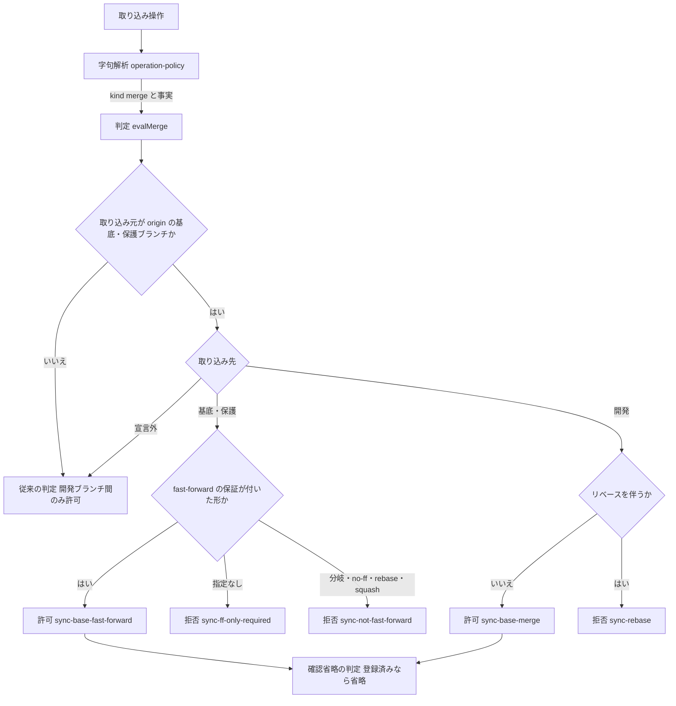
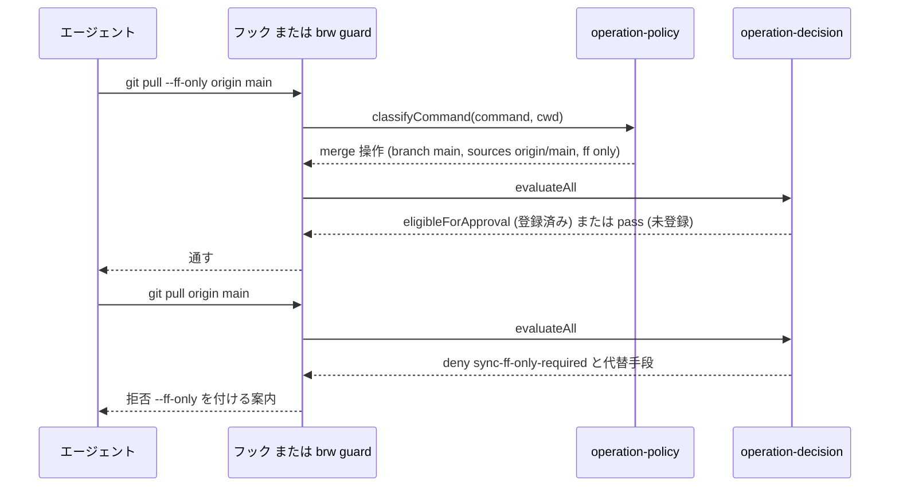

# 設計書: sync-base-branch

## 概要

**目的**: クラウドセッションや他のプロバイダの作業でリモートだけが進んだとき、エージェントが手元の基底・保護ブランチと作業ブランチを、リモートの最新へ追いつかせられるようにする。
**対象**: BRW 導入済みのリポジトリで Claude Code・Codex を使う開発者。
**影響**: 現状は、取り込み先が開発ブランチでなければ、取り込み元が開発ブランチでなければ、`git pull`・`git merge` は一律に拒否され、`git fetch origin main:main` は確定不能で止まる。本設計は、判定を次の 2 形に限って許可に変える。それ以外は従来どおり拒否する。

| 形 | 取り込み先 | 取り込み元 | 追加の条件 |
|----|------------|------------|------------|
| A: 基底の更新 | 基底・保護ブランチ | `origin` の同名の追跡ブランチ | fast-forward の保証が付いた形に限る |
| B: 作業ブランチへの基底の取り込み | 開発ブランチ | `origin` の追跡ブランチのうち基底・保護ブランチ | リベースを伴わない |

### 目標
- 形 A・B を、Claude Code のフック・Codex のフック・`brw guard` で同じ判定にする（要件 1・2・5）。
- 許可しない取り込みは、理由・対象・代替手段つきで拒否する（要件 3）。
- 宣言が登録済みなら確認を省略し、未登録・編集中なら通常の承認に任せる（要件 4）。

### 非目標
- `rebase` による取り込み、専用コマンド（`brw sync`）、直接 commit・push の拒否の変更、GitHub 側の設定、プラグイン導入状態の検査。
- 判定中の取得（`git fetch` の実行）。判定は読み取りだけで行う。

## 境界の約束

### 本仕様が担うこと
- 取り込み操作（`git pull`・`git merge`・`git fetch <リモート> <ブランチ>:<ブランチ>`）の許可条件。
- 許可条件の判定に必要な、取り込み操作の事実（fast-forward の指定・リベースの有無・分岐の有無・更新先）の取り出し。
- 許可しない取り込みの拒否の理由と代替手段の文面。
- 判定の限界の周知（診断の一覧と `SKILL.md`・`references/`）。

### 範囲外
- フック・`brw guard` の入出力の形、拒否・許可の応答の形（既存のまま）。
- 開発ブランチ間のマージ（`brw merge`）、GitHub 上のマージ・自動マージ予約の拒否、PR 作成の判定。
- 宣言ファイルの項目の追加（`origin` の名前は固定）。

### 許可する依存
- `scripts/lib.mjs` の `classifyBranch`・`loadConfig`・`git`（読み取りの実行）。
- `scripts/operation-policy.mjs`（事実の取り出し）→ `scripts/operation-decision.mjs`（判定）の既存の依存の向き。
- git の `merge-base --is-ancestor`・`config --get`・`show-ref`・`rev-parse`（読み取りのみ）。

### 再検証の契機
- 取り込みの操作オブジェクト（`kind: "merge"`）の項目の形（`ff`・`rebase`・`fastForwardable`・`sources[].remote`・`via`・`mode`）の変更。呼び出し側は `agent-hooks.mjs`・`brw.mjs`（guard）・`hook-diagnose.mjs`。
- 判定の識別子（`code`）の追加・変更。
- brw-enforcement 要件 3 の許可条件の変更（本仕様は要件 3-2 の例外を足す）。

## アーキテクチャ

### 既存のアーキテクチャの分析
- `classifyCommand`（`operation-policy.mjs`）がシェルの文字列から操作を取り出し、`evaluate`（`operation-decision.mjs`）が操作 1 件を判定する。Claude Code のフック・Codex のフック・`brw guard` は、いずれも `evaluateAll` を呼ぶ。判定を直せば 3 経路に同時に効く。
- `git pull`・`git merge` は `kind: "merge"` で表し、`evalMerge` が取り込み先と取り込み元をそれぞれ開発ブランチか調べる。`git fetch` は、更新先がローカルのブランチになりうると `unparseable` になる。
- 判定は読み取りのみで、同じ入力と同じ状態に同じ結果を返す。この性質を保つ。

### アーキテクチャの図



**アーキテクチャの統合**:
- 採用するパターン: 既存の判定への許可条件の追加（新しい層は作らない）。
- 境界: 事実の取り出し（`operation-policy.mjs`）と可否の決定（`operation-decision.mjs`）の分担を保つ。可否は判定側でだけ決める。
- 維持する既存の形: 操作オブジェクトの `kind`、判定の `decide`/`deny`、確認省略の `registered` の扱い、`decisionSignature`。
- 新しい要素の理由: fast-forward の指定・リベースの有無・分岐の有無は、字句や git の状態から取り出す事実で、判定側が持つと読み取りの副作用が混ざる。

### 技術スタック

| 層 | 選択 | 役割 | 備考 |
|----|------|------|------|
| CLI・フック | Node.js 22 以上（`.mjs`、標準モジュールのみ） | 判定の実装 | 既存の steering に従う |
| Git | 既存の `git` 呼び出し（読み取りのみ） | 追跡ブランチ・祖先関係・設定の確認 | 新しい依存は無い |

## ファイル構成の計画

### 変更するファイル
- `scripts/operation-policy.mjs` — `pull`・`merge` の事実を足す（`ff`・`rebase`・`fastForwardable`・`sources[].refspecDst`）。`fetch` の「同名の更新」の形を `kind: "merge"`・`via: "fetch"` として取り出す。それ以外の fetch の分類は変えない。
- `scripts/operation-decision.mjs` — `evalMerge` に形 A・B の許可条件と拒否の識別子を足す。代替手段の文面（`ALT_SYNC`）を足す。
- `scripts/hook-diagnose.mjs` — 判定の限界の一覧に、「取得前は分岐を確かめられない」を足す（診断の出力に出る）。
- `SKILL.md`・`references/config.md` — 取り込みの手順（`--ff-only` を付ける、`origin/<基底>` を取り込む）と確認省略の対象を書く。
- `tests/decision.mjs` — 既存の期待（`git pull origin main` の拒否）を更新し、形 A・B と拒否の網羅を足す。
- `tests/agent-hooks.mjs` — Claude・Codex・`brw guard` の同一判定の確認を足す。

新しいファイルは作らない。判定は既存の 2 ファイルに閉じる。

## システムの流れ



判定の方針: 許可は「保証が付いた形」に限る（要件 1.1・1.4）。分岐の有無は、取り込み元の ID が確定している `git merge` では実行前に祖先関係で確かめ、`pull`・`fetch` では取得前のため確かめず、git 自身の `--ff-only`・`+` なしの更新が止める。

## 要件の追跡

| 要件 | 概要 | 構成要素 | 判定の識別子・インターフェース |
|------|------|----------|-------------------------------|
| 1.1 | 基底の fast-forward 更新を許可 | 判定（形 A）、字句解析（`ff`） | `sync-base-fast-forward` |
| 1.2 | `fetch <リモート> <b>:<b>` の更新を許可 | 字句解析（fetch の形）、判定（形 A） | `sync-base-fast-forward`（`via: "fetch"`） |
| 1.3 | 実行前に確認できる分岐は拒否し代替手段を表示 | 判定（`fastForwardable`）、案内 | `sync-not-fast-forward`、`ALT_SYNC` |
| 1.4 | 保証が付かない更新（`--ff-only` なし）は拒否し、再実行を案内 | 字句解析（`ff`）、判定 | `sync-ff-only-required` |
| 1.5 | 強制・`--no-ff`・`rebase` は許可しない | 字句解析（`ff`・`rebase`）、判定 | `sync-not-fast-forward`、`merge-non-development` |
| 1.6 | 対象を確定できなければ止める | 既存の `unresolved` の扱い | `unresolved` |
| 2.1 | 開発ブランチへ基底を取り込む | 判定（形 B） | `sync-base-merge` |
| 2.2 | マージコミットを理由に拒否しない | 判定（形 B は `ff` を問わない） | `sync-base-merge` |
| 2.3 | 取り込み先が開発ブランチ以外は従来どおり | 判定（形 B の前提） | `merge-non-development` |
| 2.4 | `rebase` を伴う取り込みは許可しない | 字句解析（`rebase`）、判定 | `sync-rebase` |
| 3.1 | 許可外は従来どおり拒否 | 判定（従来の経路） | `merge-non-development` |
| 3.2 | 理由・対象・代替手段を表示 | 判定の案内 | `reason`・`targets`・`alternative` |
| 3.3 | 同じ状態に同じ判定・案内 | 判定は読み取りのみ・純粋 | `decisionSignature` |
| 4.1 | 登録済みなら確認を省略 | 判定の承認の分岐 | `eligibleForApproval` |
| 4.2 | 未登録・編集中は通常の承認 | 判定の承認の分岐 | `pass`・`approvalWhy: unregistered` |
| 4.3 | 取り込み元の指定なしは省略しない | 既存の分岐 | `approvalWhy: no-source` |
| 5.1 | 3 経路で同じ判定 | 3 経路が共通の `evaluateAll` を呼ぶ | `evaluateAll` |
| 5.2 | `brw guard` でも同じ結果 | 同上 | `evaluateAll` |
| 5.3 | 未導入のリポジトリは判定しない | 既存の `repoState` の分岐 | `not-managed` |
| 6.1 | 直接 commit・push の拒否は変えない | 変更しない（`commit`・`push` の経路に触れない） | — |
| 6.2 | 開発ブランチ間・GitHub のマージは変えない | 変更しない（従来の経路を残す） | `merge-development`・`github-merge` |
| 6.3 | 手元のブランチを動かさない fetch は変えない | 字句解析（fetch の分類は形が当たるものだけ変える） | `query` |
| 6.4 | 当たらない fetch は従来どおり | 判定（`via: "fetch"` で形 A 以外は拒否） | `merge-non-development`・`unresolved` |

## 構成要素とインターフェース

| 構成要素 | 層 | 目的 | 要件 | 主な依存 | 契約 |
|----------|----|------|------|----------|------|
| 取り込みの事実の取り出し | 字句解析 | 取り込み操作の事実を操作オブジェクトに載せる | 1.1〜1.6、2.2、2.4、6.3、6.4 | `lib.mjs` の `git`（P0） | 操作オブジェクト |
| 取り込みの判定 | 判定 | 形 A・B の許可条件と拒否 | 1〜4、5.1〜5.3、6 | `classifyBranch`（P0） | 判定（Decision） |
| 判定の限界の周知 | 診断・文書 | 取得前は分岐を確かめられないことを示す | 3.2 | — | 文面 |

### 字句解析

#### 取り込みの事実の取り出し（`operation-policy.mjs`）

| 項目 | 内容 |
|------|------|
| 目的 | `pull`・`merge`・同名更新の `fetch` の事実を、判定が読める形で取り出す |
| 要件 | 1.1〜1.6、2.2、2.4、6.3、6.4 |

**責務と制約**
- 可否を決めない。事実の取り出しだけを行う。
- 値が展開で決まる引数、`-C`・`-c` による対象の変更は、既存どおり確定不能にする。

**契約**: 操作オブジェクト（`kind: "merge"`）

```typescript
type FastForward = "only" | "allow" | "never";

interface MergeSource {
  name: string;               // 例: "origin/main"
  branch: string | null;      // 例: "main"
  remote: string | null;      // 例: "origin"（手元のブランチなら null）
  oid: string | null;         // 確定していれば commit の ID
  refspecDst?: boolean;       // pull の refspec が "<元>:<先>" の形（手元の別のブランチを更新しうる）
}

interface MergeOperation {
  kind: "merge";
  via: "merge" | "pull" | "fetch";
  mode: "merge" | "pull" | "pull-rebase" | "squash" | "control" | "fetch-update";
  branch: string | null;      // 取り込み先（fetch では更新先のブランチ）
  sources: MergeSource[];
  ff: FastForward;            // 実効の fast-forward 指定。fetch-update は "only" とみなす
  rebase: boolean;            // pull が実効でリベースになるか
  fastForwardable: boolean | null; // merge で取り込み元の ID が確定しているときの祖先確認。確認不能は null
  unresolved: string[];
}
```

- **`ff` の決め方**: 引数 `--ff-only`・`--ff`・`--no-ff` は最後の指定を採る。引数が無ければ設定を読む（`pull` は `pull.ff`、無ければ `merge.ff`。`merge` は `merge.ff`）。値は `only` → `"only"`、`false` → `"never"`、それ以外・未設定 → `"allow"`。
- **`rebase` の決め方**（pull のみ）: 引数 `-r`・`--rebase`（`=false` 以外）・`--no-rebase` は最後の指定を採る。引数が無ければ `pull.rebase`・`branch.<名前>.rebase` を読み、`false`・未設定以外を `true` とする。
- **`fastForwardable`**: `merge` で、取り込み先の先端と取り込み元の `oid` が確定しているときだけ、`merge-base --is-ancestor <先端> <oid>` の結果を載せる。それ以外は `null`。
- **fetch の形**: `git fetch <リモート> <元>:<先>` で、先がローカルのブランチ名（`refs/heads/` または省略形）、`+` が無く、`--force`・`-f`・`--update-head-ok`・`-u`・`--refmap` が無く、ローカルを更新する refspec がちょうど 1 つのとき、`via: "fetch"`・`mode: "fetch-update"`・`branch: <先>`・`sources: [{ name: "<リモート>/<元>", branch: <元>, remote: <リモート> }]` の操作にする。それ以外は従来の分類（確定不能の理由つき）のまま。
- **事前条件**: 取り込み操作の引数が確定している。**事後条件**: `unresolved` が空でない操作は、判定側で必ず拒否される（既存の経路）。**不変条件**: 取り出しの過程で git の状態を変えない。

### 判定

#### 取り込みの判定（`operation-decision.mjs` の `evalMerge`）

| 項目 | 内容 |
|------|------|
| 目的 | 形 A・B の許可と、それ以外の拒否 |
| 要件 | 1〜4、5.1〜5.3、6.1〜6.4 |

**責務と制約**
- 取り込み元のうち「`origin` の追跡ブランチで、`classifyBranch` が基底または保護、`refspecDst` でないもの」を基底の取り込み元とする。これが無い取り込みは、従来の判定のままにする。
- 形 A（取り込み先が基底・保護）: 取り込み元がちょうど 1 つで、ブランチ名が取り込み先と同じであること。さらに fast-forward の保証が付いた形（`mode` が `fetch-update`、または `ff` が `only` で `rebase`・`--no-ff`・`squash` でない）、かつ `fastForwardable` が `false` でないこと。
- 形 B（取り込み先が開発ブランチ）: 取り込み元のすべてが、開発ブランチ（従来の許可）または基底の取り込み元であり、`rebase` が `false`（`mode` が `pull-rebase` でない）であること。マージコミットは許す。
- 拒否の識別子: `sync-ff-only-required`（形 A に近いが `ff` が `allow`）、`sync-not-fast-forward`（`fastForwardable` が `false`、または `ff` が `never`、`squash`、`rebase`）、`sync-rebase`（形 B でリベースを伴う）。形に当たらないものは `merge-non-development` のまま。`via: "fetch"` で形 A に当たらないものは、更新を許さない旨の `merge-non-development` にする（要件 6.4）。
- 確認省略: 許可した取り込みは、従来の開発ブランチ間マージと同じ分岐に従う。取り込み元が空なら `no-source`、宣言が未登録・編集中なら `unregistered`（`normal`）、登録済みなら `eligibleForApproval`（`skip`）。
- 拒否の案内: 理由に取り込み先・取り込み元の分類を含め、`alternative` に `ALT_SYNC`（`git pull --ff-only origin <基底>`、または PR による反映、または `brw merge`）を載せる。同じ状態に同じ文面を返す。

**依存**
- 入力: 字句解析の操作オブジェクト（P0）。
- 出力: `evaluateAll` を呼ぶフック・`brw guard`（P0）。

**契約**: 判定（Decision）— `kind: "merge"`、`code` は下表。

| 状況 | verdict | code |
|------|---------|------|
| 形 A（保証あり）・宣言登録済み | `eligibleForApproval` | `sync-base-fast-forward` |
| 形 B・宣言登録済み | `eligibleForApproval` | `sync-base-merge` |
| 形 A・B で宣言が未登録・編集中 | `pass`（`approval: normal`） | 上の識別子と `approvalWhy: unregistered` |
| `--ff-only` が無い基底の更新 | `deny` | `sync-ff-only-required` |
| 分岐・`--no-ff`・`--squash`・`rebase`（基底の更新） | `deny` | `sync-not-fast-forward` |
| 開発ブランチへの取り込みがリベースを伴う | `deny` | `sync-rebase` |
| それ以外の許可外 | `deny` | `merge-non-development` |

### 診断・文書

- `hook-diagnose.mjs` の限界の一覧に項目 `sync-ff-unverified`（「`pull`・`fetch` による基底の更新は、取得前のため分岐を確かめません。fast-forward の保証は `--ff-only`・`+` なしの更新が持ち、分岐していれば git が止めます」）を足す。
- `SKILL.md` に、基底の更新（`git pull --ff-only origin <基底>` または `git fetch origin <基底>:<基底>`）と、作業ブランチへの取り込み（`git merge origin/<基底>`）の手順を書く。`references/config.md` の確認省略の対象に、許可した取り込みを足す。

## エラー処理

### 方針
- 対象を確定できないとき（展開を含む引数、`-c` による設定の変更、detached HEAD など）は、既存どおり `unresolved` で止め、理由を表示する（要件 1.5）。
- 許可外・条件を満たさない取り込みは、`deny` と `alternative` で、実行前に止める。判定の後に履歴が動いても、基底ブランチにマージコミットが作られないのは、`--ff-only`・`+` なしの更新を実行時の git が持つ保証による。

### 分類と応答
- **利用者の操作の誤り**: `--ff-only` の付け忘れ → `sync-ff-only-required`（付けて再実行する案内）。
- **規則への違反**: 基底へのマージコミット・リベース → `sync-not-fast-forward`・`sync-rebase`（PR または開発ブランチ間のマージの案内）。
- **判定の限界**: 取得前の分岐 → 実行時に git が止め、手元は変わらない（診断の限界に載せる）。

## テスト戦略

### 単体テスト（`tests/decision.mjs`）
1. `git pull --ff-only origin main` を `main` 上で判定し、宣言が登録済みなら `sync-base-fast-forward`（`eligibleForApproval`）、未登録なら `pass`（`unregistered`）になる（要件 1.1・4.1・4.2）。
2. `git merge --ff-only origin/main` で、分岐していると `sync-not-fast-forward`、していなければ許可になる（要件 1.1・1.3）。
3. `git fetch origin main:main` が `via: "fetch"` の許可になり、`git fetch origin +main:main`・`--force`・`main:other` は拒否になる（要件 1.2・1.5・6.4）。
4. `git pull origin main`（`--ff-only` なし）・`--no-ff`・`--rebase`・`--squash` を基底の更新として判定し、`sync-ff-only-required` または `sync-not-fast-forward` になる（要件 1.4・1.5）。`pull.ff=only` の設定があると許可になり、`pull.rebase=true` の設定があると許可にならない。
5. `dev/foo` 上で `git merge origin/main` と `git pull origin main` が `sync-base-merge`、`git pull --rebase origin main` が `sync-rebase`、`git merge main`（手元の `main`）・`git merge origin/other`・別のリモートが `merge-non-development` になる（要件 2.1〜2.4、3.1）。
6. 取り込み元の指定なし（`--abort`）は確認を省略せず、同じ入力の判定が同じ（`decisionSignature` が一致）になる（要件 3.3・4.3）。

### 結合テスト（`tests/agent-hooks.mjs`）
1. 同じ取り込みの入力に対し、Claude のフック・Codex のフック・`brw guard` が同じ許可・拒否と同じ案内を返す（要件 5.1・5.2）。
2. 宣言のないリポジトリでは、取り込みが判定されずに通る（要件 5.3）。
3. 既存の拒否（`git commit` を `main` 上、`git push origin main`、`gh pr merge`、開発ブランチ間のマージ）の判定が変わらない（要件 6.1・6.2）。
4. `git fetch origin`（追跡ブランチの更新）が照会として通る（要件 6.3）。

### 実機の確認（`tests/real-env` の方式）
- 使い捨てのリポジトリで、`git pull --ff-only`・`git fetch origin main:main` が分岐時に git に止められ、手元が変わらないことを確かめる（診断の限界の裏づけ）。

## 移行
- 既存の宣言・設定の変更は無い。`origin` の名前は固定で、宣言に項目を足さない。
- `tests/decision.mjs` の既存の期待（`git pull origin main` の拒否）を、許可外の例（`git pull origin other`・`git merge main`）に差し替える。
