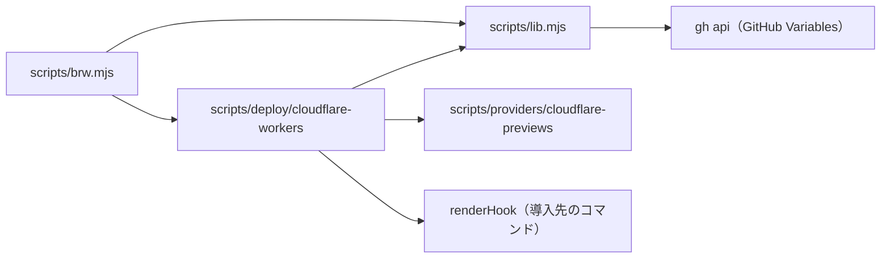
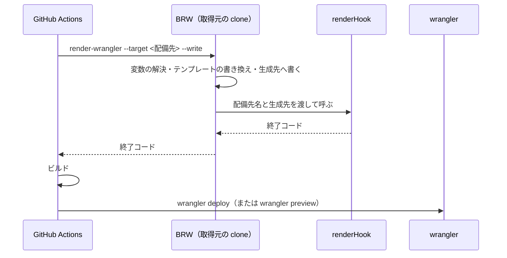

# 配備先の宣言と設定の生成 設計書

## 1. 構成

| パス                                         | 責務                                               |
| -------------------------------------------- | -------------------------------------------------- |
| `scripts/lib.mjs`                            | `deploy` の検証・正規化、変数の解決                |
| `scripts/deploy/cloudflare-workers.mjs`      | wrangler 設定の生成・配備用 workflow 雛形・検査    |
| `scripts/brw.mjs`                            | `render-wrangler` と `gen-workflow deploy` の入口  |
| `references/config.md`                       | 宣言の `deploy` の説明                             |
| `references/cloudflare-previews.md`          | 配備先を分ける構成と実機の確認結果                 |

## 2. 関係図・ワークフロー



CI での生成と配備の流れ（雛形が出力する手順）を示す。



## 3. 設計項目

### D-1: 宣言の `deploy` (FR-1, NFR-1)

```jsonc
"deploy": {
  "provider": "cloudflare-workers",
  "template": "config/wrangler.template.jsonc",
  "output": "wrangler.jsonc",
  "renderHook": "node scripts/config/after-render.mjs",
  "brwSource": { "repository": "https://github.com/nekono-dev/branch-release-workflow.git", "ref": "main" },
  "targets": {
    "production": { "branches": ["release/**"], "worker": "app", "customDomain": "${SITE_HOST}" },
    "develop": { "branches": ["develop"], "worker": "app-develop" }
  }
}
```

| キー | 必須 | 既定 | 検証 |
| --- | --- | --- | --- |
| `provider` | 必須 | — | `cloudflare-workers` だけ |
| `template` | 必須 | — | 空でない文字列。リポジトリのルートからの相対パス |
| `output` | 任意 | `wrangler.jsonc` | 空でない文字列 |
| `renderHook` | 任意 | なし | 空でない文字列 |
| `brwSource.repository` | 任意 | `https://github.com/nekono-dev/branch-release-workflow.git` | `https://github.com/<owner>/<repo>.git` の形 |
| `brwSource.ref` | 任意 | `main` | `git check-ref-format --branch` を通るブランチ名、または 40 桁の 16 進のコミット |
| `targets` | 必須 | — | 1 件以上。名前は `^[a-z][a-z0-9-]*$` |
| `targets.*.branches` | 必須 | — | 1 件以上の文字列の配列（glob） |
| `targets.*.worker` | 任意 | テンプレートの `name` | 空でない文字列。変数を使える |
| `targets.*.customDomain` | 任意 | なし（workers.dev で公開） | 空でない文字列。`https://` や `/` を含まない。変数を使える |

- `deploy` が無い宣言は、従来どおりルートの wrangler 設定を直接使う（`wrangler-config` と従来の検査）。
- Worker を分けない構成は、配備先を 1 件にして、その配備先をプレビュー先にする。

### D-2: 変数の解決 (FR-2)

| 項目 | 内容 |
| --- | --- |
| 書式 | `${NAME}`。NAME は `[A-Z_][A-Z0-9_]*` |
| 使える場所 | `targets.*.worker`、`targets.*.customDomain`、`preview.urlTemplate` |
| 解決の順 | 環境変数 → GitHub Variables（`gh api repos/{owner}/{repo}/actions/variables/NAME`。gh が無い・失敗したら次へ） → 未解決 |
| 未解決の扱い | `url` は変数を残したまま表示し、未解決の変数名を標準エラーへ出す。`render-wrangler` と `cleanup` は終了コード 1。`check` は値に依存する比較を省く |

gh は 1 回の実行で同じ名前につき 1 回だけ呼ぶ。`gh variable get` は新しい gh にしか無いため使わない。

### D-3: wrangler 設定の生成 (FR-3, FR-4, FR-5)

`brw render-wrangler --target <配備先> [--write]`。テンプレートは JSONC だけを扱う。P はプレビュー先（`preview.target`）、T は指定した配備先。

| キー | 生成結果 |
| --- | --- |
| `name` | T の `worker`（省略時はテンプレートの値） |
| `routes` / `route` | テンプレートから `custom_domain: true` の項目を除き、ほかの項目は残す。T に `customDomain` があれば `{ "pattern": <ドメイン>, "custom_domain": true }` を加え、T が P で独自ドメイン配信なら `"previews_enabled": true` を付ける |
| `workers_dev` | T に `customDomain` が無いときだけ `true` |
| `preview_urls` | T が P で workers.dev 配信のときだけ `true` |
| `previews` | T が P なら必ず置く（テンプレートに無ければ `{}`）。ほかはテンプレートのまま |

- 出力は 2 文字字下げの JSON（JSONC として正しい）。`--write` が無ければ標準出力へ出し、生成先を変えない。
- 変数が未解決、テンプレートが無い・読めない、T が宣言に無いときは、何も書かずに終了コード 1。
- `--write` のとき、生成先を書いた後に `renderHook` をシェルで実行する。作業ディレクトリはリポジトリのルート、環境変数 `BRW_TARGET`（配備先名）と `BRW_OUTPUT`（生成先の絶対パス）を渡す。終了コードが非ゼロなら、その値で終わる。
- 配信方式（独自ドメインか workers.dev か）の判定は preview の D-6 に従う。

### D-4: 配備用 workflow 雛形 (FR-6, FR-7)

`brw gen-workflow deploy [--write]`。書き込み先は `.github/workflows/deploy.yaml`。既存なら何も書かずに終了コード 1。

| 手順 | 内容 |
| --- | --- |
| トリガー | 全配備先の `branches` を合わせた push |
| 配備先の決定 | `github.ref_name` を各配備先の glob と照合する。一致が無ければ配備しない |
| 同時実行 | 配備先ごとに直列化し、実行中の配備は中断しない |
| BRW の取得 | `brwSource` を `git fetch --depth 1 <repository> <ref>` で取得し、`FETCH_HEAD` を checkout |
| 生成 | `node $BRW/scripts/brw.mjs render-wrangler --target <配備先> --write` |
| ビルド・配備 | `npm ci`、`npm run build`、`npx wrangler deploy` |
| 変数 | 宣言で参照する変数を `NAME: ${{ vars.NAME }}` で job の環境変数に渡す |
| 認証 | `CLOUDFLARE_API_TOKEN` と `CLOUDFLARE_ACCOUNT_ID` を Secrets から渡す |

テスト・マイグレーション・シークレットの登録などは雛形に含めず、導入先が加える。

### D-5: 配備先の検査 (FR-8)

`brw check` が、`deploy` のある宣言に対して行う。

| 検査 | 結果の水準 |
| --- | --- |
| テンプレートが無い・JSONC として読めない | 誤り |
| 配備先の `branches` の要素が `protectedBranches` に同じ文字列で無く、その glob にも一致しない | 警告 |
| 生成先が git に登録されている | 警告 |
| `wrangler deploy` を実行する workflow が無い | 警告 |

## 4. エラー処理

| 事象 | 処理 |
| --- | --- |
| `deploy` が不正 | 宣言の検証で誤りとして報告する |
| 変数が未解決 | 生成・後始末は理由と変数名を表示し、終了コード 1 で終わる |
| テンプレートが無い・読めない | 理由を表示し、終了コード 1 で終わる |
| renderHook が失敗 | その終了コードで終わる。生成先は書いたまま残す |
| 雛形の書き込み先が既にある | 何も書かず、終了コード 1 で終わる |
