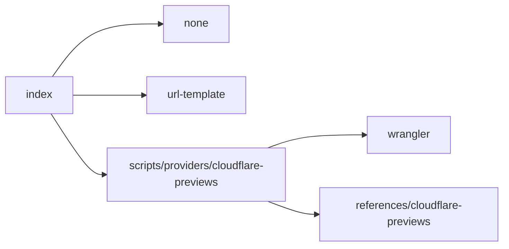
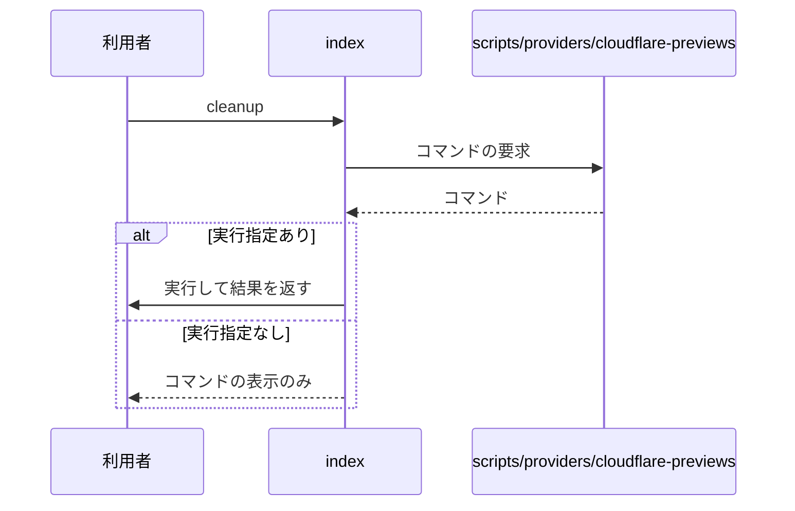

# プレビュー運用 設計書

## 1. 構成

| パス                                          | 責務                          |
| ------------------------------------------- | --------------------------- |
| `scripts/providers/index.mjs`               | provider の選択とプレビューURLの算出    |
| `scripts/providers/none.mjs`                | プレビューを行わない provider         |
| `scripts/providers/url-template.mjs`        | URL の算出だけを行う provider       |
| `scripts/providers/cloudflare-previews.mjs` | Cloudflare の検査・雛形・後始末       |
| `references/cloudflare-previews.md`         | Cloudflare Previews の前提と注意点 |

## 2. 関係図・ワークフロー

provider の選択と各 provider の依存方向を示す。



後始末のコマンドを提示し、指定があるときだけ実行する流れを示す。



## 3. 設計項目

### D-1: プレビューURLの算出 (FR-1, FR-9, FR-13)

| 入力                 | 出力                   |
| -------------------- | ---------------------- |
| ブランチ dev/foo-bar | alias は dev-foo-bar   |
| 接頭辞 dev/ の指定あり | alias は foo-bar       |
| URL 雛形の {alias}   | alias で置き換える     |
| URL 雛形の {branch}  | ブランチ名で置き換える |
| URL 雛形の ${NAME}   | deploy の D-2 で解決する。未解決なら残したまま表示し、変数名を標準エラーへ出す (FR-13) |

### D-2: provider の切り替え (FR-2, FR-5, FR-6)

| provider            | 検査                     | 雛形     | 後始末                  |
| ------------------- | ------------------------ | -------- | ----------------------- |
| none                | なし                     | なし     | なし                    |
| url-template        | なし                     | なし     | なし                    |
| cloudflare-previews | 有効化設定・版・workflow | workflow | wrangler preview delete |

後始末のコマンドは `npx wrangler preview delete --name <alias> -y`。配備先を宣言したときは `--worker-name <プレビュー先の Worker 名>` を加える（設定ファイルが無くても削除先を指定できることを実機で確認済み。存在しない名前は終了コード 1）。Worker 名の変数が未解決なら終了コード 1。

雛形の書き込みは、同名のファイルがあるとき何も書かずに終了コード 1 で終わる。後始末は実行指定がなければコマンドを表示するだけにする。

### D-3: 宣言外の CI の警告 (FR-3)

```json
{
  "走査対象": ".github/workflows の *.yml と *.yaml",
  "取り出す値": "on の push の branches",
  "警告する条件": "workBranches と protectedBranches のどちらにも含まれない指定",
  "branches がない push": "全ブランチ対象として警告",
  "tags だけの push": "ブランチ対象ではないため警告しない"
}
```

### D-4: Cloudflare の検査 (FR-4, FR-8)

| 検査                                    | 結果の水準 |
| --------------------------------------- | ---------- |
| 配信設定が wrangler 設定にない（配備先を宣言していないとき。独自ドメイン配信は previews_enabled: true、workers.dev 配信は preview_urls: true） | 誤り       |
| wrangler が 4.135.0 未満                | 誤り       |
| wrangler preview を使う workflow がない | 誤り       |
| 旧方式の preview alias が残っている     | 警告       |
| 独自ドメインの有効状況と workers.dev 関連キーが食い違う | 警告       |

### D-5: workers.dev 関連キーの設定 (FR-7, FR-8)

`brw wrangler-config [ファイル] [--write]` が行う。ファイルの既定は `wrangler.jsonc`。形式は JSONC（コメントと末尾のカンマを許す）だけを扱う。

| 判定               | 条件                                                                                              |
| ------------------ | ------------------------------------------------------------------------------------------------- |
| 独自ドメインが有効 | `routes` の要素か `route` に、`custom_domain` が `true` で `enabled` が `false` でない項目がある |
| 独自ドメインが無効 | 上記以外（`routes` がない・文字列だけ・`enabled: false` のみ）                                    |

| 判定               | `workers_dev` | `preview_urls`（独自ドメイン配信） | `preview_urls`（workers.dev 配信） |
| ------------------ | ------------- | ---------------------------------- | ---------------------------------- |
| 独自ドメインが有効 | `false`       | `false`                            | `true`                             |
| 独自ドメインが無効 | `true`        | `true`                             | `true`                             |

配備先を宣言したときは、このコマンドではなく deploy の D-3（`render-wrangler`）を使う。宣言が無い・読めないときは独自ドメイン配信の列を使う。

- 書き込みを指示するまで、設定ファイルは変えない。
- 両キーは省略せず、明示して書く。実機の確認（wrangler 4.147.0）では、独自ドメインがある設定で省略しても `wrangler deploy` の結果は `false` と同じだが、毎回警告が出て wrangler の既定値に依存する。`wrangler versions upload` と `wrangler preview` は、どちらの書き方でも workers.dev の状態を変えない。
- 変更はトップレベルのキーだけに行う。`previews` 内の入れ子のキーは変えない。
- 書き込みを指示しないときは、設定した結果の内容を標準出力へ出し、ファイルを変えない。
- 設定した結果が JSONC として読めないときは、何も書かずに終了コード 1 で終わる。
- 検査は、同じ判定で期待値と食い違うキーを警告する。取り除く期待のキーが無ければ食い違いとしない。

### D-6: 配信方式の判定 (FR-10)

URL 雛形の `://` の後から最初の `/` までをホスト名とし、文字のまま（変数を解決せずに）判定する。

| ホスト名 | 配信方式 |
| --- | --- |
| `.workers.dev` で終わる | workers.dev 配信 |
| それ以外（変数だけのホスト名を含む） | 独自ドメイン配信 |

実機（wrangler 4.165.0）で確認した URL の形:

| 配信方式 | Preview の URL（同じ名前なら不変） | デプロイごとの URL |
| --- | --- | --- |
| workers.dev | `https://<名前>-<Worker 名>.<サブドメイン>.workers.dev` | `https://<ID 先頭 8 桁>-<Worker 名>.<サブドメイン>.workers.dev` |
| 独自ドメイン | `https://<名前>.<独自ドメイン>` | `https://<ID 先頭 8 桁>.<独自ドメイン>` |

### D-7: プレビュー先の配備先 (FR-11)

| 項目 | 内容 |
| --- | --- |
| 宣言 | `preview.target`。`deploy.targets` があり provider が cloudflare-previews なら必須で、その名前のどれか |
| 雛形 | `deploy.template` があれば、BRW の取得（deploy の D-4 と同じ）と `render-wrangler --target <プレビュー先> --write` を、ビルドの前に加える。宣言で参照する変数を GitHub Variables から渡す |
| 後始末 | D-2 のとおり `--worker-name` を加える |

### D-8: URL 雛形とプレビュー先の整合 (FR-12)

配備先を宣言したときに `brw check` が行う。比較は変数を解決せずに文字のまま行う。

| 検査 | 結果の水準 |
| --- | --- |
| 独自ドメイン配信なのに、プレビュー先に `customDomain` が無い | 誤り（`wrangler preview` が成功しても URL が空になることを実機で確認済み） |
| 独自ドメイン配信で、ホスト名が `{alias}.<プレビュー先の customDomain>` でない | 警告 |
| workers.dev 配信で、ホスト名が `{alias}-<プレビュー先の Worker 名>.` で始まらない | 警告 |
| 独自ドメイン配信で、alias の最大の長さが 63 を超えうる | 警告 |
| workers.dev 配信で、alias の最大の長さ＋1＋Worker 名の長さが 63 を超えうる | 警告 |

alias の最大の長さは、`maxNameLength` から `aliasStripPrefix` の長さを引いた値とする。

## 4. エラー処理

| 事象                  | 処理                                |
| --------------------- | ----------------------------------- |
| 宣言の preview が不正 | 宣言の検証で誤りとして報告する      |
| provider に雛形がない | 理由を表示し、終了コード 1 で終わる |
| 後始末の実行が失敗    | コマンドの終了コードをそのまま返す  |
| wrangler 設定が JSONC として読めない・存在しない・toml | 理由を表示し、終了コード 1 で終わる |
